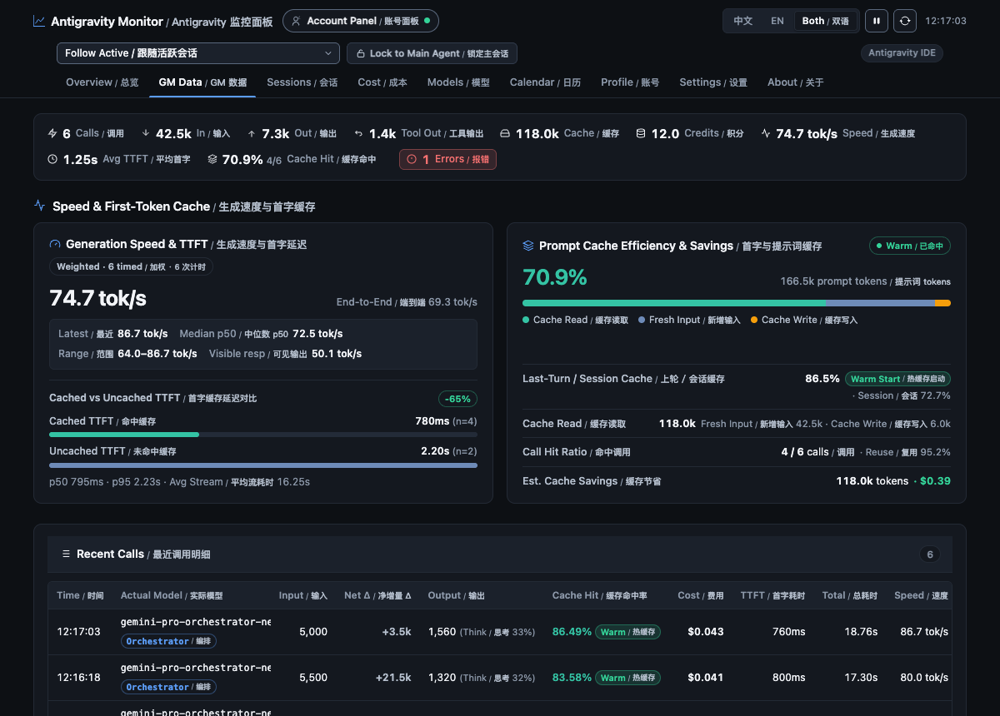
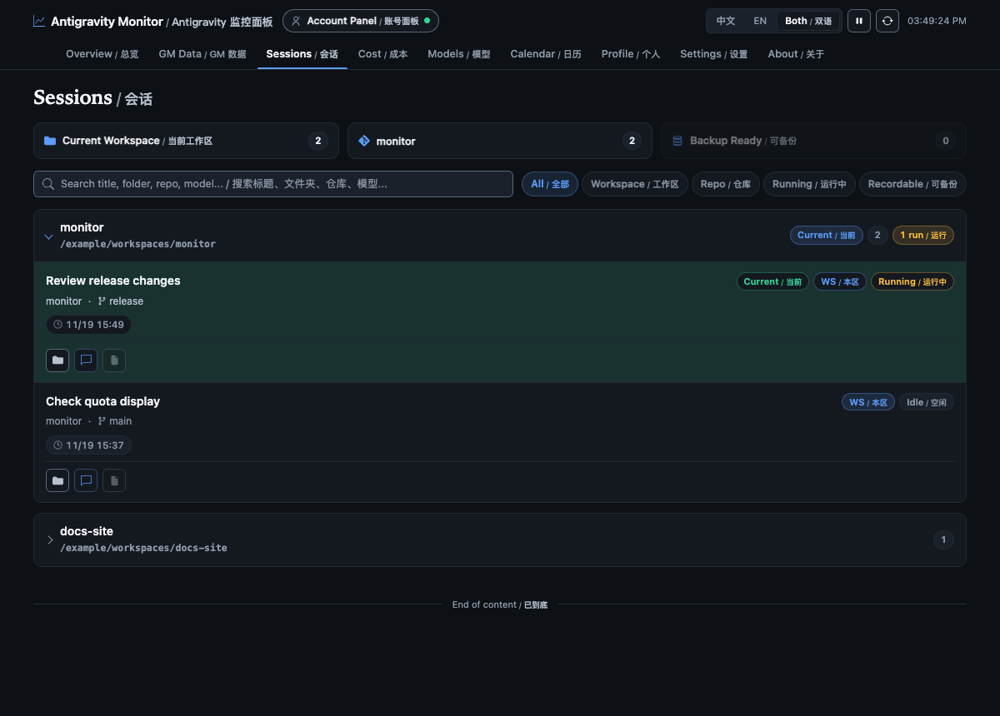
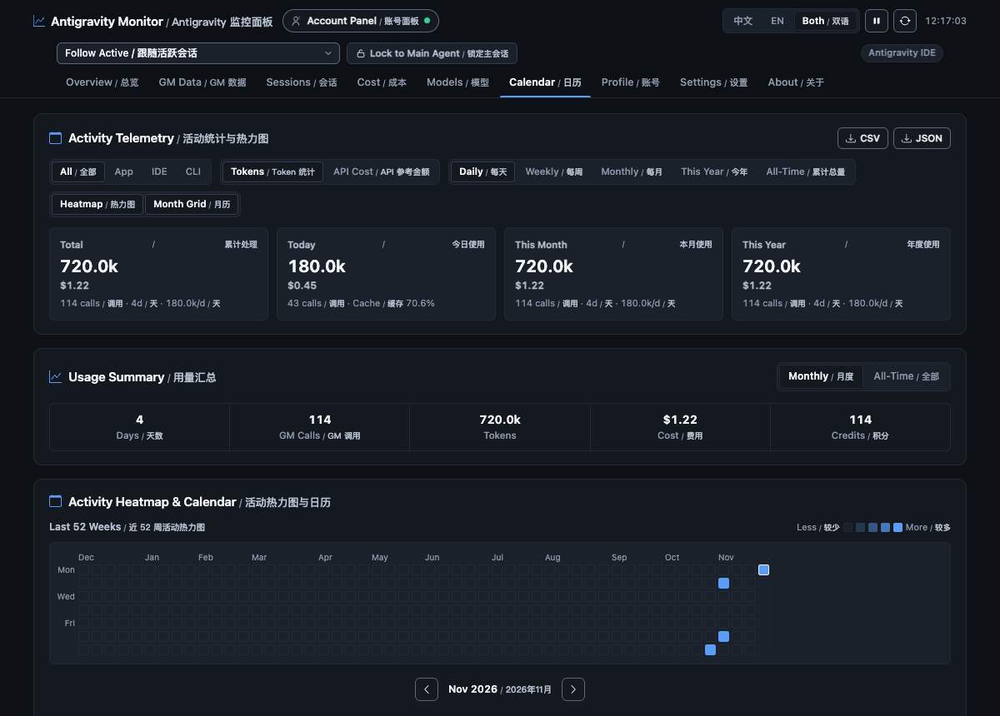
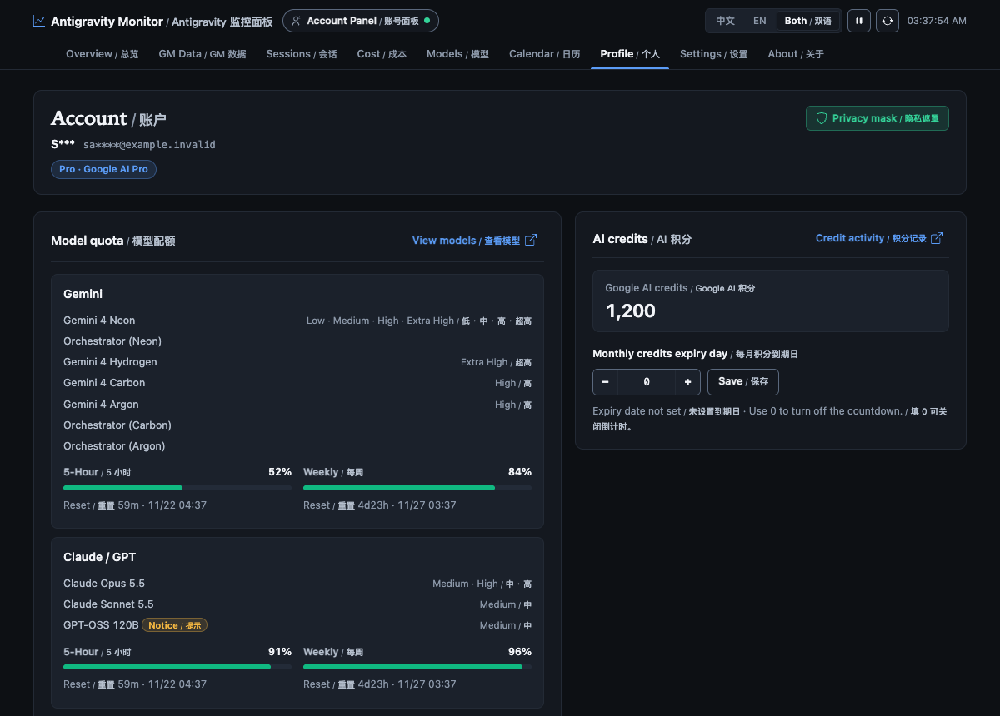
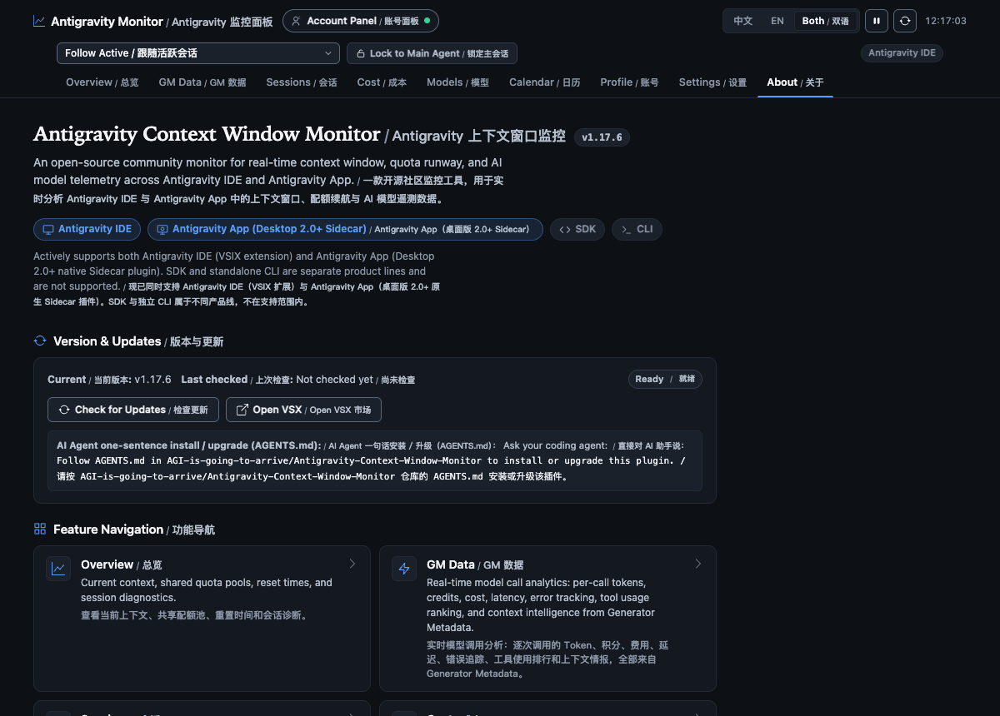

# Antigravity Context Window Monitor

Monitor conversation context, model generation speed (`tok/s`), TTFT & prompt cache efficiency, shared model quotas, reset times, and AI credits in Antigravity IDE.

**1.17.2** introduces the **Modern Editorial Telemetry ("Studio Telemetry Ledger")** redesign across all nine monitor views, adds end-to-end **Model Generation Speed (`tok/s`), TTFT (Cached vs Uncached), and First-Token / Prompt Cache Telemetry**, upgrades the bottom-right status bar and hover summary, merges thinking-effort variants per base model across all families, modernizes the **Profile** tab, and adds **Gemini 4 Neon** (Low, Medium, High, Extra) plus **Orchestrator (Neon)**.

[中文文档](readme_CN.md) · [1.17.2 release notes and validation](docs/releases/1.17.2.md) · [Technical guide](docs/technical_implementation.md) · [Project structure](docs/project_structure.md) · [Changelog](CHANGELOG.md)

## Highlights in 1.17.2

- **Model Generation Speed (`tok/s`), TTFT & First-Token / Prompt Cache Telemetry:** Powered by the pure `src/telemetry-metrics.ts` engine using verified Antigravity protobuf semantics (decode-only streaming time, additive `input + cacheRead + cacheCreation` prompt totals, inclusive + implicit thinking separation, time-weighted ratio-of-sums speed, two-gate noise filters, and unpriced-savings guards). Surfaced across **Overview** (4-cell L2 telemetry strip), **GM Data** (account-filtered KPI cells, dedicated 2-column **Speed & First-Token Cache Ledger** with **Cached vs Uncached TTFT** comparison bars and a 3-segment Prompt Cache bar, unified per-model speed & token-weighted cache stats, and per-step/per-turn timeline pills), **Calendar** (archived speed, adaptive TTFT, and token-weighted cache hit rate), and **Status Bar / Hover** (opt-in `showSpeed` / `showCacheHit` toggles and `compact`/`auto`/`full` hover telemetry).
- **Studio Telemetry Ledger UI (all 9 tabs):** Crisp studio-neutral **Obsidian Slate Dark** (`#0D1014` / `#14181F`), **Alabaster Studio Light** (`#FAFBFC` / `#FFFFFF`), and native **High-Contrast** themes with a sticky hairline masthead, 2px sliding Studio Cobalt active tab indicator, semantic health meters (Emerald / Amber / Crimson), unified `32px` tactile controls, and responsive zero-overflow layout from `320px` to `1440px`.
- **Zero-Songti CJK/Latin typography & subordinate bilingual mode:** Optical Latin serif display titles terminating into system sans/CJK fonts (never falling back to Songti SC / SimSun), tabular numerals for jitter-free 5-second updates, and structured `English / 中文` visual subordination that preserves exact accessibility text.
- **Redesigned status bar & hover summary:** Configurable `auto`, `compact`, and `full` densities with context used/remaining tokens, opt-in status bar speed & cache indicators (`statusBar.showSpeed`, `statusBar.showCacheHit`, default off and hidden on cold start), live Speed / TTFT / Prompt Cache hover telemetry, shared quota pool meters, exact reset clock time + countdown across all densities (without cross-pool reset leaks), unknown-safe AI credits, and direct links to **Overview**, **Models**, and **Settings**.
- **Universal base-model effort merging:** Collapses verified thinking-effort tiers into one base-model family across Gemini 4 Neon, Hydrogen, Carbon, Argon, Flash, Pro, Claude Opus/Sonnet/Haiku, GPT-OSS, and guarded future catalog families — while keeping Orchestrators distinct and preserving exact per-effort IDs in **Models**, **GM Data**, and **Cost**.
- **Gemini 4 Neon & Orchestrator (Neon):** Full support for `Gemini 4 Neon` Low / Medium / High / Extra (`M534`/`M533`/`M532`/`M535`) and `Orchestrator (Neon)` (`M537`, configured execution route `M669`) with 512,000 live compression limits.
- **Modernized Profile tab:** Retires legacy Prompt and Flow quota counters in favor of shared model quota pools, unknown-safe Google AI credits (`Not reported` when absent, never fabricated `0`), per-account monthly expiry day, default-on privacy masking, and collapsible plan limits & capabilities.

## Install

1. Get `antigravity-context-monitor-1.17.2.vsix` from the release assets or build it locally with `npm run package`. [GitHub Releases](https://github.com/AGI-is-going-to-arrive/Antigravity-Context-Window-Monitor/releases)
2. In Antigravity IDE, open the Command Palette with `Cmd+Shift+P` on macOS or `Ctrl+Shift+P` on Windows and Linux. Run **Extensions: Install from VSIX...** and select the file.
3. Reload the window. Confirm **1.17.2** in extension details or the monitor's **About** page.

You can also install the published registry version from [Open VSX](https://open-vsx.org/extension/AGI-is-going-to-arrive/antigravity-context-monitor).

The extension supports macOS, Windows, Linux, and WSL. Native IDE checks for 1.17.2 ran on macOS; the release notes separate native checks from mocked Windows and Linux branch tests. [Validation](docs/releases/1.17.2.md#validation)

## Use the monitor

- **Hover over the bottom-right status item** for the active session and model, context used and remaining tokens, live **Speed (`tok/s`), TTFT (including Cached vs Uncached comparison), and token-weighted Prompt Cache** telemetry, account plan, shared quota pools, exact reset time + countdown, and AI credits. Effort variants count once per base-model family. Choose **Automatic**, **Compact**, or **Full** in Settings: Compact condenses each pool and telemetry readout to single summary rows, while Full adds median (`p50`) speed/TTFT, cache write volume, family breakdowns, and active-session diagnostics. Enable opt-in **Generation speed (`tok/s`)** or **Prompt cache hit rate (`%`)** in Settings to surface live telemetry directly in the status bar (hidden automatically on cold start).
- **Click the status item** to open **Overview**. The hover also links directly to **Overview**, **Models**, and **Settings**. Use the sticky header controls to inspect multi-account snapshots (**Account Panel**), switch between Chinese, English, and bilingual display, pause live polling, or refresh manually.
- **Expand Session diagnostics** for provider-reported token counts, compression events, and image activity. The monitor distinguishes measured values from estimates, updates streaming responses in place, and recalculates context on undo or a model switch.

## Monitor views

The panel adapts cleanly from `320px` narrow split-panes to `1440px` wide editor tabs, follows IDE Light, Dark, and High-Contrast themes, and meets WCAG 2.1 AA contrast standards. Screenshots below use example data and showcase both **Obsidian Slate Dark** and **Alabaster Studio Light** themes in bilingual mode.

### Overview

See the active conversation, context used and remaining tokens, the recessed 4-cell L2 telemetry strip (generation speed `tok/s`, adaptive TTFT, token-weighted cache hit rate, and estimated cache savings / warmth state), collapsible session diagnostics, shared quota pools with semantic health meters and reset timers, and the AI credits footer.

GM Data — speed, TTFT, prompt cache ledger, model calls, and timeline

Inspect real-time Generator Metadata by model and session, including the account-filtered KPI strip (with Speed, Avg TTFT, and token-weighted Cache Hit), the dedicated 2-column **Speed & First-Token Cache Ledger** (weighted/latest/median/visible `tok/s`, **Cached vs Uncached TTFT** comparison bars with speedup delta, and a 3-segment Prompt Cache bar with warmth state & estimated savings), unified per-model stats cards, per-step and per-turn timeline telemetry pills, today's ledgers, tool call ranking, context growth chart, and error details.

Sessions — searchable conversation history

Browse conversation context and history grouped by workspace. Filter by current workspace, repository, running state, or backup availability, and reveal local workspace, Brain, or `.pb` files.

Cost — estimates and custom API rates

Review monthly USD usage estimates, 4-series cost distribution (input, output, cache, thinking), and per-model breakdowns. Set custom rates per 1M tokens for a family or individual model; unpriced usage is flagged as **Cost unavailable** with partial-total labeling.

Models — quota pools and model specifications

Inspect the default model, merged Gemini and Claude / GPT quota pools, reset schedules, available families and effort tiers, and full IDE-reported model specifications. Chat models and the image-generation catalog are presented separately.

Calendar — daily usage, archived speed/TTFT/cache, and cycles

Switch between **Monthly** and **All-Time** summaries, browse daily activity indicators on the interactive 7-column calendar, and expand any day to inspect per-model totals, archived generation speed (`tok/s`), adaptive TTFT, token-weighted prompt cache hit rate, and archived cycles.

Profile — plan, shared quotas, AI credits, and account settings

Review account identity (masked by default with a one-click privacy toggle), current plan, shared model quota pools, Google AI credits (labeled **Not reported** when absent), per-account monthly credit expiry day, and collapsible plan limits, feature flags, and team configuration. Legacy Prompt and Flow counters have been retired.

Settings — persistent storage, polling, layout, and status bar

Inspect external persistent storage, set the low-quota warning threshold, polling interval, six status bar toggles (including opt-in generation speed `tok/s` and prompt cache hit rate `%`), hover density (`auto` / `compact` / `full`), internal model ID display, interface zoom, and scrollbar / end-of-content preferences.

About — version, compatibility, and navigation

Confirm the installed extension version (`v1.17.2`) and platform scope, jump directly to any monitor view via the feature navigation directory, and access repository and compatibility notes.

## Models, context, and cost

- The signed-in account's live catalog determines availability. The November 19, 2026 catalog check found **27 selectable entries**, with 20 in Gemini and seven in Claude / GPT. The status bar hover and **Overview** count verified effort variants once per base-model family; **Models** (Model Info) and call accounting retain each effort's exact ID. A pool with divergent readings displays their range and expandable per-effort details.
- **Gemini 4 Neon** offers four efforts (`Low` / `Medium` / `High` / `Extra`). **Orchestrator (Neon)** has one picker entry and a configured route to the hidden `M669` worker. The five new entries report 1,048,576 model-context tokens, 262,144 maximum output tokens, a 512,000-token live compression limit, and a separate 50,000-token checkpoint threshold. The release notes list exact IDs, thinking levels, and live checks. [Neon model catalog](docs/releases/1.17.2.md#neon-model-catalog)
- Context readings prioritize provider-reported fresh input, cache reads, cache creation, and output from the current planner response or checkpoint. Account-specific names and older model IDs remain available in saved usage. Image-generation steps and their reported model are shown separately.
- Cost estimates use local API-equivalent rates and call timestamps. Enter a custom price in **Cost** for a model with an unverified rate, including Neon. Subscription AI credits are tracked separately (unknown readings display **Not reported** instead of `0`). Image-generation fees require separate model usage from the IDE. [Model and pricing details](docs/technical_implementation.md)

## Commands and settings

| Command | Action |
| --- | --- |
| **Show Context Window Details** | Open Overview |
| **Refresh Context Window Monitor** | Reconnect to the backend and restart polling |
| **Switch Display Language** | Choose English, Chinese, or bilingual display |
| **Show Model Activity** | Open GM Data |

IDE settings use the `antigravityContextMonitor.` prefix.

| Setting | Default | Action |
| --- | --- | --- |
| `pollingInterval` | `5` | Set the polling interval in seconds |
| `statusBar.showContext` | `true` | Show context usage in the status bar |
| `statusBar.showQuota` | `true` | Show the current model's quota percentage |
| `statusBar.showResetCountdown` | `true` | Show the current model's reset countdown |
| `statusBar.showAiCredits` | `true` | Show AI credit balance in the status bar (hidden when unreported) |
| `statusBar.showSpeed` | `false` | Show latest or weighted-average model generation speed (`tok/s`) in the status bar (hidden when untimed) |
| `statusBar.showCacheHit` | `false` | Show token-weighted prompt cache hit rate (`%`) in the status bar (hidden when no prompt tokens exist) |
| `statusBar.tooltipDensity` | `auto` | Set `auto`, `compact`, or `full` hover density |
| `quotaNotificationThreshold` | `20` | Warn below this quota percentage. Use `0` to disable |
| `showModelInternalId` | `false` | Add the internal ID to model names |
| `activity.maxRecentSteps` | `100` | Limit retained recent activity steps in persistence |
| `activity.maxArchives` | `20` | Limit retained activity archives |

## Troubleshooting and limits

- **No active conversation** means the backend is connected and there is no loaded conversation in the current view. Open a conversation to load its context. Windows on the same workspace can share session data; open different folders for independent views.
- **Backend disconnected** or **LS not found** points to local discovery or connectivity. Reload after installing, then open **Output → Antigravity Context Monitor** and inspect `PATH check:`. The extension supports both `agy --hub` and legacy language servers. Windows uses system discovery tools including PowerShell and netstat; run Antigravity under a standard user account. [Backend discovery](docs/technical_implementation.md)
- In WSL, the extension can inspect the active distribution and connect through WSL interop. For Remote-WSL or Remote SSH, Antigravity may run the extension on the local UI host. [Project structure](docs/project_structure.md)
- Long or internally summarized sessions can have incomplete telemetry. The monitor marks estimates and missing steps. Antigravity can use a lightweight execution model for a subtask while the selected model remains the context reference. [Context and token calculation](docs/technical_implementation.md) · [Community discussion of checkpoint summaries](https://www.reddit.com/r/google_antigravity/comments/1q7zcag/heres_how_to_find_which_mcp_tools_are_leading_to/)

## Credits

Maintained by **AGI-is-going-to-arrive**. Thanks to **SecretLUL** for the Windows discovery report. [Issue #64](https://github.com/AGI-is-going-to-arrive/Antigravity-Context-Window-Monitor/issues/64)

[MIT License](LICENSE) · [LINUX DO](https://linux.do/) · [Star history](https://www.star-history.com/#AGI-is-going-to-arrive/Antigravity-Context-Window-Monitor&type=date&legend=top-left)
