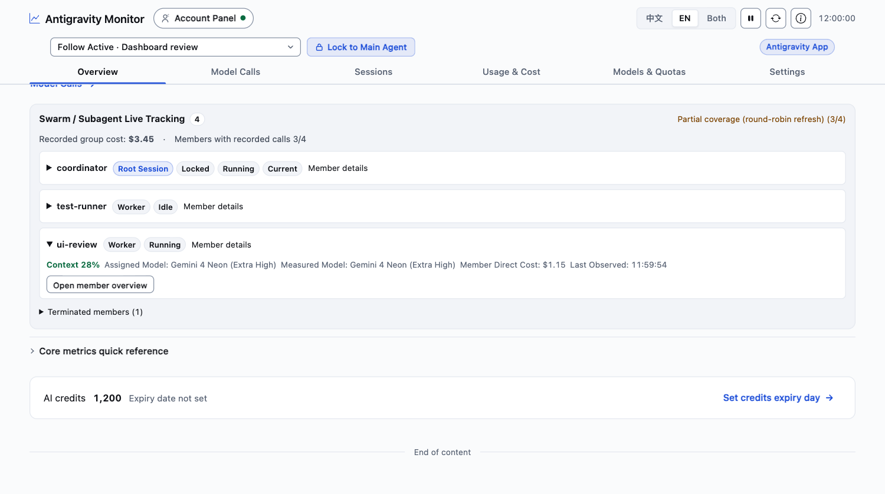
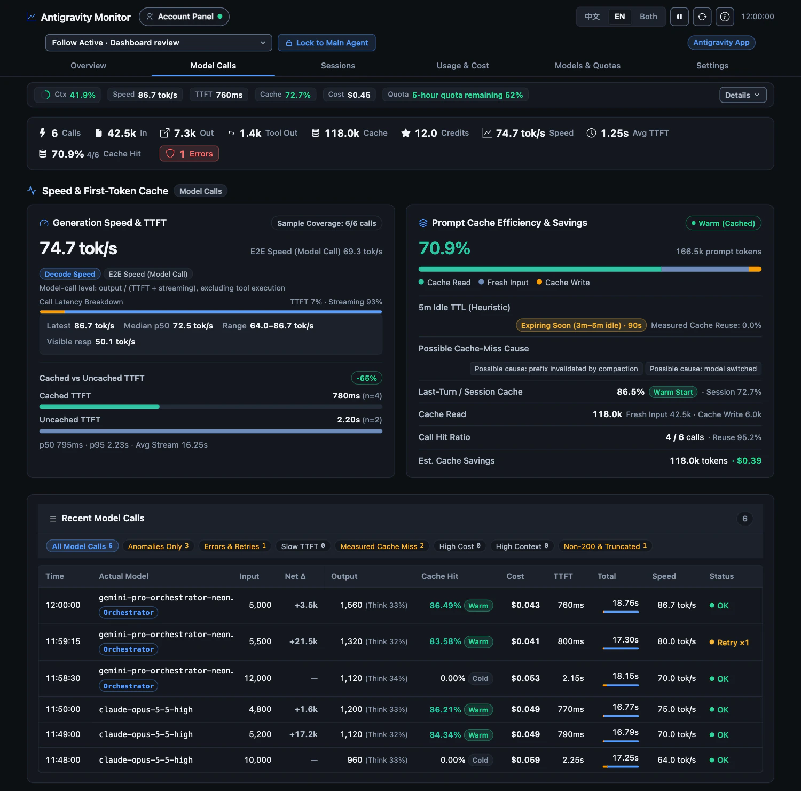
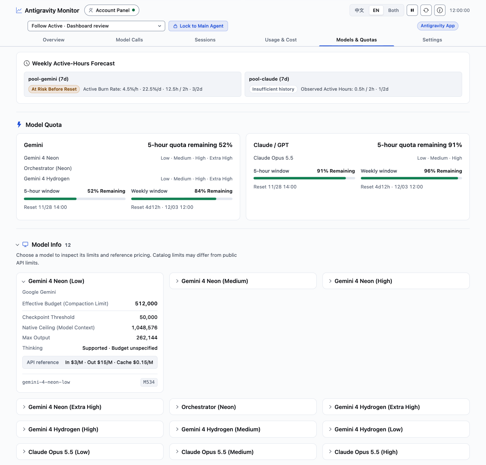
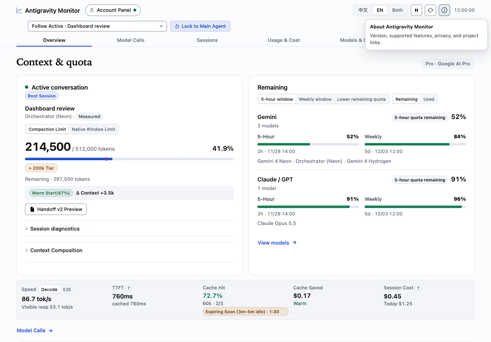
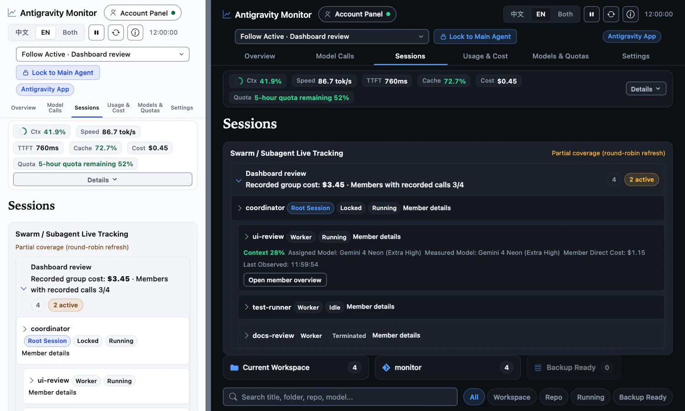

# Antigravity Context Window Monitor

Real-time, strictly read-only context window, prompt cache, generation speed, Swarm/subagent, multi-currency API-equivalent cost, and dual-window (`5h` + `7d`) model quota telemetry for **Antigravity App** (Desktop 2.0+ Native Sidecar), **Antigravity IDE** (VSIX Extension), and opt-in **`agy` CLI** (`statusLine`).

[中文文档](readme_CN.md) · [AI Agent Install (`AGENTS.md`)](AGENTS.md) · [v1.18.0 Release Notes](docs/releases/1.18.0.md) · [Architecture](docs/architecture.md) · [Telemetry & Pricing](docs/telemetry-and-pricing.md) · [Opt-In CDP Overlays](docs/cdp-overlays.md) · [Changelog](CHANGELOG.md)


## Capability Matrix

| Capability | Antigravity App (Sidecar) | Antigravity IDE (VSIX) | `agy` CLI (`statusLine`) |
| --- | :---: | :---: | :---: |
| **Integration Surface** | `AUX_PANE` (`/`) + `SIDEBAR` (`/full`) + `SKILL.md` | Status Bar + Hover + Webview Panel | Opt-in read-only stdin pipe (`agy-statusline.mjs`) |
| **6-Tab Monitor UI + Topbar `ⓘ`** | Full (zero-scroll `320px–1440px` + onboarding) | Full (4 themes, nonce IPC, safe hotkeys) | Single-line ANSI/plain summary |
| **Unified Observation & 3-Field Root Lock** | Yes (App + Native HUD + CDP parity) | Yes (Panel + Status Bar parity) | Shares context & currency contract |
| **Swarm / Subagent Live Tracking** | Yes (20+ members, Inspect / Back to Main) | Yes (read-only topology + group cost) | Active subagent count (`sub:N`) |
| **Native HUD / Opt-In CDP Overlays** | Native HUD (`on`) + Opt-In CDP (`off`) | Native HUD (`off`) + Status Bar | Terminal status line (`NO_COLOR` safe) |
| **Global Rules & Bidirectional Hot Sync** | `~/.gemini/GEMINI.md` editor + `state-v1.json` | `~/.gemini/GEMINI.md` editor + `state-v1.json` | Local CLI logs read in **Usage & Cost** |
| **Runtime Dependencies / Host Patching** | Zero npm deps / Zero `app.asar` patches | Zero npm deps / Standard VSIX API | Zero npm deps / Read-only stdin |

## 3-Step Install & Upgrade

### 1. Antigravity App (Native Sidecar Plugin — macOS / Windows / Linux)

Paste this sentence to any AI coding agent (Antigravity, Claude Code, Codex), or run the zero-clone installer directly (automatic HTTPS allowlist + fail-closed `SHA256SUMS.txt` verification):

> Read `AGENTS.md` in `https://github.com/AGI-is-going-to-arrive/Antigravity-Context-Window-Monitor` and install/upgrade Antigravity Context Monitor for my Antigravity App.

```bash
# macOS / Linux (curl + node)
curl -fsSL https://raw.githubusercontent.com/AGI-is-going-to-arrive/Antigravity-Context-Window-Monitor/main/scripts/install-app-plugin.mjs -o /tmp/acm-install.mjs && node /tmp/acm-install.mjs --from-github && rm -f /tmp/acm-install.mjs
```

```powershell
# Windows PowerShell (irm + node)
$f = Join-Path $env:TEMP 'acm-install.mjs'; irm 'https://raw.githubusercontent.com/AGI-is-going-to-arrive/Antigravity-Context-Window-Monitor/main/scripts/install-app-plugin.mjs' -OutFile $f; node $f --from-github; Remove-Item $f -Force
```

Enable **Antigravity Context Monitor** in **Customizations → Installed** (`customization://antigravity-context-monitor`), then open via the side panel **`+`** menu (`AUX_PANE`) or **Plugins → Context Monitor** (`SIDEBAR`). When upgrading over a running sidecar, toggle **Off → On** safely — never kill the running Antigravity process. See [AGENTS.md](AGENTS.md) for local builds (`--local-dir` / `--no-remote-fallback`) and `--status --check-remote`.

### 2. Antigravity IDE (VSIX Extension — macOS / Windows / Linux / WSL)

Install from [Open VSX](https://open-vsx.org/extension/AGI-is-going-to-arrive/antigravity-context-monitor) or download `antigravity-context-monitor-<version>.vsix` + `SHA256SUMS.txt` from [GitHub Releases](https://github.com/AGI-is-going-to-arrive/Antigravity-Context-Window-Monitor/releases) and run:

```bash
antigravity-ide --install-extension antigravity-context-monitor-<version>.vsix --force
```

Reload the IDE window (`Developer: Reload Window`). Open the panel anytime with `Cmd+Alt+M` (macOS) / `Ctrl+Alt+M` (Windows/Linux) or refresh with `Cmd+Alt+Shift+R` / `Ctrl+Alt+Shift+R`.

### 3. Optional Opt-In Enhancements (Zero Binary Patching)

- **Persistent CDP Overlays (App, default `OFF`):** Core Sidecar and Native HUD work without CDP. First-open Overview displays a dismissible **Overlays & CDP Quick Setup** banner, and **Settings → Overlays & CDP** provides 1-click **Create Persistent Launcher** (or run `node scripts/install-app-plugin.mjs --setup-cdp-launcher`). See [docs/cdp-overlays.md](docs/cdp-overlays.md).
- **Opt-In `agy` CLI `statusLine`:** Point `~/.gemini/antigravity-cli/settings.json` at `~/.gemini/config/plugins/antigravity-context-monitor/bin/agy-statusline.mjs`. See [docs/telemetry-and-pricing.md](docs/telemetry-and-pricing.md).

## Highlights in v1.18.0

- **Inspect a swarm member.** In Overview or Sessions, expand **Member details** to see the member’s last reported state and available measurements. Choose **Open member overview** to read that member directly. **Back to Main** returns to the root. The App and IDE also show members missing from the host’s public session list when a local swarm manifest identifies them.
- **Read the group estimate.** Usage & Cost shows how many members have call records. Each recorded call counts once toward its group. A worker with no recorded calls has no estimate. The current group’s session history and the ledger for the selected period have separate labels.
- **Find model limits and quota.** Expand **Model Info** under Models & Quotas, then a model name to see its limits and reference rates. Open multiple models to compare them. **Lower remaining quota** selects between the 5-hour and weekly windows. The reading names the selected window, for example **Weekly quota remaining 71%**.
- **Find updates and credit settings.** **Version & Updates** is first in Settings. About links directly there. **Set credits expiry day** in Overview opens Models & Quotas and focuses the monthly expiry field for the current account.

The release also adds root-session locking, Decode/E2E speed readings, weekly quota forecasts, CAD display, handoff and recovery reports, and Markdown/CSV/JSON exports.

Global Rules editing in both hosts adapts the implementation contributed by @gitstq. @GHTGXL reported large-session crashes and locked-directory updates on Windows. [PR #78](https://github.com/AGI-is-going-to-arrive/Antigravity-Context-Window-Monitor/pull/78) · [Issue #79](https://github.com/AGI-is-going-to-arrive/Antigravity-Context-Window-Monitor/issues/79)

## Interface Gallery (v1.18.0)

| Member details and recorded group cost | Version & Updates, Overlays & CDP, and Global Rules |
| :---: | :---: |
|  |  |

| Output speed, first-token latency and recent calls | Workspace usage and members with recorded calls |
| :---: | :---: |
|  |  |

| Weekly quota forecast and expandable model specifications | Optional CDP overlays for context and quota |
| :---: | :---: |
|  |  |

| IDE light theme with the About tooltip open | Member details in narrow and wide Sessions views |
| :---: | :---: |
|  |  |

## Thresholds & Quick Troubleshooting

| Signal / Symptom | Threshold or Behavior | Quick Resolution |
| --- | --- | --- |
| **Context Pressure** | Healthy `<65%` · Elevated `65%–79%` · High `>=80%` · Overflow `>100%` | Use **Handoff v2** or `/compact`; `200k` tick is a standard API reference marker, not an extra subscription fee |
| **Prompt Cache / 5m TTL** | Measured: Warm `>=70%` · Partial `10%–69%` · Cold `<10%`; TTL warn `>=180s`, expire `>=300s` | Local TTL is an idle-timer heuristic; check possible miss causes (model switch, idle gap, compaction) |
| **Model Quota Pools** | Healthy `>=50%` · Caution `20%–49%` · Critical `<20%` (alert threshold default `20%`) | Switch `5h` / `7d` / **Lower remaining quota** and `remaining` / `used`; weekly forecast requires `>=2` active hours across `>=2` days |
| **`reloadRequired` After Upgrade** | On-disk plugin version/buildId differs from running Sidecar | Open `customization://antigravity-context-monitor` and toggle **Off → On** (never force-quit Antigravity) |
| **`CDP Inactive` / `host_missing_flag`** | Opt-in CDP overlays enabled without `--remote-debugging-port` | Use **Create Persistent Launcher** in **Settings → Overlays & CDP**, quit cleanly (`Cmd+Q` + ~5s wait on macOS), relaunch, click **Recheck CDP** |
| **Huge Session / `Unattributed`** | `>50 MB` / `>1,200`-step conversations or pre-v1.18 rows without workspace tags | Bounded suffix binary-search recovers latest context safely without OOM; legacy rows stay honestly under **Unattributed** |

## Architecture & Technical Compliance Boundaries

| Boundary | Technical Fact |
| --- | --- |
| **Host Binaries & `app.asar`** | Zero modification, unpacking, patching, or code-signing of `app.asar`, `Info.plist`, `language_server`, or `agy` |
| **Telemetry & Global Rules Access** | Strictly read-only loopback RPC to local `language_server`, read-only CLI logs, and allowlisted `members.json`/`swarm.json` metadata (never reads `board.jsonl`, `transcript.jsonl`, or prompts); explicit user-triggered Global Rules editing is strictly scoped to exact non-symlink `~/.gemini/GEMINI.md` (`<=200 KiB`) |
| **Credentials & Network** | Never extracts CloudCode/Google OAuth tokens, switches accounts, sends synthetic wake-up requests, or uploads telemetry; only optional outbound traffic is ETag-throttled HTTPS `443` GitHub Releases checks |
| **Opt-In CDP Overlays** | Default `OFF`; mounts read-only Trusted-Types-safe Shadow DOM widgets only when explicitly launched with CDP; per-target Origin-bound credentials revoked on navigation/detach |
| **Runtime Dependencies & License** | Zero external runtime npm dependencies (pure Node.js built-ins + bundled `esbuild` artifacts); independent clean-room **MIT** codebase |

## Deep Guides & License

- [Architecture & D9 Swarm Design](docs/architecture.md) · [Telemetry, Pricing & `agy-statusline`](docs/telemetry-and-pricing.md) · [Opt-In CDP Overlays & Launchers](docs/cdp-overlays.md) · [Full Changelog](CHANGELOG.md) · [Design System](DESIGN.md) · [Product Spec](PRODUCT.md)
- Maintained by **AGI-is-going-to-arrive** under the [MIT License](LICENSE). Community acknowledgments are listed in [v1.18.0 Release Notes](docs/releases/1.18.0.md#acknowledgments) and the **About** view.
