# 🌌 Antigravity Context Window Monitor

A plugin built for **Antigravity IDE** that provides real-time monitoring of context window usage across all your chat sessions.

**[🇨🇳 中文文档 / Chinese Documentation](readme_CN.md)**

---

> [!WARNING]
> **Platform Support**
>
> 🍏 **macOS**: Supported. Discovers both the current `agy` hub and legacy language servers using `ps`, declared hub ports, and `lsof`.
>
> 🐧 **Linux**: Supported since v1.6.0. Uses `ps` with `lsof`/`ss` fallback for process discovery. Earlier platform testing covered Ubuntu 22.04 (x64 & ARM64).
>
> 🪟 **Windows**: Fully supported (v1.8.0+). Optimized discovery with `wmic` caching and PowerShell fallbacks.
>
> 🐧🪟 **WSL**: Fully supported (v1.12.0+). Detects WSL environment via `/proc/version` and uses Windows-side tools through WSL interop for LS discovery. v1.12.1 adds `extensionKind: ["ui", "workspace"]` so the extension runs on the local Windows host when connected via Remote-WSL or Remote SSH. v1.13.0 adds **Remote-WSL LS discovery** — when connected to a WSL workspace, the extension discovers the `language_server_linux_x64` process running inside the WSL distro via `wsl -d <distro>`, connects to it through WSL2 port forwarding, and displays the correct context data.

---

**1.16.21:** Adds Gemini 4 Hydrogen Low / Medium / High / Extra (catalog `XHigh`), using verified IDE identities and effort levels 1 / 2 / 3 / 100. All four retain separate context, usage, and pricing identities while sharing the Gemini quota pool. Includes official Hydrogen Standard API reference prices and English/Chinese/bilingual effort labels. Compilation and 859 tests passed; the installed macOS plugin verified eight real Hydrogen requests, same-conversation tier switching, native three-language UI, and the 21-entry chat catalog. Installed-code browser fixtures covered three languages, four themes, narrow layouts, interactions, and quota boundaries. See the [release validation](docs/releases/1.16.21.md#validation) for the current installation and test results.

## 📚 Technical Details

👉 **[Read the Technical Implementation Guide](docs/technical_implementation.md)**

---

## ✨ Features

* **⚡ Real-Time Token Usage**
    Shows current token consumption in the status bar (e.g. `125k/200k, 62.5%`). Uses provider-reported fresh input + cache-read + cache-creation + output tokens from current planner responses or legacy checkpoints. Cached input still occupies context; cache hits do not imply compression. Estimates fill gaps and remain labeled as estimates; GM pre-request estimates never overwrite precise provider counts. Running responses are re-fetched so streaming updates do not leave stale totals.

* **🪪 Stable Plan Tier Hover**
    The status bar hover now clears stale secondary plan/tier suffixes when Antigravity stops returning the latest `userTierName`, preventing outdated labels from lingering across later polls.

* **🌐 Language Switching**
    Users can choose between Chinese-only, English-only, or bilingual display mode. Accessible from the details panel: click status bar → Settings → Switch Language. Preference is persisted via `globalState` across sessions.

* **🔒 Multi-Window Isolation**
    Each Antigravity window prefers conversations from its own workspace, filtered by workspace URI. If Antigravity keeps reporting a stale workspace after you switch projects, the monitor can follow the currently RUNNING conversation from the shared language server instead of going blank. Windows without a workspace folder show all conversations.

* **🗜️ Context Compression Detection**
    When the model auto-compresses conversation history, the plugin detects it via two-layer detection: primary layer compares cache-inclusive input in consecutive checkpoints (drop > 5000 tokens, immune to Undo false positives), fallback layer compares cross-poll `contextUsed` (with Undo exclusion guard). Shows `~100% 🗜` in the status bar.

* **⏪ Undo/Rewind Support**
    When you undo a conversation step, the plugin detects the `stepCount` decrease and recalculates token usage to reflect the rollback.

    | Before Undo | After Undo |
    | :---: | :---: |
    | 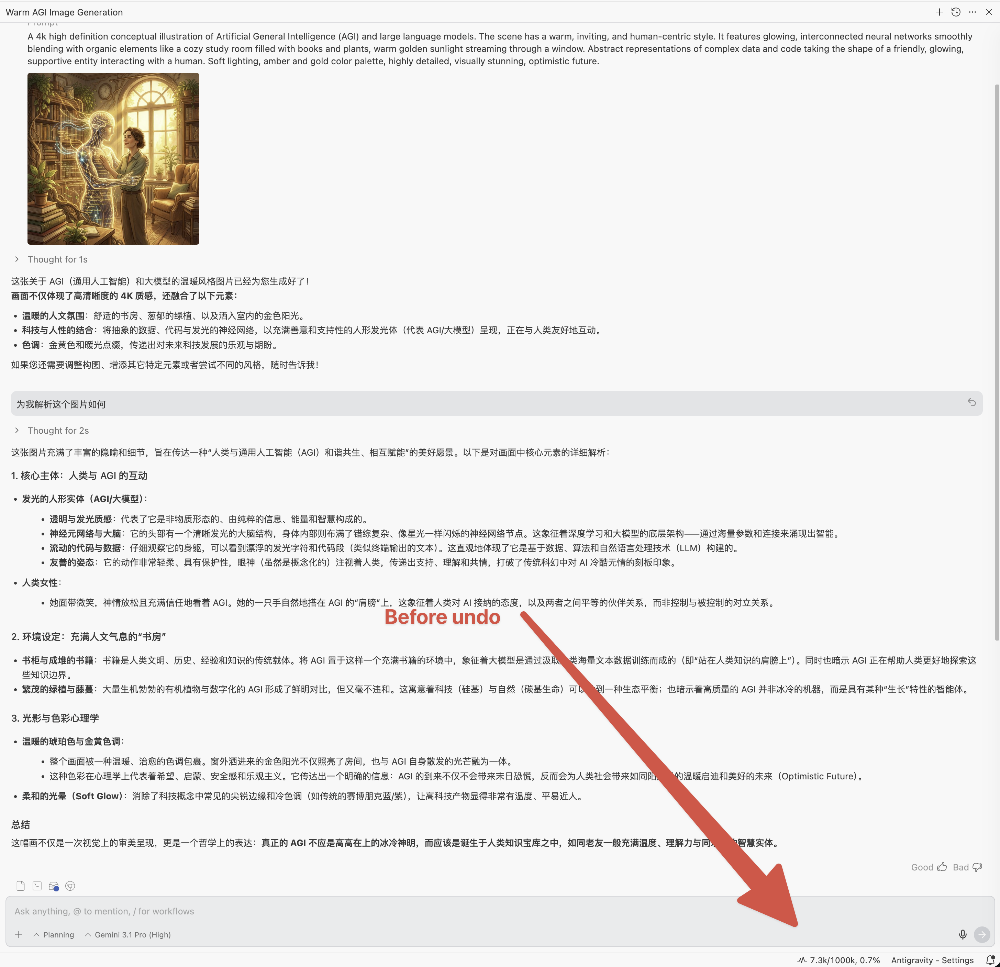 | 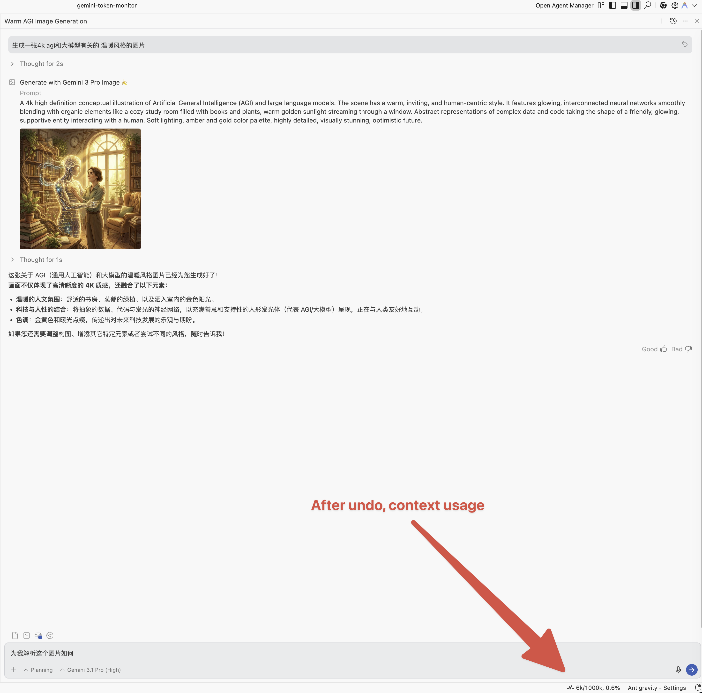 |

* **🔄 Dynamic Model Switching**
    When switching models mid-conversation, the context window limit automatically updates to match the new model. Since v1.4.0, model display names are dynamically fetched via the `GetUserStatus` API.

* **🎨 Image Generation Tracking**
    When Nano Banana Pro is invoked for image generation during Gemini Pro conversations, the associated token consumption is tracked and marked with `📷` in the tooltip. Detection is based on step type and generator model name matching.

    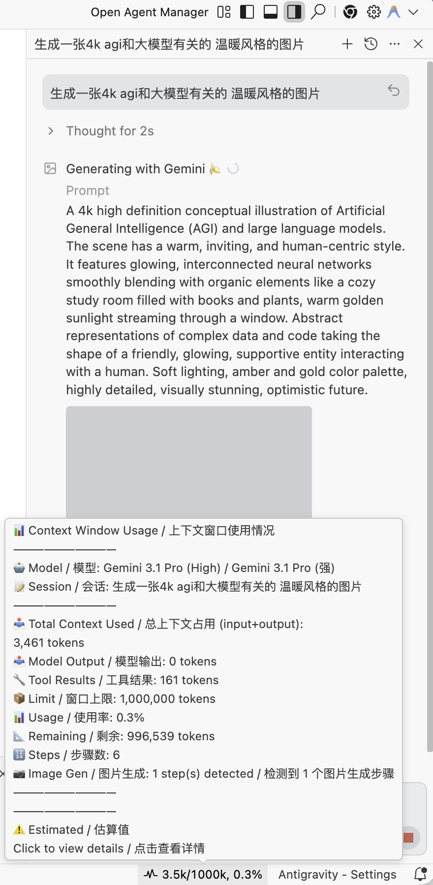

* **🛌 Exponential Backoff Polling**
    When the language server is unreachable, polling interval increases as `baseInterval × 2^n` with dual caps: discovery failures cap at 15s (5s → 10s → 15s) for fast LS detection, RPC failures cap at 60s. Resets immediately on reconnection.

* **📊 WebView Monitor Panel** *(v1.10.1)*
    Click the status bar to open a side panel with a full-featured dashboard. Displays your account plan and tier, Prompt/Flow credit balance, shared model-quota pools with color-coded progress bars, feature flags, team config (MCP Servers, Auto-Run, etc.), and Google AI credits. All data comes from the existing `GetUserStatus` API — zero additional network requests.
    * **🛡️ Privacy Mask**: A shield button in the panel header masks your name and email. The toggle state persists across panel refreshes.
    * **📂 Collapsible Sections**: Secondary info (Plan Limits, Feature Flags, Team Config, Google AI Credits) is collapsed by default. Expand/collapse state persists.

* **⚙️ Interactive Settings Dashboard** *(v1.11.0, enhanced through v1.16.9)*
    The Settings tab lets you configure polling, quota warnings, status bar content, interface zoom, and panel display preferences directly from a GUI.
    * **🟢 Status Bar Quota Indicator**: Current model's quota percentage is now shown directly in the status bar with color-coded dot icons (`🟢`, `🟡`, `🔴`).
    * **⏳ Current-Model Reset Countdown**: The status bar countdown now tracks the reset time of the model you are currently using, not the earliest reset across all models.
    * **🎛️ Status Bar Display Toggles**: Independent toggle switches to hide/show 'Context Usage', 'Quota Indicator', 'Reset Countdown' and 'AI Credits Balance' in the status bar.
    * **⚡ AI Credits in Status Bar** *(v1.16.7)*: Status bar shows real-time AI Credits balance (e.g. `⚡14,701`) wrapped in `||` separators (e.g. `|| ⚠ 121.2k/160k || 🟡40% || ⏳4h6m || ⚡14,701 ||`). Auto-hides when credits are zero. Controlled by `statusBar.showAiCredits` toggle.
    * **📆 Per-Account Billing Day** *(v1.16.7)*: Set monthly credits-expiry day per account (1-31) inline on the Profile tab. Profile, account panel and status bar tooltip all show a countdown badge ("Expires today / Xd until expiry / Expiry date not set"). Stored in durable JSON state — survives uninstall/reinstall. Uses UTC calendar-day delta so the countdown is correct across DST transitions.
    * **⏸️ Pause/Resume**: Pause auto-refresh to freeze the panel while investigating data.

* **🧠 Model Activity Monitor** *(v1.11.2, enhanced through v1.16.4)*
    New Activity tab tracks real-time AI reasoning calls, tool usage, tokens, and timing per model across all conversations. Access via the main status bar item or the `Show Model Activity` command.
    * **🔧 Tool Name Display** *(v1.11.3)*: Timeline entries show the tool name (e.g., `view_file`, `gh/search_issues`) with step index badges.
    * **📚 Tool Catalog Cleanup** *(v1.16.4)*: GM Data shows a collapsible tool catalog with smart chip tooltips and a clear button for removing stale catalog entries without touching tool ranking counts.
    * **⚡ Independent Activity Polling** *(v1.11.3)*: Activity tracking runs on a separate 3-second polling loop, decoupled from the global 5-second poll for faster updates.
    * **🎯 Three-Layer Quota Detection** *(v1.12.2)*: Instant detection via elapsed-in-cycle comparison, drift-based detection via resetTime observation, and fraction-based detection. No more hardcoded cycle lengths — adapts to any quota cycle automatically.
    * **🔀 Archive Debounce** *(v1.12.2)*: Cross-pool resets within 5 minutes are merged into a single archive entry, preventing fragmentation.
    * **💾 Persistence**: Activity stats survive VS Code restarts via `globalState`. Throttled to max once per 30s.
    * **📋 Auto-Archive**: When model quota resets, current activity is automatically archived to history with source tracking (`triggeredBy`), giving per-cycle usage reports.
    * **📊 Estimated Steps**: When conversations exceed the LS API's ~500 step window, additional steps are tracked as estimated counts with clear `📊` markers.
    * **⚠️ Low Quota Notification**: Warning popup when any model's remaining quota drops below a configurable threshold (default 20%).

## 🤖 Supported Models

The Models tab follows the signed-in account's live chat picker and its separate image-generation catalog. Registration preserves historical identities; it does not grant access or assume every account has the same models.

### Current IDE model metadata

The local `GetUserStatus` and `GetAvailableModels` responses on 2026-11-13 contained **21 chat entries: 20 known effort variants plus Orchestrator**. Orchestrator (`M667`) remains an independent entry; matching quota readings alone do not prove pool membership. Values below are **reported by the IDE**, not promises about public API limits. “Compression limit” and “checkpoint threshold” are separate settings.

| Chat model | Tiers and internal IDs | Model context | Max output | Compression limit | Checkpoint threshold |
| --- | --- | ---: | ---: | ---: | ---: |
| Gemini 4 Hydrogen | Low / Medium / High / Extra: `M527` / `M526` / `M525` / `M528` | 1,048,576 | 262,144 | 256,000 | 50,000 |
| Gemini 4 Carbon | Low / Medium / High: `M438` / `M437` / `M427` | 1,048,576 | 262,144 | 256,000 | 50,000 |
| Gemini 4 Argon | Low / Medium / High: `M419` / `M418` / `M417` | 1,048,576 | 65,536 | 256,000 | 50,000 |
| Gemini 3.8 Flash | Low / Medium / High: `M320` / `M319` / `M318` | 1,048,576 | 65,536 | 256,000 | 50,000 |
| Claude Opus 5.5 | Low / Medium / High: `M400` / `M401` / `M402` | 1,000,000 | 128,000 | 256,000 | 50,000 |
| Claude Sonnet 5.5 | Low / Medium / High: `M403` / `M404` / `M405` | 1,000,000 | 128,000 | 256,000 | 50,000 |
| GPT-OSS 120B | Medium: `MODEL_OPENAI_GPT_OSS_120B_MEDIUM` | 131,072 | 32,768 | 80,000 | 50,000 |

`Mxxx` abbreviates `MODEL_PLACEHOLDER_Mxxx`. Hydrogen catalog IDs are `gemini-4-hydrogen-{low,medium,high,xhigh}`; the IDE menu calls `xhigh` **Extra**, while backend labels use **XHigh**. Its thinking levels are 1 / 2 / 3 / **100**, with no fixed budget inferred from the reported minimum of 32. Carbon and Argon catalog IDs are `gemini-4-carbon-{low,medium,high}` and `gemini-4-argon-{low,medium,high}`. Other listed Gemini tiers use thinking levels 1 / 2 / 3 without a fixed budget; Claude uses adaptive thinking at those levels; GPT-OSS reports an 8,192-token thinking budget. A reported minimum thinking budget is a capability boundary, not a fixed per-request budget. The current Flash 3.8 tiers no longer use their earlier dynamic/4,000/1,000 budget values. Live parameters override static fallbacks; Hydrogen, Carbon, Argon, Flash 3.8, and Claude 5.5 use 255,000 before their 256,000 live compression limits arrive.

Tier identities stay distinct across English/Chinese labels, context tracking, GM data, and saved usage. Family-only response names do not erase a known effort tier. Hydrogen, Carbon, Argon, and Flash share the chat Gemini quota pool; the displayed representative follows the current model, live recommendation, and available generation order, with Hydrogen ahead of Carbon and Argon when none is current or recommended.

Malformed names such as `Gemini 4 CarbonHigh`, unmatched parentheses, and unsupported effort names do not acquire Carbon's identity or family price. Conflicting learned aliases cannot overwrite a registered tier through uppercase or Chinese label variants.

**Model Quota** groups the 20 known effort variants into two shared-pool cards: **Gemini** contains Hydrogen (four tiers), Carbon, Argon, and Flash (three each), totaling 13 tiers; **Claude / GPT** contains Opus, Sonnet, and GPT-OSS (seven tiers). Orchestrator remains a separate card. Each card lists its available model families and effort tiers. Percentages are not summed or averaged: inconsistent values use ranges and per-model details, and missing data remains explicit. Unknown and image-generation identities stay separate from the two known chat pools. **Model Info**, call statistics, and pricing keep individual effort identities.

### Image-generation model

The IDE's `imageGenerationModelIds` list identifies **Gemini 3.1 Flash Image (Nano Banana 2)** separately from the chat picker.

| Model | Internal ID | Catalog ID | IDE model context | IDE max output | Chat compression/threshold |
| --- | --- | --- | ---: | ---: | --- |
| Gemini 3.1 Flash Image | `MODEL_PLACEHOLDER_M21` | `gemini-3.1-flash-image` | 65,536 | 65,536 | Not applicable |

The Models tab shows a separate **Image generation models** section. Image capability comes from the explicit catalog list, not a model merely accepting image input. The IDE reports no chat checkpointer or independent image quota for this entry, so no chat compression limit or shared chat allowance is invented. Thinking is labeled **Not reported by IDE** when the local catalog omits that capability, rather than being declared unsupported.

The [public Gemini API model page](https://ai.google.dev/gemini-api/docs/models/gemini-3.1-flash-image) lists 131,072 input and 32,768 output tokens for the public image API. These differ from the installed IDE's 65,536 / 65,536, so cards use **Model context** and identify the IDE as the source.

The monitor follows image-generation steps in the current workflow and its linked subagents, with traversal limits and duplicate/cycle protection. It preserves the parent chat model and context; child text calls and missing image billing data are not presented as image-model token usage.

### Historical compatibility

Older Gemini Flash/Pro, Claude 4.6, and renamed/retired placeholders remain registered for accounts that expose them and for saved history. For example, Gemini 3.6 `M264` / `M265` / `M266` still resolve alongside current `M71` / `M72` / `M73`. Catalog-only `M322` and older Flash generations retain their historical profiles. Model availability follows live account data, without subscription-name or date-based hiding rules.

### API-equivalent pricing

[Gemini 4 Hydrogen Standard API prices](https://aistudio.google.com/docs/pricing#gemini-4-hydrogen), verified 2026-11-13, are **$1.50 input / $7.50 output including thinking / $0.075 implicit cache reads per million tokens** for all four efforts. Explicit caching is unsupported. Hydrogen has an independent fixed reference rate; Carbon/Argon introductory rates and their December cutover do not apply. Custom family/tier overrides keep precedence. Account-specific display-name changes retain a known model's verified built-in rate while explicit custom display-name prices still win.

The built-in Google Standard API rates for [Gemini 4 Carbon](https://aistudio.google.com/docs/pricing#gemini-4-carbon) (verified 2026-11-11) and [Gemini 4 Argon](https://ai.google.dev/gemini-api/docs/pricing#gemini-4-argon) apply to all three effort tiers, in USD per million tokens:

| Call date (UTC) | Input | Output, including thinking | Implicit cache reads |
| --- | ---: | ---: | ---: |
| Through 2026-11-30 | $2.00 | $10.00 | $0.10 |
| From 2026-12-01 | $4.00 | $20.00 | $0.20 |

Pricing uses each call's UTC timestamp, so historical calls retain their applicable rate across the December cutover. Saved archival costs and custom overrides are preserved. Carbon and Argon have separate pricing identities and family/tier overrides even though their published rates match. Both support implicit caching only; no explicit cache-write fee is added. Unknown models retain **Price unavailable** instead of being treated as free. These are Standard API reference estimates, separate from Antigravity subscription charges and credits; Batch, Flex, and Priority prices are not used.

For image generation, [Google's Standard API reference](https://ai.google.dev/gemini-api/docs/pricing#gemini-3.1-flash-image) is $0.50/1M input tokens, $3/1M text/thinking output tokens, and $60/1M image-output tokens. The published image-output equivalents are $0.045 / $0.067 / $0.101 / $0.151 for 512 px / 1K / 2K / 4K images. The real IDE image test returned no separate M21 token, credit, or GM usage. The Cost tab therefore labels observed amounts as **known subtotals that exclude image-generation fees**, with a link to the official reference; image generation is not treated as free. See the [release validation](docs/releases/1.16.19.md#validation).

The [official Claude 5.5 API prices](https://platform.claude.com/docs/en/about-claude/pricing) are listed below as a reference, in USD per million tokens (2026-10-03):

| Model | Input | Output | Cache read | Cache write, 5 min | Cache write, 1 hour |
| --- | --- | --- | --- | --- | --- |
| Claude Opus 5.5 | $4 | $20 | $0.20 | $5 | $8 |
| Claude Sonnet 5.5 | $2 | $10 | $0.20 | $2.50 | $4 |

The built-in cache-write reference rate is for **5 minutes**. Current cost estimates exclude cache creation fees because telemetry does not reliably identify creation tokens and their TTL; 1-hour cache-write fees are not added automatically either. Reported cache-read tokens are included. These are local API-equivalent estimates, not Antigravity subscription charges.

Gemini 3.8 Flash uses the same introductory price as 3.7 Flash: **$0.75 / 1M input tokens** and **$3.75 / 1M output tokens** through 2026-12-31; from 2027-01-01 the rates become $1.50 / $7.50. Sources: [Google Antigravity launch post](https://antigravity.google/blog/gemini-3-8-flash-in-google-antigravity) and [Google model announcement](https://blog.google/innovation-and-ai/models-and-research/gemini-models/3-8-flash-and-3-8-flash-cyber/).

## 🚀 Usage

1. **Install**:
   * **OpenVSX**: Install directly from [Open VSX Registry](https://open-vsx.org/extension/AGI-is-going-to-arrive/antigravity-context-monitor).
   * **Manual**: Install `antigravity-context-monitor-1.16.21.vsix` via Extensions → Install from VSIX, then reload the window and confirm version **1.16.21** in extension details.
2. **Status Bar**: The bottom-right status bar shows current context usage. With no active conversation it shows **No active conversation**, rather than a saved model's old limit. The selected effort tier is recognized from the user-input configuration before the first model response.
3. **Hover**: Hover over the status bar item for detailed info (model, input/output tokens, remaining capacity, compression status, image gen steps, per-model quota summary, and the latest checkpoint shadow model when present).

   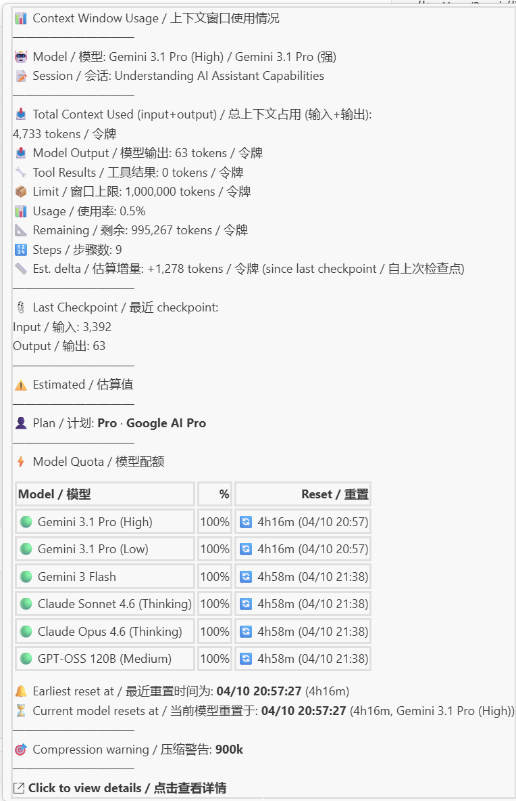

4. **Click — WebView Monitor Panel**: Click the status bar item to open a comprehensive **8-tab monitoring dashboard**:

   **Overview** (now inside the GM Data tab) — Quota overview, GM snapshot, cost snapshot, active session details with output breakdown and LLM call details.

   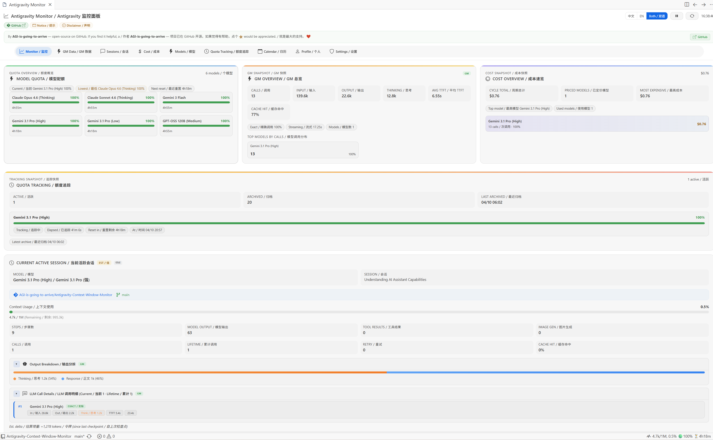

   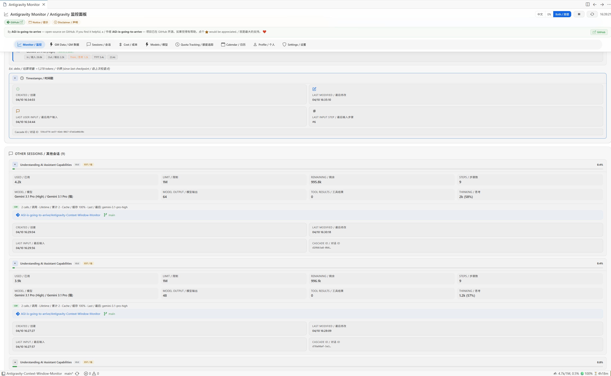

   **GM Data** — Detailed per-model token usage, call counts, cache hit rates, retry statistics, tool ranking, and a collapsible tool catalog.

   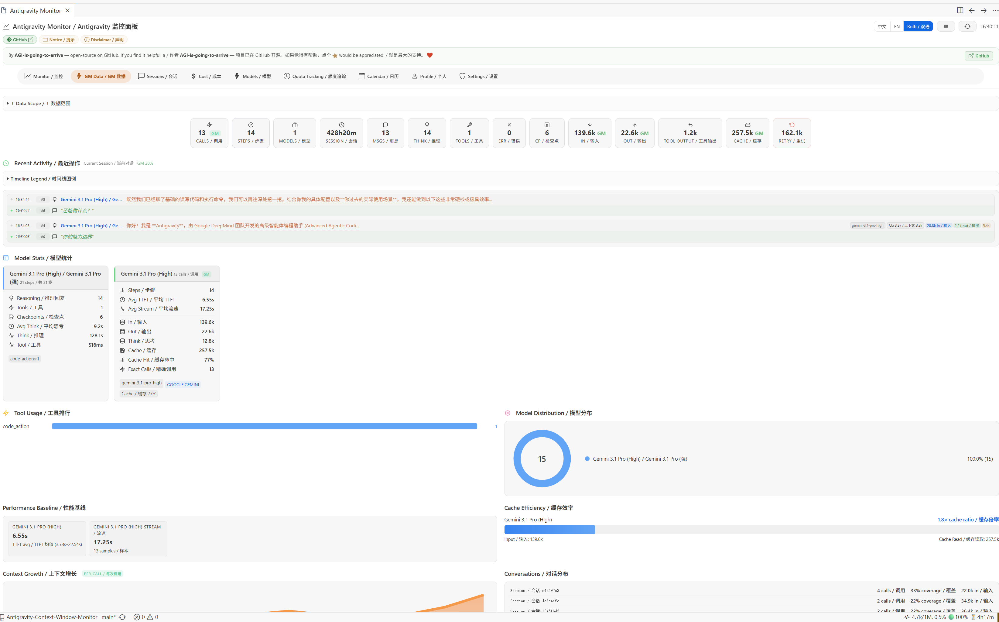

   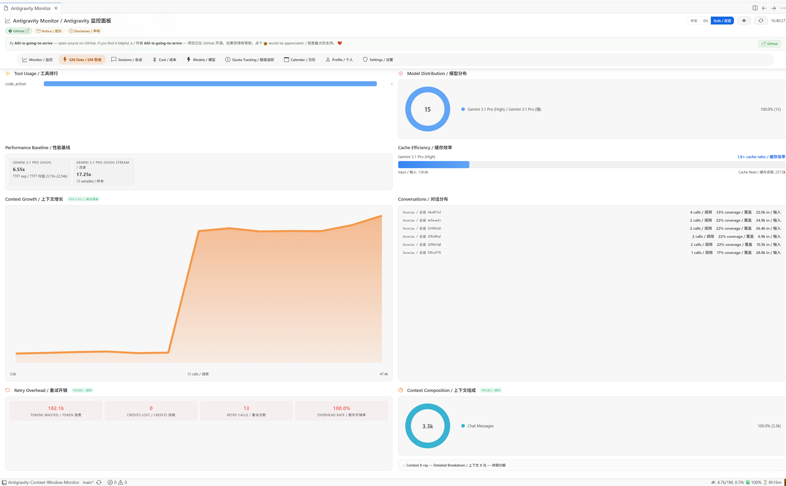

   **Sessions** — Browse all conversation sessions with context usage, step counts, and model info.

   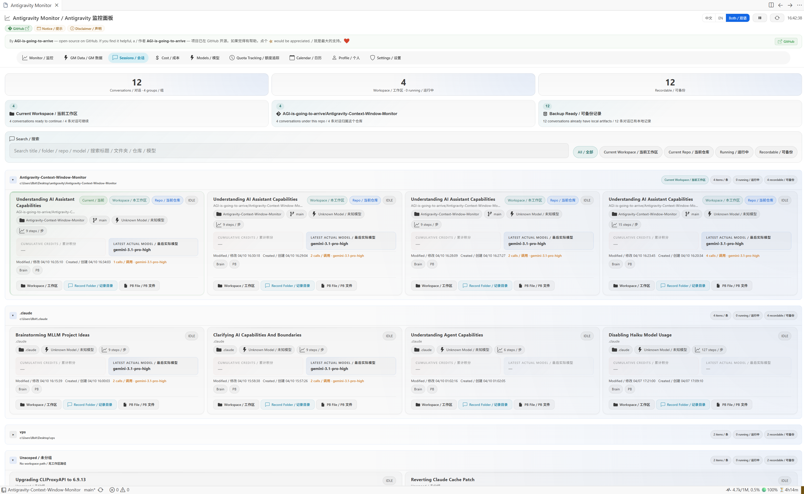

   **Cost** — Monthly cost breakdown with per-model pricing, cost overview visualization, and a custom pricing editor for called models plus built-in default pricing models.

   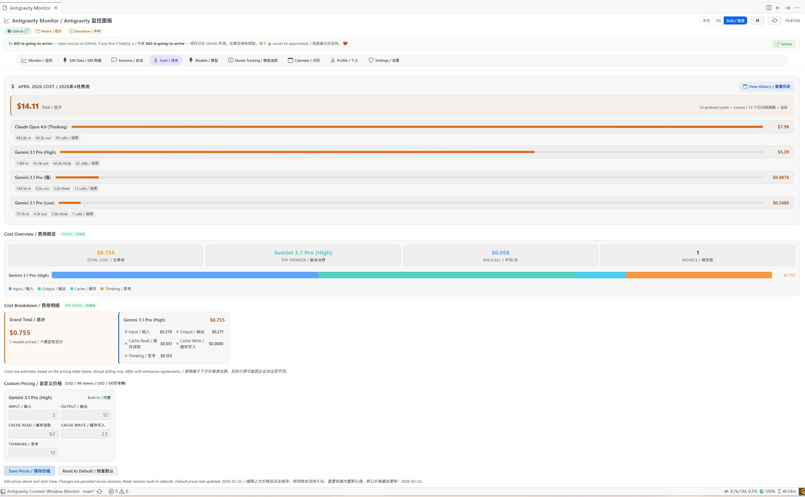

   **Models** — Gemini and Claude / GPT shared-pool cards summarize quota/reset information and list their available families/efforts; Model Info keeps individual chat effort tiers and a separate image-generation catalog. Information cards distinguish IDE-reported model context, maximum output, compression limits, checkpoint thresholds, and thinking state. Image compression settings display Not applicable. The layout supports narrow panels, light/dark/high-contrast themes, and English, Chinese, or bilingual display.

   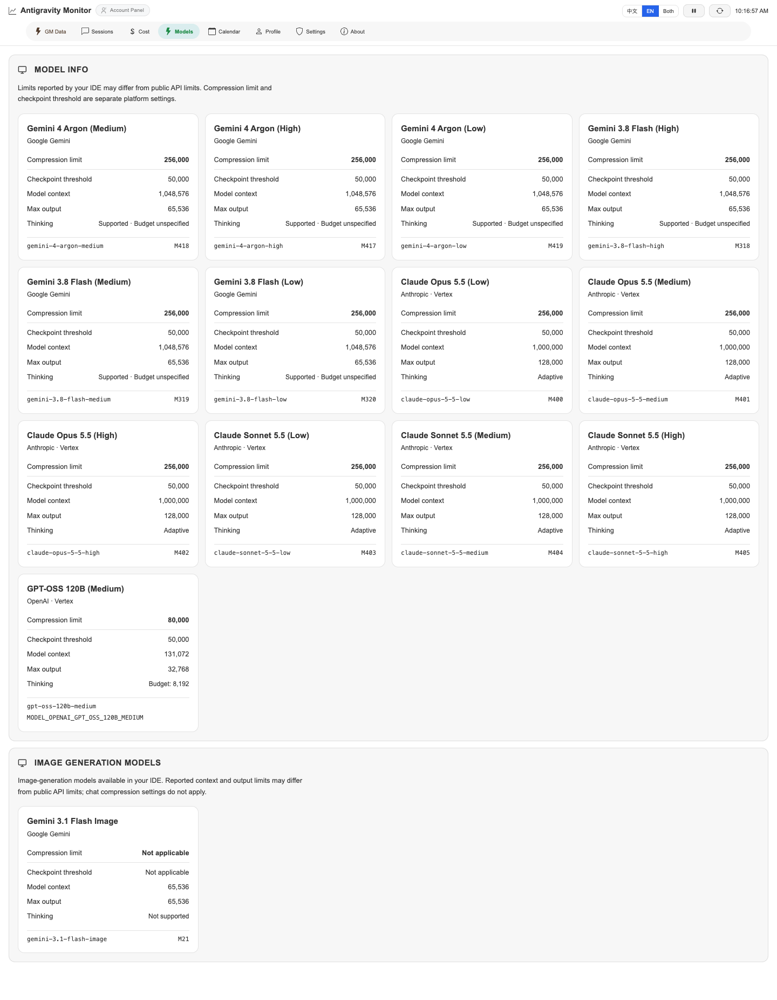

   The 80% quota shown in this screenshot is example data.

   **Calendar** — Historical usage data organized by date, with per-cycle cost and token breakdowns.

   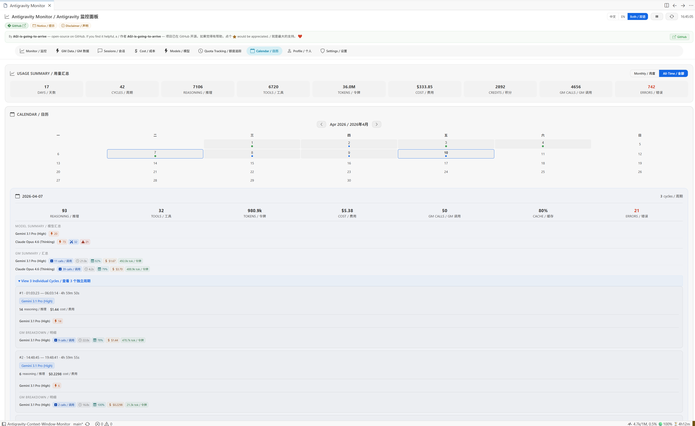

   **Profile** — Account information, plan details, and credit balances.

   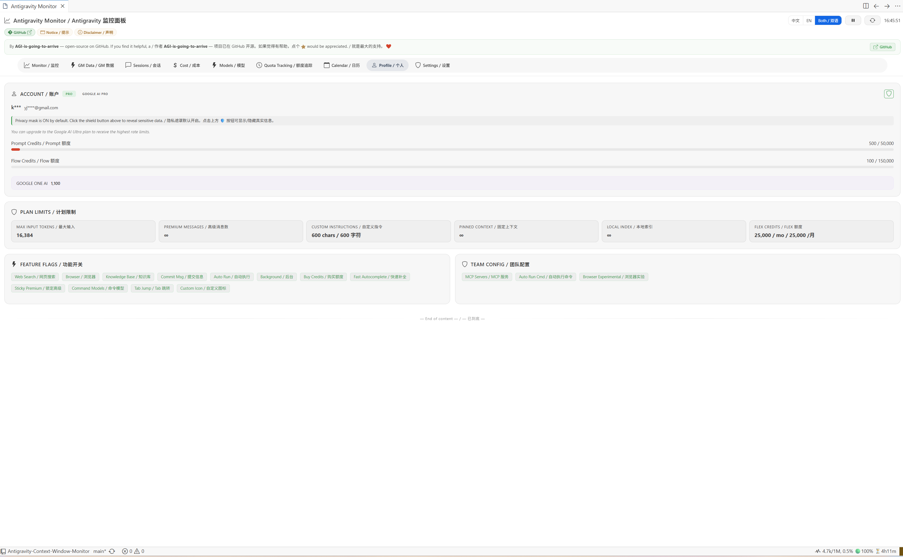

   **Settings** — Configure extension behaviors: low-quota warning threshold, status bar toggles, polling interval, and more.

   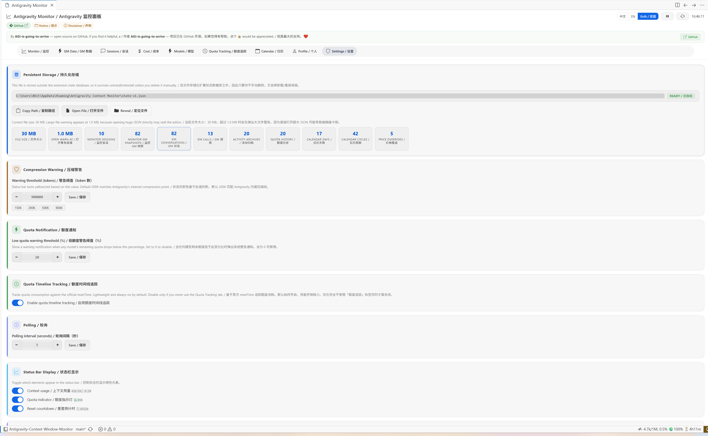

   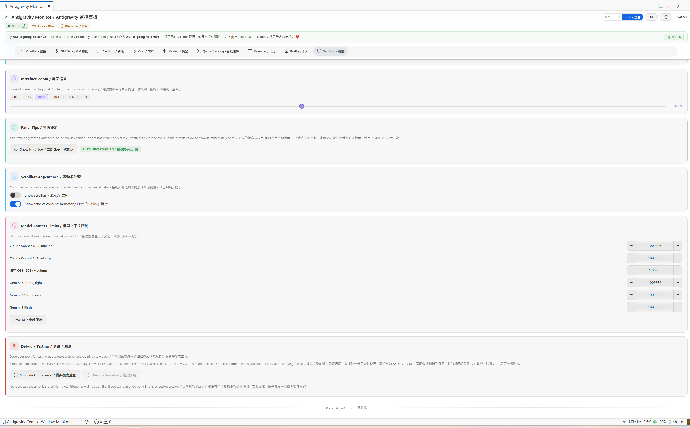

## ⚠️ Known Limitations

> [!IMPORTANT]
> **Same-Workspace Multi-Window**
> If you open multiple Antigravity windows on the **same folder**, they share the same workspace URI, and session data may overlap.
>
> **Solution**: Open different folders in different windows.

> [!NOTE]
> **Compression Notification**
> The compression notification (🗜 icon) shows for ~15 seconds (3 poll cycles) before reverting to normal display.

> [!IMPORTANT]
> **Antigravity Internal Summarization**
> The Antigravity IDE has a hardcoded 7500 token "Summarization Threshold" for checkpoint summaries. This can lead to slight discrepancies in token counts for very long conversations once the threshold is crossed. For more details on this behavior, see the [Reddit reference](https://www.reddit.com/r/google_antigravity/comments/1q7zcag/heres_how_to_find_which_mcp_tools_are_leading_to/).

> [!NOTE]
> **Dynamic Sub-Agent Switching**
> When using Claude models, Antigravity may call its lightweight sub-agent model for small tasks — the platform labels that model **Gemini Flash Lite** (`MODEL_PLACEHOLDER_M50`; the display name follows the IDE catalog). Sub-agent switching does not change the displayed context limit, because the extension tracks the limit of the model you selected. Claude 5.5 uses a 1,000,000-token IDE-reported model context and 256,000-token platform compression limit (verified 2026-10-03); retained Claude 4.6 profiles use 250,000 and 160,000 respectively, while the sub-agent uses the 128,000 profile.

> [!IMPORTANT]
> **"LS not found" in the current Antigravity IDE**
> Newer IDE builds run an `agy --hub` backend instead of a process named `language_server_*`. Since version 1.16.19, the monitor discovers both architectures, accepts `--csrf_token=value` and space-separated flags, and checks the declared hub port before using platform socket discovery. Install `antigravity-context-monitor-1.16.21.vsix` and reload the window. A connected backend with no loaded conversations displays **No active conversation**, not a discovery failure; saved history may still exist in the IDE. Opening the IDE without a folder does not by itself mean the backend is unavailable.
>
> **Windows discovery diagnostics**
> If the status bar is stuck on `LS not found`, open **Output → "Antigravity Context Monitor"** and read the `PATH check:` line — the extension now logs exactly which discovery step failed. Since v1.16.13 it invokes `wmic`/`powershell.exe`/`netstat` by absolute `%SystemRoot%` path, so a truncated Extension Host `PATH` (e.g. missing `System32\wbem` on Win11 24H2+ where WMIC is removed) no longer breaks discovery.
> Since v1.16.16 two further causes are handled (issue #64, reported by @SecretLUL): Windows localizes the `netstat` State column, so on a German install `LISTENING` reads `ABHÖREN` and every candidate line used to be rejected; and a language server listening on all interfaces rather than on loopback used to yield no port at all. Both are fixed, and if the extension host itself runs inside WSL it now looks for the language server in that distro first.
> **Do not run Antigravity as Administrator** — it does not help detection (LS discovery needs no elevation) and can crash the IDE at launch with `The window terminated unexpectedly (reason: 'launch-failed', code: '18')`, an Electron/Chromium sandbox issue unrelated to this extension.

## ⚙️ Settings

| Setting | Default | Description |
| --- | --- | --- |
| `pollingInterval` | 5 | Polling interval in seconds |
| `statusBar.showContext` | true | Show context usage (e.g. `45k/1M, 4.5%`) in status bar |
| `statusBar.showQuota` | true | Show current model quota indicator (e.g. `🟢85%`) in status bar |
| `statusBar.showResetCountdown` | true | Show quota reset countdown (e.g. `⏳4h32m`) in status bar |
| `quotaNotificationThreshold` | 20 | Show warning when model quota drops below this % (0 to disable) |
| `activity.maxRecentSteps` | 100 | Max recent activity steps to keep in timeline |
| `activity.maxArchives` | 20 | Max activity archives to keep |

## 🔤 Commands

| Command | Description |
| --- | --- |
| `Show Context Window Details` | Open a QuickPick panel listing all tracked sessions |
| `Refresh Context Window Monitor` | Re-discover the language server and restart polling |
| `Switch Display Language` | Choose between Chinese-only, English-only, or bilingual display |
| `Show Model Activity` | Open the GM Data tab in the monitor panel |

## ⭐ Star History

## 🔗 Friendly Links

- [LINUX DO](https://linux.do/)

---
**Author**: AGI-is-going-to-arrive
**Version**: 1.16.21 — [Release notes](docs/releases/1.16.21.md)
