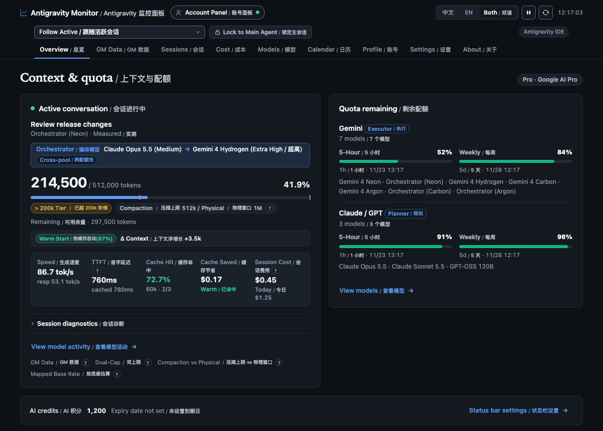
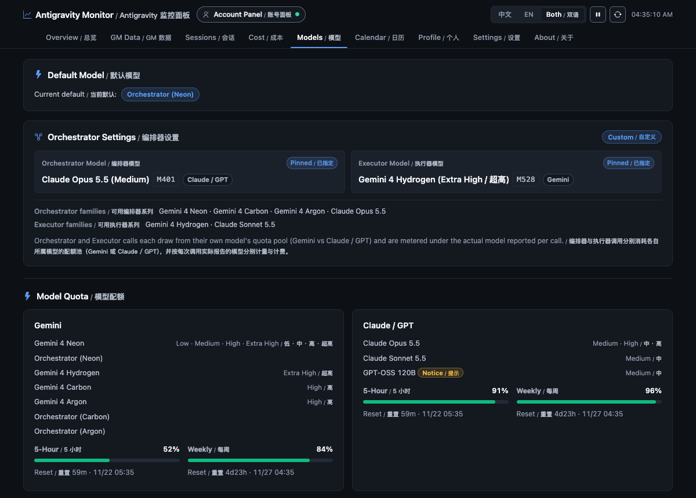
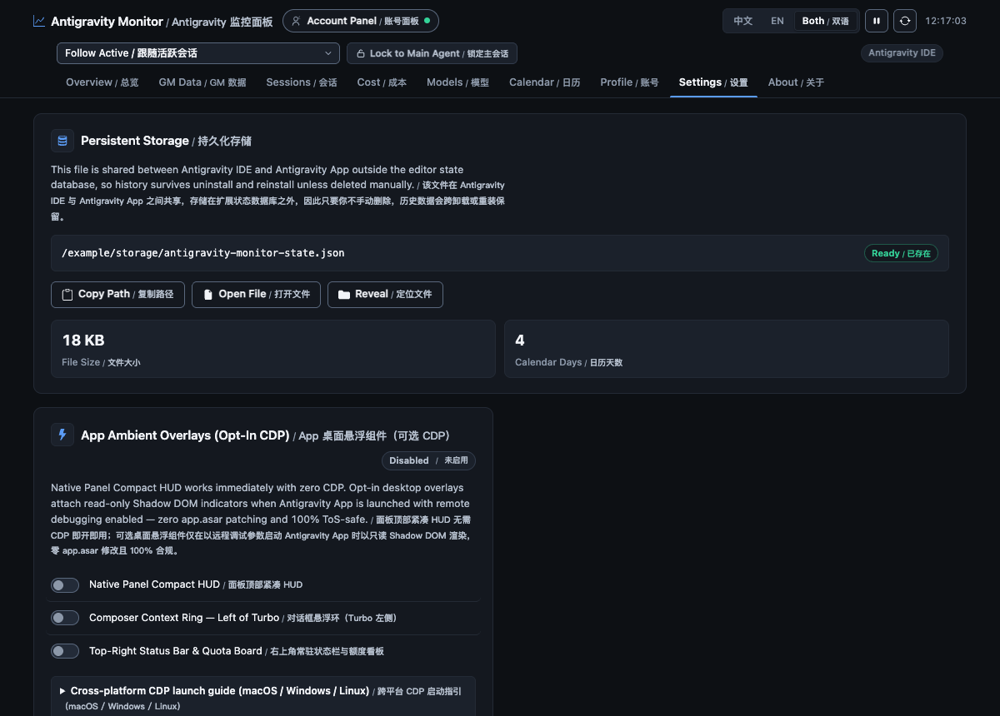

# Antigravity Context Window Monitor

Monitor conversation context composition, dual context watermarks (`Compaction` + `200k` tier), Orchestrator & Executor routing with base-mapped pricing & role attribution, dual-window model quotas (`5h` + `Weekly`) with burn-rate runway, generation speed (`tok/s`), TTFT & turn-level prompt cache diagnostics, 52-week multi-source activity heatmaps (`App` / `IDE` / `CLI`), multi-currency API-equivalent costs & optional Subscription ROI, reset times, and AI credits across **Antigravity App (Desktop 2.0+ Native Sidecar Plugin)** and **Antigravity IDE (VSIX Extension)**.

**1.17.11** delivers a major usability, accuracy, and cross-platform launcher upgrade on top of v1.17.10: (1) **Three-Platform Zero-Patch Persistent CDP Launcher Upgrade & `CDP` Icon Badges** (macOS `/Applications/Antigravity (CDP).app` priority with stale cleanup & native JXA/AppKit `CDP` badge, Windows OneDrive-aware direct `.lnk` shortcuts + `.ico` badge with zero CMD flash & native Taskbar pinning, Linux Snap/AppImage detection + non-killing conflict notice + `CDP` SVG badge, and platform Dock/Taskbar anti-pitfall guides with 100% `install-app-plugin.mjs` parity), (2) **Cross-Session Context Usage Jump Fix (`54% → 9%` Flicker)** (`hostPending` clean `0%` brand-new chat startup, Swarm worker/subagent `.gemini/antigravity/worktrees/.../swarm-*` isolation, monotonic `telemetryRefreshSeq` atomic commits, and Trusted-Types-safe Hub `focusConversation` overlay sync), (3) **Unified Body-Level Adaptive Rich Popover Engine (`#acmRichTipPopover`)** (CSS `zoom` scaling, top/bottom auto-flip, `320px` `AUX_PANE` clamping, 5s refresh re-anchoring, disabled-button explanations, retiring clipped CSS `[data-tooltip]::after`), (4) **Context Breakdown Overhaul** (per-category Top 3 `topItems`, 9-category 4-theme Dark/Light/HC-Dark/HC-Light palette, hover quick popovers + click-lock inline diagnostic drawer surviving 5s refreshes, and responsive `<=420px` `10×10` dot matrix), and (5) **Full 8-Tab, Topbar/Native HUD, Account Popover & CDP Overlay Terminology Unification & Plain-Language Popovers** (including `200k Tier` non-billing reassurance, server-side Prompt Cache `Warm / Partial / Cold` explanations, collapsed Overview glossary, interactive CDP watermark & Turn Cache tooltips, and targeted UX fixes across every tab).

[中文文档](readme_CN.md) · [AI Agent Install (`AGENTS.md`)](AGENTS.md) · [1.17.11 release notes and validation](docs/releases/1.17.11.md) · [Technical guide](docs/technical_implementation.md) · [Project structure](docs/project_structure.md) · [Changelog](CHANGELOG.md)

## For AI Agents — One-Sentence Install / Upgrade (`AGENTS.md`)

Paste this single sentence to any AI coding agent (Antigravity, Claude Code, Codex, etc.) to install or upgrade safely — **zero `app.asar` patching, zero external npm dependencies, automatic SHA-256 verification, and never force-quitting a running Antigravity session**:

> Read `AGENTS.md` in `https://github.com/AGI-is-going-to-arrive/Antigravity-Context-Window-Monitor` and install/upgrade Antigravity Context Monitor for my Antigravity App.

Or run one of the cross-platform zero-dependency one-liners directly from your terminal (add `--version <x.y.z>` to pin a release):

- **macOS / Linux (`curl` + `node`):**
  ```bash
  curl -fsSL https://raw.githubusercontent.com/AGI-is-going-to-arrive/Antigravity-Context-Window-Monitor/main/scripts/install-app-plugin.mjs -o /tmp/acm-install.mjs && node /tmp/acm-install.mjs --from-github && rm -f /tmp/acm-install.mjs
  ```
- **Windows (PowerShell `irm` + `node`):**
  ```powershell
  $f = Join-Path $env:TEMP 'acm-install.mjs'; irm 'https://raw.githubusercontent.com/AGI-is-going-to-arrive/Antigravity-Context-Window-Monitor/main/scripts/install-app-plugin.mjs' -OutFile $f; node $f --from-github; Remove-Item $f -Force
  ```
- **Cross-Platform Pure Node One-Liner (macOS / Windows / Linux):**
  ```bash
  node -e "const fs=require('fs'),os=require('os'),p=require('path'),cp=require('child_process');fetch('https://raw.githubusercontent.com/AGI-is-going-to-arrive/Antigravity-Context-Window-Monitor/main/scripts/install-app-plugin.mjs').then(r=>{if(!r.ok)throw new Error(r.status);return r.text()}).then(s=>{const f=p.join(os.tmpdir(),'acm-install.mjs');fs.writeFileSync(f,s);try{cp.execFileSync(process.execPath,[f,'--from-github'],{stdio:'inherit'})}finally{fs.rmSync(f,{force:true})}})"
  ```
- **From a local clone:** `node scripts/install-app-plugin.mjs --upgrade` (or `./scripts/install-app-plugin.sh --upgrade` / `.\scripts\install-app-plugin.ps1 --upgrade` which auto-discover bundled `agy-node` or Electron `ELECTRON_RUN_AS_NODE=1`) and `node scripts/install-app-plugin.mjs --status --check-remote` to verify version, enabled state, and live sidecar health. See [AGENTS.md](AGENTS.md) for the complete safety contract.

## Highlights in 1.17.11

- **Three-Platform Zero-Patch Persistent CDP Launcher Upgrade, `CDP` Icon Badges & Pinning Guides (`src/app/cdp-launcher.ts`, `src/app/cdp-injector.ts`, `scripts/install-app-plugin.mjs`):**
  - **macOS:** Prefers writable `/Applications/Antigravity (CDP).app` (falls back to `~/Applications`), safely removes stale duplicate copies, composites a zero-dependency `CDP` corner badge onto the native `.icns` via JXA AppKit + `sips` + `iconutil`, and documents Finder-drag Dock pinning (warning against *Options → Keep in Dock* on the running icon).
  - **Windows:** Resolves OneDrive-aware Desktop via UTF-8 PowerShell, creates direct Desktop & Start Menu `.lnk` shortcuts targeting `Antigravity.exe --remote-debugging-port=0` with `WindowStyle=1` (native Pin to Taskbar, zero CMD flash, removes legacy `.cmd`), and generates a `CDP`-badged `.ico`.
  - **Linux:** Detects standard, Snap, and AppImage Antigravity processes without false positives, displays a non-killing conflict notice (`zenity` → `kdialog` → `notify-send` → `stderr`), creates a `CDP`-badged SVG icon (`~/.local/share/icons/hicolor/scalable/apps/antigravity-cdp.svg`), configures `StartupWMClass=Antigravity`, and refreshes desktop entries with best-effort `update-desktop-database`.
- **Cross-Session Context Usage Jump Fix (`54% → 9%` Flicker), Swarm Worker Isolation & Hub `focusConversation` Hook (`src/conversation-selector.ts`, `src/tracker.ts`, `src/app/host-bridge.ts`, `src/app/sidecar-runtime.ts`, `src/app/sidecar-server.ts`, `src/app/cdp-injector.ts`, `src/app/cdp-overlay-assets.ts`):**
  - **Clean `0%` brand-new chat startup & Swarm isolation:** `hostPending` / `hostNewConversationPending` keep brand-new conversations cleanly at `0%` / `0 tokens` until their first step lands (with `processSteps([])` returning `0` instead of `10,000`), while Swarm worker worktree/branch detection (`.gemini/antigravity/worktrees/.../swarm-*`) and stricter `auto_follow` preemption guards prevent background workers or older sessions from hijacking the active main conversation.
  - **Atomic telemetry refresh & live Hub focus sync (`CDP_OVERLAY_SCRIPT_VERSION = '1.17.11'`):** Monotonic `telemetryRefreshSeq` epochs commit usage, breakdown, diagnostics, and step caches atomically with strict `cascadeId` checks; `host-bridge.ts` reacts immediately to `window.sidecar.conversationId` changes/clears; and the CDP overlay sends deduplicated Trusted-Types-safe `focusConversation` updates over `/api/overlay/action`.
- **Unified Body-Level Adaptive Rich Popover Engine (`#acmRichTipPopover` — `src/webview-document.ts`, `src/webview-script.ts`, `src/webview-editorial-styles.ts`, `src/webview-styles.ts`):**
  - Retires clipped CSS `[data-tooltip]::after` rules in favor of a single `document.body`-mounted `#acmRichTipPopover` with CSS `zoom` (`80%–150%`) scaling, top/bottom auto-flip, `320px` `AUX_PANE` clamping, hover grace timer, click/`Enter`/`Space` pin + `Esc` dismiss, disabled-button `.rich-tip-disabled-wrap` tips, and flicker-free 5s `applyIncrementalUpdate` re-anchoring by `data-popover-key`.
- **Context Breakdown Overhaul & Full 8-Tab / HUD / CDP Terminology Unification (`src/context-breakdown.ts`, `src/webview-overview-tab.ts`, `src/activity-panel.ts`, `src/pricing-panel.ts`, `src/webview-*-tab.ts`, `src/app/cdp-overlay-assets.ts`):**
  - **Interactive Context Breakdown:** Per-category Top 3 `topItems`, calibrated 9-category 4-theme palette (Dark, Light, HC-Dark, fixed HC-Light / `forced-colors`), hover quick popovers + click-lock inline `#ctxSelectedDrawer` surviving 5s refreshes, and responsive `<=420px` `10×10` dot matrix.
  - **Plain-language copy & UX fixes everywhere:** Unified EN/ZH/Bilingual terminology across all 8 tabs, Topbar/Native HUD (context danger aligned at `>=80%`), Account Popover (visible `.acct-quota-pct`), and CDP overlays (fixed unreachable watermark ticks + Turn Cache pill tooltips); added default-collapsed Overview glossary (`#overview-glossary`), clear `200k Tier` non-billing reassurance, server-side Prompt Cache (`Warm / Partial / Cold`) explanations, and removed internal `M537/M667/M681/M669` codes from user-facing descriptions.

### Built on v1.17.10 Foundations

- **Fixed Windows Inline TopBar WCO Blank Gap & Hardened WCO Boundary Guards (thanks to [`@Number444`](https://github.com/Number444) — [Issue #77](https://github.com/AGI-is-going-to-arrive/Antigravity-Context-Window-Monitor/issues/77), `CDP_OVERLAY_SCRIPT_VERSION = '1.17.10'` — `src/app/cdp-overlay-assets.ts`):**
  - **Zero phantom inline `.acm-wco-spacer` gap:** `computeWcoInsetPx(isFixedAnchor)` now returns `0` immediately when anchored inline (`!isFixedAnchor`), eliminating the ~146px blank spacer between the TopBar cluster and `toggle-aux-sidebar` on Windows Antigravity 2.35.2's two-row header layout (where Row 1 holds `_ □ ×` and Row 2 holds the conversation header without a `window-controls-reserve` node).
  - **Hardened `fixed`-mode WCO & `geometrychange` tracking:** Scans `querySelectorAll(reserveSel)` for the first visible top-right reserve, guards against empty Chromium `DOMRect(0,0,0,0)` blowups (`rect.right > 0`, `rightGap < vw * 0.5`), authoritatively returns `0` on Windows Fullscreen/RTL (`wco.visible && rightGap === 0`) instead of falling through to `138px`, and listens to `navigator.windowControlsOverlay` `geometrychange` (cleaned up on unmount).
- **Inline Row-Accurate Right-Chrome Budgeting, Empty Row-1 WCO Cutout Guard & Idempotent Anchoring (`src/app/cdp-overlay-assets.ts`):**
  - **No premature `···` collapse on Windows 2.35.2:** `getRightChromeLeftPx()` stops subtracting phantom `computeWcoInsetPx(true)` in inline mode, measures same-row following siblings first, and scans inline right-chrome controls up to `r.top < 96` (accurate for Row-2 headers at `top >= 48` with `AUX_PANE` open or closed).
  - **Empty Row-1 `pane-titlebar-toolbar` WCO cutout guard & idempotent `anchor.before`:** Tier 3 skips empty Row-1 `pane-titlebar-toolbar` containers overlapping right WCO cutouts so they fall through cleanly to Tier 4 `fixed` (zero `_ □ ×` collision), while `anchorTopBarHost()` and `anchorComposerHost()` normalize self-referential `anchor.before === host` to `host.nextSibling` so repeat ticks stay strictly idempotent.

### Built on v1.17.9 Foundations

- **Top-Right Status Bar 4-Tier Anchoring, Top Layer Popovers & Sidebar-Safe Positioning (`src/app/cdp-overlay-assets.ts`):**
  - **Zero overlap on sidebar collapse/open:** Replaced the tree-order `@container/titlebar` fallback and `.agy-hover-actions` selector with strict 4-tier anchoring (`toggle-aux-sidebar` / `toggle-maximize-pane` → `window-controls-reserve` → standalone visible non-hover `pane-titlebar-toolbar` → `fixed` top-right with WCO spacer and left-chrome safe `maxWidth`), live re-anchoring across route changes, `:host { flex-shrink: 0 }`, and live `AUX_PANE` drag-spacer free-space budgeting.
  - **Top Layer `popover="manual"` + dynamic sidebar clamping:** Promoted the TopBar 4-view popover, `···` overflow menu, and Composer Usage Card into Chromium's Top Layer (`popover="manual"` + `inset: auto; margin: 0;`) so popovers paint above `agy-sheet` (`z:0; overflow:hidden`), left sidebar (`z:10`), resize sashes (`z:30`), and `AUX_PANE` iframes; added `getOpenSidebarRightPx()` horizontal clamping, steady `r.cluster` tab anchoring, and `ResizeObserver` / layout-attribute `MutationObserver` / `transitionend` live repositioning.
- **Composer Context Ring Anchoring Left of `Turbo` & HTTPS Hub Target Fix (`src/app/cdp-overlay-assets.ts`, `src/app/cdp-injector.ts`):**
  - **Strictly anchored left of `Turbo` (never `This Computer`):** Blacklisted the legacy metadata bar `[data-testid="input-box-bottom-toolbar"]` (`This Computer` / project / branch), switched to global priority tiering with focused-pane (`data-pane-unfocused`) & 64-level ancestor visibility checks, broadened approval preset/i18n/`<400px` icon-only/cancel matching, and walked out of `span[data-testid="voice-live-pill"]` wrappers cleanly.
  - **No HTTPS Hub self-exclusion:** Updated `isExcludedSidecarOrDevToolsTitle()` so HTTPS `... - Antigravity` Hub windows stay selectable when the opened repo or conversation title mentions `"antigravity context monitor"` or `"swarm"`.

### Built on v1.17.8 Foundations

- **Top-Right Status Bar 4-View Popover, Local `HH:MM:SS` Clock & Context-Aware `Open Panel` (`src/app/cdp-overlay-assets.ts`, `src/app/sidecar-types.ts`, `src/app/sidecar-runtime.ts`, `src/app/sidecar-server.ts`, `src/app/cdp-injector.ts`, `src/webview-script.ts`):**
  - **4 Dedicated Views (`Quota` / `Context` / `Speed` / `Total`):** Clicking any Top-Right Status Bar pill—or any item in the narrow-titlebar `···` overflow menu—opens directly to its dedicated popover view with an interactive 4-segment switcher, smooth cross-pill switching (no accidental close-on-switch), and a local `HH:MM:SS` update clock.
  - **8 Live Speed & Total Telemetry Fields (`buildCdpOverlayPayload()`):** Populates `todayTokens`, `todayCostFormatted`, `cumulativeCostFormatted`, `recordedDaysCount`, `sessionCount`, `Short sample`-filtered `peakOutputSpeedTps`, `recentCallCount`, and `subscriptionRoiSummary` directly from live runtime state.
  - **Context-Aware `Open Panel` `targetTab` Routing:** Clicking **Open Panel** routes directly to the matching monitor tab (`quota → Models`, `context → Overview`, `speed → GM Data`, `total → Cost`) via the authenticated 256-bit `POST /api/overlay/action` bridge and monotonic `meta.overlayTargetTab` snapshot updates.
- **Persistent CDP Launcher UX, One-Click Reveal & Cross-Platform Hardening (`src/app/cdp-launcher.ts`, `src/app/sidecar-runtime.ts`, `src/webview-panel.ts`, `src/webview-settings-tab.ts`, `src/webview-script.ts`, `src/webview-editorial-styles.ts`, `scripts/install-app-plugin.mjs`):**
  - **macOS foreground dialog & TCC fallback alert:** Explicit AppleScript `activate` ensures confirmation dialogs surface in front of other windows, with a clear fallback alert if macOS Automation (TCC) denies Apple Events.
  - **One-click `Reveal in Finder / Explorer / Folder` (`#cdpRevealLauncherBtn`):** Wired across BOTH Antigravity App Sidecar and Antigravity IDE alongside clearer Step 1 / Step 2 guidance, hardened Linux `DEFAULT_BIN` + Freedesktop `.desktop` `Exec=` escaping, and a responsive Subscription Plan ROI `<select>` preventing narrow-pane truncation of `Google AI Ultra 20x ($199.99/mo)`.

### Built on v1.17.7 Foundations

- **Idle Polling, ETag Stability & GM Cache Optimization (thanks to [`@reidentify`](https://github.com/reidentify) — [Issue #75](https://github.com/AGI-is-going-to-arrive/Antigravity-Context-Window-Monitor/issues/75) / [PR #76](https://github.com/AGI-is-going-to-arrive/Antigravity-Context-Window-Monitor/pull/76) + follow-up hardening):**
  - **Idle-Backoff Self-Lock Fixed (`src/app/sidecar-runtime.ts`, `src/app/sidecar-server.ts`, `src/app/host-bridge.ts`):** Passive `/api/snapshot` polls no longer reset `lastClientActivityMs`; polling smoothly backs off `5s → 30s` when idle while staying at base cadence during `CascadeStatus.RUNNING`, and wakes immediately on genuine user interaction (`?active=1` or `/api/action`, with visible client idle polling capped cleanly at `≤ 15s`).
  - **~4,900+ Idle LS RPCs/h Eliminated (`src/gm/tracker.ts`, `src/app/sidecar-runtime.ts`, `src/extension.ts`):** `GMTracker.fetchAll()` now skips unchanged idle active conversations, settles empty/unrecoverable-timestamp idle step counts, applies bounded exponential error backoff (`60s → 10m`, cleared on manual Refresh on BOTH App Sidecar and IDE) on transient `GetCascadeTrajectory` errors instead of permanently settling incomplete entries, preserves all enriched fields (including `model`, `responseModel`, `executionModel`, anchors, tools, and conversation-level checkpoints) with strict non-conflicting `executionId` guards, protects `RUNNING → IDLE` trailing enrichment, and skips redundant `env` LS revalidation probes.
  - **Stable ETag & Multi-Slot Minute-Bucket Snapshot Cache:** Excludes volatile `meta.pollCount` from `computeSnapshotHash()`, upgrades `snapshotCache` to a bounded multi-slot `Map` keyed with a 1-minute bucket so dual `AUX_PANE` + `SIDEBAR` views never thrash while live reset countdowns and ready indicators stay fresh, expands `computeDataSignature()` across all rendered state, and closes async `handleAction()` cache-poisoning races.
- **App CDP Discovery, Floating Overlays, Live Diagnostics & 1-Click Zero-Patch Persistent CDP Launcher (`src/app/cdp-launcher.ts`, `src/app/cdp-injector.ts`, `src/app/cdp-overlay-assets.ts`, `src/webview-settings-tab.ts`, `src/webview-script.ts`, `src/webview-panel.ts`, `scripts/install-app-plugin.mjs`):**
  - **1-Click Zero-Patch Persistent CDP Launcher:** Create a native, auto-update-proof launcher from **Settings → Overlays & CDP** (`Create Persistent Launcher`) or CLI (`node scripts/install-app-plugin.mjs --setup-cdp-launcher`, remove via `--remove-cdp-launcher`) — zero modification to `/Applications/Antigravity.app` or `app.asar`:
    - **macOS (`~/Applications/Antigravity (CDP).app`):** Native icon & `LSUIElement=true`; checks running Antigravity App process (ignoring IDE/Tools), prompts with a foreground-activated confirmation dialog if running without CDP (with Automation TCC fallback), sends graceful quit, and polls up to 15s until the ~5s `before-quit` `language_server` teardown fully completes before launching with `--remote-debugging-port=0`.
    - **Windows (`Desktop` + `Start Menu` `.lnk` + `%LOCALAPPDATA%\AntigravityContextMonitor\launch-antigravity-cdp.cmd`)** and **Linux (`~/.local/share/applications/antigravity-cdp.desktop` + `~/.local/bin/antigravity-cdp`)**.
  - **Smart Host Argv Discovery & Concurrency Hardening:** Fixed `selectAntigravityHubTarget()` self-attachment (auto-excluding `ANTIGRAVITY_SIDECAR_WEB_PORT`, `ANTIGRAVITY_SIDECAR_PORT`, standalone listening port, `plugin://`, and sidecar/swarm titles while preferring `https:` loopback Hub and `Jetski Web`), added read-only grandparent host process inspection (detecting `host_missing_flag`, custom `--user-data-dir`, and fixed `--remote-debugging-port=<N>` direct fallback), added IPv6 `[::1]` fallback, serialized connections with a mutex & socket-detach catch guard, and added loopback TCP reachability probing in `install-app-plugin.mjs --status` (`cdp.stale` + `cdpLauncher`).
  - **Overlay Anchoring, WCO, Theme, `Open Panel` & Live Dual-Surface Diagnostics (`CDP_OVERLAY_SCRIPT_VERSION = '1.17.11'`):** Anchored Top-Right Status Bar via 4-tier right-overlay priority (before `[data-testid="toggle-maximize-pane"]`) with zero inline `.acm-wco-spacer` width (`computeWcoInsetPx(false) === 0`), boundary-guarded `fixed` WCO insets + `geometrychange` tracking, row-accurate inline right-chrome budgeting (`getRightChromeLeftPx()`), empty Row-1 `pane-titlebar-toolbar` WCO cutout fallthrough, and idempotent `anchor.before` handling; promoted popovers to Chromium Top Layer (`popover="manual"`) with live sidebar clamping; anchored Composer Floating Ring strictly left of `permissions-selector-trigger` (`Turbo`, never the top `This Computer` metadata bar); added interactive watermark ticks, Turn Cache pill tooltips, and Hub `focusConversation` focus sync; made `Open Panel` expand collapsed side panels and route directly to the active view's monitor tab; improved host theme detection; added live rich-tip `#cdpStatusPill`, bilingual `#cdpDiagnosticHint` (including `host_missing_flag`), `#cdpLauncherStatus`, `#cdpSetupLauncherBtn`, `#cdpRevealLauncherBtn`, `#cdpRecheckBtn`, copyable commands (`.cdp-copy-btn`), and live IDE toggle-ON CDP probing.
- **Updated Subscription Plan ROI Presets (`src/cli-usage-scanner.ts`, `package.json`, `src/webview-settings-tab.ts`, `src/webview-script.ts`):**
  - Updated built-in Calendar Plan ROI presets to **Google AI Pro (`$19.99/mo`)**, **Google AI Ultra 5x (`$99.99/mo`)**, and **Google AI Ultra 20x (`$199.99/mo`)** (plus `custom`), with centralized `normalizeSubscriptionPlanId()` non-destructive migration for legacy `'google-ai-ultra'` selections (preserving any historical user-saved monthly fee such as `$249.99`) and dynamic `#subscriptionFeeInput` placeholder updates.

### Built on v1.17.6 Foundations

- **For AI Agents — One-Sentence Install / Upgrade (`AGENTS.md`):** Ships a bilingual [AGENTS.md](AGENTS.md) contract and zero-dependency cross-platform installers (`install-app-plugin.{mjs,sh,ps1}`) supporting `--from-github`, `--upgrade`, `--install` (local-first with automatic GitHub Releases fallback), `--status [--check-remote] [--json]`, `--uninstall`, and `--print-cdp-guide`. All downloads enforce a strict HTTPS GitHub allowlist (including port `443` on every redirect hop), fail-closed `SHA256SUMS.txt` verification, zip-slip / symlink / CRC-32 checks, atomic backup+swap with automatic rollback, and non-clobbering `~/.gemini/config/config.json` registration (`agy plugin enable` when available).
- **In-App Auto / Manual Update Checker & One-Click Self-Upgrade (`src/app/plugin-updater.ts`):** Checks GitHub Releases via conditional ETag (`If-None-Match` / `304`, throttled every 6 hours when `autoCheckUpdates` is on, or on demand from **Settings** / **About**). In **Antigravity App**, clicking **Upgrade Now** downloads, fail-closed verifies `SHA256SUMS.txt`, safely extracts, and atomically swaps the installed plugin with automatic rollback — then prompts you to toggle the plugin Off → On without ever killing the running host. In **Antigravity IDE**, surfaces the update status alongside a one-click **Open VSX** link.
- **Native Sidecar Ambient HUD + Strictly Opt-In CDP Overlays (`src/app/cdp-injector.ts`, `src/app/cdp-overlay-assets.ts`):**
  - **Zero-CDP Native Ambient HUD (on by default in App):** Compact collapsible HUD bar at the top of the Sidecar panel showing live context pressure, dual watermarks, tightest quota pool, speed / `Short sample` guard, and session cost with zero extra flags.
  - **Strictly Opt-In CDP Ambient Overlays (both default `OFF`):** Independently toggle **Composer Context Ring** (positioned immediately left of `Turbo` / `Auto` / `Ask` / `Plan` with hover & pin frosted-glass Usage Card — single-column metric rows for TPS, TTFT, Cache Hit, USD + local currency, and bottom quick pill) and **Top-Right Status Bar + Model Quota Board** (tightest quota ring, context ring, speed badge, cumulative tokens, Windows WCO spacer, narrow-window `···` overflow). 100% Antigravity ToS-compliant: **zero `app.asar` or binary patching**, pure-Node RFC 6455 WebSocket client, strict Trusted-Types-safe **Shadow DOM** (zero `innerHTML`/`outerHTML`/`insertAdjacentHTML`/`eval`), loopback-only authenticated `/api/overlay/action` bridge (constant-time 256-bit `X-Monitor-Token` + strict loopback/Hub `Origin`), immediate per-slot unmount when toggled off, and quiet degradation to the Native HUD when CDP is not enabled.
- **52-Week Activity Heatmap Calendar & Multi-Source Telemetry (`src/cli-usage-scanner.ts`, `src/webview-calendar-tab.ts`, `src/daily-store.ts`):**
  - **Live Today Merge & Additive Token Accounting:** Non-destructively merges live `DailyLedger` activity into Calendar so today's usage appears immediately with zero rollover double-counting; reports true additive tokens (`input + cacheRead + cacheCreation + output`).
  - **400-Day Configurable Retention & Multi-Source Filter (`All / App / IDE / CLI`):** Default `DailyStore` retention is **400 days** (`30–3650` configurable) with a zero-dependency, strictly read-only `~/.gemini/antigravity-cli` scanner (`CliUsageScanner`, mtime+size LRU cached, SQLite `immutable=1` + JSONL fallback creating zero `-wal`/`-shm` sidecars).
  - **Multi-Period Views, Multi-Currency, Plan ROI & Safe Exports:** Switch between **52-Week Heatmap** and **Month Grid**, **Daily / Weekly / Monthly / This Year / All-Time** periods, and **Tokens / API Cost** metrics; convert estimates across **9 currencies** (`USD`, `CNY`, `EUR`, `JPY`, `KRW`, `GBP`, `AUD`, `HKD`, `TWD` + custom FX rate) with optional **Subscription Plan ROI** comparison (**Google AI Pro `$19.99/mo`**, **Google AI Ultra 5x `$99.99/mo`**, **Google AI Ultra 20x `$199.99/mo`**, or custom fee with clear non-billing disclaimer); export RFC 4180 formula-safe **CSV** or **JSON**; and protect history resets behind a **2-step Clear History confirmation bar**.
- **Orchestrator Base-Mapped Pricing & Full-Stack Role Attribution (`src/orchestrator-attribution.ts`, `src/pricing-store.ts`, `src/telemetry-metrics.ts`):** Combines live RPC `Orchestrator Settings` with read-only `~/.gemini/config/config.json` fallback, supports **Mapped Base Pricing (Default)** vs **Strict Mode**, renders **Orchestrator Split** cards, `Orchestrator / Executor / Subagent` role badges, `Switch Cold` detection, `Short sample` speed guards, dual context watermarks (**Compaction** + **200k**), and App ↔ IDE bidirectional `DurableState` hot sync with hardened `O_CREAT | O_EXCL` lockfile safety.

## Install

### Option A — Antigravity App (Desktop 2.0+ Native Sidecar Plugin)

Works on **macOS, Windows, and Linux** with zero external dependencies (runs on Antigravity App's bundled Node runtime).

1. **One-command install / upgrade from GitHub Releases (recommended):**
   - Run the zero-clone one-liner in [For AI Agents — One-Sentence Install / Upgrade (`AGENTS.md`)](#for-ai-agents--one-sentence-install--upgrade-agentsmd) above — it verifies `SHA256SUMS.txt`, extracts safely, and registers the plugin cleanly without clobbering `config.json`.
   - Or download `antigravity-context-monitor-app-1.17.11.zip` (macOS / Windows / Linux), `antigravity-context-monitor-app-1.17.11.tar.gz` (macOS / Linux), and `SHA256SUMS.txt` from [GitHub Releases](https://github.com/AGI-is-going-to-arrive/Antigravity-Context-Window-Monitor/releases), extract (`antigravity-context-monitor/`), and run:
     ```bash
     agy plugin install ./antigravity-context-monitor
     ```
     *(Or extract directly into `~/.gemini/config/plugins/` on macOS/Linux or `%USERPROFILE%\.gemini\config\plugins\` on Windows.)*
2. **From a local source checkout:**
   - Upgrade from latest GitHub Release (no build required): `node scripts/install-app-plugin.mjs --upgrade` (`./scripts/install-app-plugin.sh --upgrade` on macOS/Linux, `.\scripts\install-app-plugin.ps1 --upgrade` on Windows).
   - Build & install from local working tree:
     ```bash
     npm ci && npm run compile && node scripts/package-app-plugin.mjs && node scripts/install-app-plugin.mjs --install
     ```
   - Inspect installed state, remote version, and sidecar status: `node scripts/install-app-plugin.mjs --status --check-remote` (add `--json` for machine parsing, `--uninstall` to remove, or `--print-cdp-guide` for opt-in CDP launch instructions).
3. **Enable & open inside Antigravity App:**
   - Open **Customizations → Installed** (`customization://antigravity-context-monitor`) and confirm **Antigravity Context Monitor** and its **Context Monitor** sidecar are enabled. *(When upgrading over a running sidecar, toggle **Off → On** safely — never force-quit Antigravity during an active chat.)*
   - Open from the side panel **`+`** menu (`AUX_PANE`), **Plugins → Context Monitor** in the left sidebar (`SIDEBAR`), or `sidecar://antigravity-context-monitor/context_monitor/`.
   - Future App plugin updates can be checked and applied in one click directly inside **Settings** or **About**.

### Option B — Antigravity IDE (VSIX Extension)

1. Download `antigravity-context-monitor-1.17.11.vsix` (and verify against `SHA256SUMS.txt`) from [GitHub Releases](https://github.com/AGI-is-going-to-arrive/Antigravity-Context-Window-Monitor/releases), or build locally with `npm run compile && npm run package`.
2. In Antigravity IDE, open the Command Palette (`Cmd+Shift+P` on macOS, `Ctrl+Shift+P` on Windows/Linux), run **Extensions: Install from VSIX...**, and select the file — or install via CLI:
   ```bash
   antigravity-ide --install-extension antigravity-context-monitor-1.17.11.vsix --force
   ```
3. Reload the IDE window and confirm **1.17.11** in extension details or the monitor's **About** page.

You can also install and auto-update the IDE extension from [Open VSX](https://open-vsx.org/extension/AGI-is-going-to-arrive/antigravity-context-monitor).

Both plugins support **macOS, Windows, and Linux** (plus **WSL** for IDE). Native live App + IDE verification for 1.17.11 runs on macOS; the release notes transparently separate native checks from mocked Windows and Linux unit-test coverage. [Validation](docs/releases/1.17.11.md#validation)

## Use the monitor

- **In Antigravity App:** Open **Context Monitor** in the compact **`AUX_PANE`** alongside chat or in the full-width **`SIDEBAR`** dashboard. Keep the collapsible **Native Ambient HUD** pinned at the top for zero-CDP glanceable telemetry, or optionally enable the opt-in **CDP Composer Context Ring** (`Turbo`-left) and **Top-Right Status Bar** in **Settings → Overlays & CDP** (see `--print-cdp-guide` for zero-patch launch flags). Use the Masthead Context Bar to switch or pin conversations, enable **Lock to Main Agent** during subagent swarms, toggle **Bar View ↔ 20×5 Dot Matrix**, inspect **Top 5 Largest Items**, and click **Copy `/context` Report** or **Copy Handoff Prompt**.
- **In Antigravity IDE — Hover over the bottom-right status item** for the active session and model (or cross-pool **Orchestrator `Planner → Executor`** route), context gauge with used/remaining tokens, **Latest Call** telemetry, **Session & Today Cost** with cache savings & effective blended input rate, **Orchestrator Split**, **Dual-Window (`5h` + `Weekly`) Quota** with Planner/Executor markers, smart event-driven alerts, and 1-click links to **Overview**, **Activity**, **Cost**, **Models**, **Settings**, and **Refresh**.
- **Click the status item (IDE) or open the panel (App)** to inspect all 9 tabs. Settings, pricing mode, currency, retention, and language sync bidirectionally between App and IDE via shared `state-v1.json`.

## Monitor views

The panel adapts cleanly from `320px` narrow side panes (`AUX_PANE` / split panes) to `1440px` wide dashboards (`SIDEBAR` / editor tabs), follows Light, Dark, and High-Contrast (`hc` & `hc-light`) themes, and passes **WCAG 2.1 AA** with zero violations across all 432 App Sidecar layout cells, 332 App Sidecar axe-core audits, and 742 installed IDE UI checks. Screenshots below showcase the **Obsidian Slate Dark** theme in bilingual mode.

### Overview

See the optional collapsible **Native Ambient HUD**, **Masthead Context Bar** (Conversation Switcher, Lock to Main Agent, surface & stale-cache badges), App-side **Low-Quota Warning Banner**, active conversation hero with **Dual Context Watermarks** (`Compaction` + `200k` tier), active **Orchestrator `Planner → Executor`** cross-pool route pill & auto-hiding **Orchestrator Split** card, **Context Composition** card (Bar ↔ 20×5 Dot Matrix, Dual-Cap effective budget vs native ceiling, measurement badge, compaction savings, collapsible Top 5 Largest Items, and Copy `/context` Report / Copy Handoff Prompt), recessed L2 telemetry strip (with `Short sample` speed guard and jargon tooltips), collapsible session diagnostics, dual-window (`5h` + `Weekly`) shared quota pools with **Quota Burn-Rate Runway** badges (or `custom-*` Model Isolation banner), and the AI credits footer.



<details>
<summary>GM Data — speed, TTFT, turn-level cache diagnostics, Orchestrator Split, Recent Calls Ledger, and timeline</summary>

Inspect real-time Generator Metadata by model and session, including the account-filtered KPI strip, the 2-column **Speed & First-Token Cache Ledger** (weighted/latest/median/visible `tok/s`, **Cached vs Uncached TTFT** comparison bars, 3-segment Prompt Cache bar, and **Last-Turn vs Session Cache Hit** with **Cold / Partial / Warm Start** pills), the auto-hiding **Orchestrator Split** breakdown, the collapsible **Recent Calls Ledger** (with `Orchestrator / Executor / Subagent` role badges, `Switch Cold` cross-model handoff pills, `Short sample` speed guards, `+Δ` net context growth / compaction drops, Cost / Mapped / Unpriced, TTFT, Total Latency, and Status), unified per-model stats cards, timeline telemetry pills, today's ledgers, tool call ranking, context growth chart, and error details.


</details>

<details>
<summary>Sessions — searchable conversation history</summary>

Browse conversation context and history grouped by workspace. Filter by current workspace, repository, running state, or backup availability, and reveal local workspace, Brain, or `.pb` files (with hardened Windows `explorer.exe /select,` quoting and macOS/Linux reveal).


</details>

<details>
<summary>Cost — Orchestrator Mapped vs Strict pricing, multi-currency estimates, rate-change alerts, and custom API rates</summary>

Switch between **Mapped Base Pricing (Default)** and **Strict Mode** for Orchestrator models while keeping custom per-1M overrides first in precedence; review monthly and daily usage estimates in USD or your selected display currency, inspect total & per-model cache savings, thinking cost share, 4-series cost distribution (input, output, cache, thinking), and **Upcoming Scheduled Rate Changes** banners (Carbon/Argon `2026-12-01`, Flash `2027-01-01`).


</details>

<details>
<summary>Models — Orchestrator Settings with effective rates, dual-window quota pools, runway badges, and model specifications</summary>

Inspect live **Orchestrator Settings** (`Orchestrator Model` + `Executor Model`, RPC + `~/.gemini/config/config.json` fallback, default vs custom pairing, effective per-1M API reference rates, and cross-pool role indicator), the default model, merged Gemini and Claude / GPT **Dual-Window (`5h` + `Weekly`)** quota pools with **Quota Burn-Rate Runway** indicators, reset schedules, available families & effort tiers (`Low` / `Medium` / `High` / `Extra High`), API reference pricing rows on spec cards, `Notice` sunset tags (e.g. GPT-OSS 120B), and full backend-reported model specifications. Chat models and the image-generation catalog are presented separately.



</details>

<details>
<summary>Calendar — 52-week activity heatmap, live Today merge, multi-source (App/IDE/CLI), multi-currency, Plan ROI & exports</summary>

Explore up to **400 days** (configurable `30–3650`) of usage across **All / App / IDE / CLI** sources with live Today merging and additive token accounting. Toggle between the **52-Week Heatmap** and **Month Grid**, switch **Daily / Weekly / Monthly / This Year / All-Time** periods and **Tokens / API Cost** metrics, inspect streaks, dual-currency totals, optional **Subscription Plan ROI**, expandable Day Detail Drawers (token breakdown, model proportions, source badges, archived speed/TTFT/cache, and cycles), one-click **CSV / JSON export**, and a safe **2-step Clear History** guard.


</details>

<details>
<summary>Profile — plan, dual-window shared quotas, AI credits, and account settings</summary>

Review account identity (masked by default with a one-click privacy toggle), current plan, dual-window (`5h` + `Weekly`) shared model quota pools, amber `Notice` tags for sunsetting models, Google AI credits (labeled **Not reported** when absent), per-account monthly credit expiry day, and collapsible plan limits, feature flags, and team configuration.


</details>

<details>
<summary>Settings — Overlays & CDP, Updates, Cost/Currency/History, persistent storage, and surface adaptation</summary>

Configure **Overlays & CDP** (Native Ambient HUD toggle + independent opt-in toggles for Composer Context Ring and Top-Right Status Bar with live `#cdpStatusPill` connection status, bilingual diagnostic hints incl. `host_missing_flag`, **1-click Persistent CDP Launcher** creation/removal, **Recheck CDP** button, and copyable race-free cross-platform launch commands), **Updates** (6h auto-check toggle, Check Now, and App one-click Upgrade Now), **Cost, Currency & History** (Orchestrator pricing mode, 9 display currencies + custom FX rate, updated Subscription Plan ROI presets `Pro $19.99` / `Ultra 5x $99.99` / `Ultra 20x $199.99`, and Calendar retention days), shared persistent storage (`state-v1.json` with atomic lockfile hot-sync between App and IDE), low-quota warning threshold, polling interval, IDE status bar toggles (collapsed neatly inside `<details>` when running in Antigravity App), hover density, internal model ID display, interface zoom, and scrollbar / end-of-content preferences.



</details>

<details>
<summary>About — Version & Updates card, AGENTS.md one-sentence tip, dual-host compatibility, and navigation</summary>

Inspect the live **Version & Updates** card (`v1.17.11`, last-checked timestamp, **Check for Updates**, **Upgrade Now** on App or **Open VSX** on IDE), copy the **AGENTS.md** one-sentence AI agent install/upgrade prompt, view dual-host support badges (**Antigravity IDE** + **Antigravity App (Desktop 2.0+ Sidecar)**), jump directly to any monitor view via the feature navigation directory, and read community acknowledgments and compatibility notes.


</details>

## Models, context, and cost

- The signed-in account's live catalog determines model availability. The status bar hover and **Overview** count verified thinking-effort variants once per base-model family; **Models**, **GM Data**, and **Cost** retain each effort's exact ID.
- **Orchestrator & Gemini 4 family:** All **Gemini 4** families (**Neon**, **Hydrogen**, **Carbon**, **Argon**) and **Orchestrator** models (`M537`, `M667`, `M681`, `M669`) use the unified **512,000-token** live checkpointer limit (`1,048,576` model context, `262,144` max output). Both **Gemini 4 Neon** and **Gemini 4 Hydrogen** expose `Low` / `Medium` / `High` / `Extra High` thinking tiers. Under **Custom Orchestrator Mode**, any eligible Orchestrator model (including **Claude Opus 5.5** and **Gemini 4 Neon**) can pair with any eligible Executor model (such as **Gemini 4 Hydrogen** or **Claude Sonnet 5.5**), with each leg billed to its own actual model and tracked across quota pools.
- **Orchestrator Base-Mapped Pricing (v1.17.6):** By default (`Mapped Base Pricing`), legacy Orchestrator & worker IDs resolve to their verified Gemini 4 base model's official API rate (respecting UTC cutover dates for Carbon/Argon) while keeping custom overrides highest in precedence. Switch to **Strict Mode** in **Cost** or **Settings** at any time to leave unpriced unless customized.
- **Verified built-in API-equivalent pricing (USD per 1M tokens, verified 2026-11-22):**

| Model Family | Input | Output / Thinking | Cache Read | Cache Write | Notes / Schedule |
| --- | ---: | ---: | ---: | ---: | --- |
| **Gemini 4 Neon** (`Low`–`Extra High`) | `$3.00` | `$15.00` | `$0.15` | `$0` | Flat across 1M context; implicit cache reads |
| **Gemini 4 Hydrogen** (`Low`–`Extra High`, `M530`/`M531`) | `$1.50` | `$7.50` | `$0.075` | `$0` | Flat across 1M context; `M578` Sonar unpriced |
| **Gemini 4 Carbon / Argon** | `$2.00` → `$4.00` | `$10.00` → `$20.00` | `$0.10` → `$0.20` | `$0` | Intro rate ends `2026-12-01` UTC (`2×` standard) |
| **Claude Opus 5.5** (`Low`–`High`) | `$4.00` | `$20.00` | `$0.20` | `$5.00` | 5-minute TTL cache write |
| **Claude Sonnet 5.5** (`Low`–`High`) | `$2.00` | `$10.00` | `$0.10` | `$2.50` | Fixed cache read rate (`$0.10`); 5-min TTL write |
| **Gemini 3.8 / 3.7 / 3.6 Flash** | `$0.75` → `$1.50` | `$3.75` → `$7.50` | `$0.075` → `$0.15` | `$0.9375` → `$1.875` | Promo ends `2027-01-01` UTC (3.6 bounded from `2026-08-13`) |
| **GPT-OSS 120B (Medium)** | `$0.09` | `$0.36` | `$0` | `$0` | Displays `Notice` sunset badge when reported |
| **Orchestrators** (`M537` / `M667` / `M681` / `M669`) | Mapped base | Mapped base | Mapped base | `$0` | Default: maps to Neon / Carbon (dated) / Argon (dated) / Hydrogen; `Strict Mode` leaves unpriced unless customized |
| **Sonar & Image** (`M578` / `M21`) | Unpriced | Unpriced | Unpriced | Unpriced | Never fabricated as `$0.00`; set custom overrides in **Cost** |

- Context readings prioritize provider-reported fresh input, cache reads, cache creation, and output from the current planner response or checkpoint. Undated historical calls on scheduled-cutover models remain honestly unpriced rather than fabricating current-date rates. Subscription AI credits are tracked separately (unknown readings display **Not reported** instead of `0`). [Model and pricing details](docs/technical_implementation.md)

## Commands and settings

### Antigravity IDE Commands & Settings

| Command | Action |
| --- | --- |
| **Show Context Window Details** | Open Overview (also accepts hover deep-link targets: `gmdata`, `pricing`, `models`, `settings`) |
| **Refresh Context Window Monitor** | Reconnect to the backend and restart polling |
| **Switch Display Language** | Choose English, Chinese, or bilingual display |
| **Show Model Activity** | Open GM Data |

IDE settings use the `antigravityContextMonitor.` prefix (22 settings total; shared preferences mirror bidirectionally with Antigravity App via `state-v1.json`):

| Setting | Default | Action |
| --- | --- | --- |
| `pollingInterval` | `5` | Set the polling interval in seconds |
| `statusBar.showContext` | `true` | Show context usage in the status bar |
| `statusBar.showQuota` | `true` | Show the current model's quota percentage |
| `statusBar.showResetCountdown` | `true` | Show the current model's reset countdown |
| `statusBar.showAiCredits` | `true` | Show AI credit balance in the status bar (hidden when unreported) |
| `statusBar.showSpeed` | `false` | Show latest or weighted-average model generation speed (`tok/s`) in the status bar |
| `statusBar.showCacheHit` | `false` | Show token-weighted prompt cache hit rate (`%`) in the status bar |
| `statusBar.showSessionCost` | `false` | Show the active session's estimated API-equivalent cost in the status bar |
| `statusBar.tooltipDensity` | `auto` | Set `auto`, `compact`, or `full` hover density |
| `quotaNotificationThreshold` | `20` | Warn below this quota percentage (IDE notification & App Overview banner). Use `0` to disable |
| `showModelInternalId` | `false` | Add the internal ID to model names |
| `activity.maxRecentSteps` | `100` | Limit retained recent activity steps in persistence (`10–500`) |
| `activity.maxArchives` | `20` | Limit retained activity archives (`1–100`) |
| `orchestratorPricingMode` | `mapped` | Orchestrator pricing mode: `mapped` (Gemini 4 base rates) or `strict` (custom-only) |
| `displayCurrency` | `USD` | Display currency for Cost & Calendar estimates (`USD`, `CNY`, `EUR`, `JPY`, `GBP`, `KRW`, `HKD`, `TWD`, `AUD`) |
| `customFxRate` | `null` | Optional custom exchange rate per 1 USD (`null` uses built-in indicative rate) |
| `subscriptionPlan` | `none` | Optional Calendar Plan ROI preset (`none`, `google-ai-pro` `$19.99`, `google-ai-ultra-5x` `$99.99`, `google-ai-ultra-20x` `$199.99`, `custom`; legacy `google-ai-ultra` auto-migrates non-destructively) |
| `subscriptionMonthlyFee` | `null` | Optional monthly subscription fee amount for Plan ROI calculation |
| `subscriptionCurrency` | `USD` | Currency of the monthly subscription fee |
| `calendarRetentionDays` | `400` | Maximum Calendar history retention in days (`30–3650`) |
| `autoCheckUpdates` | `true` | Automatically check GitHub Releases in the background (6h ETag throttle) |
| `showNativeHudBar` | `false` (`true` on App) | Show the compact Native Ambient HUD bar at the top of the monitor panel |

### Antigravity App Sidecar Endpoints & Views

| Surface / Route | Purpose |
| --- | --- |
| `AUX_PANE` (`/`) | Compact side panel opened from the side panel `+` menu or `sidecar://antigravity-context-monitor/context_monitor/` |
| `SIDEBAR` (`/full`) | Full-width dashboard opened from **Plugins → Context Monitor** in the left sidebar |
| `/api/health`, `/api/snapshot`, `/api/action` | Local loopback health check, visibility-gated ETag snapshot feed, and UI action endpoint (including updates, calendar filters/exports, Orchestrator pricing mode, currency/ROI, and App↔IDE synced `appSettings`) |
| `POST /api/overlay/action` | Loopback-only authenticated bridge for opt-in CDP Shadow DOM overlays — enforces constant-time 256-bit `X-Monitor-Token`, strict loopback/Hub `Origin`, bounded `16 KB` payload, and command allowlist (`ping`, `refresh`, `openSidecar`, `togglePanel`, `openPanel`, `togglePause`, `focusConversation`) |

## Troubleshooting and limits

- **No active conversation** means the backend is connected and there is no loaded conversation in the current view. Open a conversation (or pick one in the Masthead Conversation Switcher) to load its context.
- **Running Antigravity App and Antigravity IDE together:** Both hosts automatically isolate their respective local backends (`preferredSurface: 'app'` vs `'ide'`) with zero crosstalk and hot-sync shared history and settings in `state-v1.json` via a hardened atomic `O_CREAT | O_EXCL` lockfile (dead-PID stale reclamation + owner-token release) and 3-way merge.
- **Upgrading the Antigravity App plugin:** After an in-app **Upgrade Now** or CLI `--upgrade`, toggle **Antigravity Context Monitor** **Off → On** in **Customizations → Installed** (`customization://antigravity-context-monitor`) or restart Antigravity App when ready — never kill a running Antigravity host from inside an active chat.
- **Opt-in CDP Overlays showing `CDP Inactive` / `CDP unavailable`:** Core Sidecar `AUX_PANE`, `SIDEBAR`, and the Native Ambient HUD work 100% natively without CDP. If you want the optional Composer Context Ring or Top-Right Status Bar overlays (zero `app.asar` patching):
  - **Recommended (1-click, auto-update proof):** Click **Create Persistent Launcher** in **Settings → Overlays & CDP** (or run `node scripts/install-app-plugin.mjs --setup-cdp-launcher`) to generate a `CDP`-badged `/Applications/Antigravity (CDP).app` (macOS, fallback `~/Applications`; drag from Finder to Dock rather than *Keep in Dock*), direct Desktop/Start Menu `.lnk` shortcuts (Windows, native Pin to Taskbar, zero CMD flash), or `~/.local/share/applications/antigravity-cdp.desktop` + `CDP` SVG badge (Linux), then launch Antigravity from it anytime.
  - **Manual terminal relaunch:** **Quit Antigravity App completely first** (`Cmd+Q` on macOS — wait ~5s for background `language_server` shutdown to finish before running `open -a`, otherwise macOS silently ignores `--args`; close all windows & tray icon on Windows/Linux), then relaunch and click **Recheck CDP**:
    - **macOS (race-free wait-and-launch):** `while pgrep -f '^/Applications/Antigravity\.app/Contents/MacOS/Antigravity($| )' >/dev/null; do sleep 0.5; done; open -a "/Applications/Antigravity.app" --args --remote-debugging-port=0`
    - **Windows (PowerShell):** `& "$env:LOCALAPPDATA\Programs\Antigravity\Antigravity.exe" --remote-debugging-port=0`
    - **Windows (CMD / Shortcut target):** `"%LOCALAPPDATA%\Programs\Antigravity\Antigravity.exe" --remote-debugging-port=0`
    - **Linux:** `antigravity --remote-debugging-port=0`
  - *(Note: Antigravity auto-updates restart without CLI flags; using the Persistent CDP Launcher avoids retyping terminal commands. Run `node scripts/install-app-plugin.mjs --print-cdp-guide` for full details.)*
- **Backend disconnected** or **LS not found** points to local discovery or connectivity. Reload after installing, then open **Output → Antigravity Context Monitor** (IDE) and inspect `PATH check:`. Discovery supports `ANTIGRAVITY_LS_ADDRESS`, `agy --hub` (including v1.5.14+ via `GetStatus` / `daemon/hub_<port>.json`), legacy language servers, Linux `/proc/<pid>` socket fallback, and dynamic WSL mount/home resolution (`drvfs` / `9p` / `wslpath`). [Backend discovery](docs/technical_implementation.md)
- Long or internally summarized sessions can have incomplete telemetry. The monitor marks post-compaction/rewind estimates, `Short sample` speed guards, and missing steps explicitly. [Context and token calculation](docs/technical_implementation.md) · [Community discussion of checkpoint summaries](https://www.reddit.com/r/google_antigravity/comments/1q7zcag/heres_how_to_find_which_mcp_tools_are_leading_to/)

## Acknowledgments

Maintained by **AGI-is-going-to-arrive**. Thanks to **SecretLUL** for the Windows discovery report ([Issue #64](https://github.com/AGI-is-going-to-arrive/Antigravity-Context-Window-Monitor/issues/64)), **@AxelDZP** for secondary-port TLS-first discovery, `GetUserStatus` shape validation, and equivalent proto3 epoch-0 `resetTime` fixes ([PR #74](https://github.com/AGI-is-going-to-arrive/Antigravity-Context-Window-Monitor/pull/74)), **@reidentify** for identifying and fixing the Sidecar idle-backoff self-lock, idle/empty GM cache churn, ETag instability, and redundant `env` LS revalidation ([Issue #75](https://github.com/AGI-is-going-to-arrive/Antigravity-Context-Window-Monitor/issues/75) / [PR #76](https://github.com/AGI-is-going-to-arrive/Antigravity-Context-Window-Monitor/pull/76)), and **@Number444** for reporting the Windows inline TopBar WCO blank gap on Antigravity 2.35.2 ([Issue #77](https://github.com/AGI-is-going-to-arrive/Antigravity-Context-Window-Monitor/issues/77)).

We are grateful to the open-source Antigravity community projects whose design exploration and real-world engineering lessons inspired UX and architectural improvements across **v1.17.5–v1.17.11** (our implementation is built independently from scratch atop our own TypeScript core and official Sidecar / VSIX APIs, without patching `app.asar` or copying third-party code):

- [`dimitr-io/antigravity-desktop-context`](https://github.com/dimitr-io/antigravity-desktop-context) — Antigravity App Sidecar `AUX_PANE` workflow, 20×5 dot-matrix context visualization, dual-cap clarity, and CLI-style `/context` text export.
- [`elviscjn-cjn/antigravity-context-viewer`](https://github.com/elviscjn-cjn/antigravity-context-viewer) — Desktop telemetry UX exploration, turn/cache visualization ideas, and community stability lessons on Antigravity v2.33+/v2.34+.
- [`yuhuan-dev/antigravity-usage-monitor`](https://github.com/yuhuan-dev/antigravity-usage-monitor) — Zero-dependency Sidecar architecture, Linux `/proc` port discovery fallback, and the "Lock to Main Agent" safeguard against subagent bursts.
- [`ahmetdotsh/agy-context`](https://github.com/ahmetdotsh/agy-context) & [`ahmetdotsh/agy-usage`](https://github.com/ahmetdotsh/agy-usage) — Segmented bar ↔ matrix toggle, effective vs native limit presentation, last-turn vs cumulative cache rate distinction, and ETag `unchanged` short-circuiting.
- [`arthurcavallari/antigravity-context-monitor`](https://github.com/arthurcavallari/antigravity-context-monitor) & [`arthurcavallari/antigravity-sidecar-kit`](https://github.com/arthurcavallari/antigravity-sidecar-kit) — Compaction checkpoint & largest-items context inspection, `custom-*` model quota isolation, and cross-platform BOM-safe installation practices.
- [`Lumidarin/agy-capsule`](https://github.com/Lumidarin/agy-capsule) — Design inspiration for compact desktop context capsule and composer-adjacent ring telemetry UX.
- [`evenluo/agy-pulse`](https://github.com/evenluo/agy-pulse) — Design inspiration for multi-period activity pulse heatmaps and usage analytics dashboards.
- [`jule-x/antigravity-context-monitor`](https://github.com/jule-x/antigravity-context-monitor) — Per-turn Cold / Partial / Warm prompt cache classification and `+Δ` context growth diagnostics.
- [`bocai991/antigravity-quota-meter`](https://github.com/bocai991/antigravity-quota-meter) — Dual `AUX_PANE` + `SIDEBAR` Sidecar mounting and rolling quota burn-rate / runway estimation.
- [`vladsboev-web/chat_tokens`](https://github.com/vladsboev-web/chat_tokens) — One-click `HANDOFF.md` continuation prompt export and recent conversation switching.
- [`benedictusrey/Antigravity-Monitor`](https://github.com/benedictusrey/Antigravity-Monitor) — Explicit `Measured` vs `Estimated` state badges and distinguishing Rewind from Compaction.

[MIT License](LICENSE) · [LINUX DO](https://linux.do/) · [Star history](https://www.star-history.com/#AGI-is-going-to-arrive/Antigravity-Context-Window-Monitor&type=date&legend=top-left)
