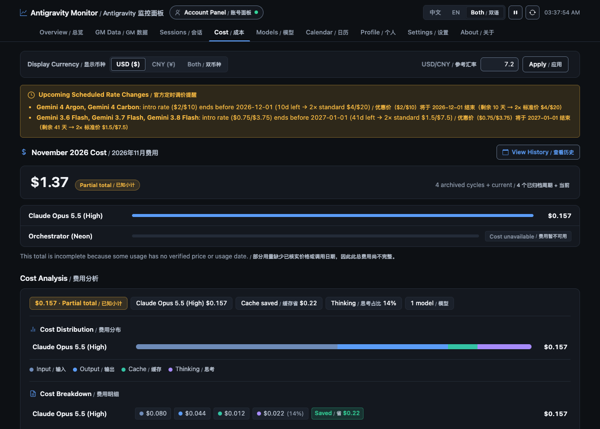

# Antigravity Context Window Monitor

Monitor conversation context composition, Orchestrator & Executor routing, dual-window model quotas (`5h` + `Weekly`) with burn-rate runway, generation speed (`tok/s`), TTFT & turn-level prompt cache diagnostics, API-equivalent costs (USD), reset times, and AI credits across **Antigravity App (Desktop 2.0+ Native Sidecar Plugin)** and **Antigravity IDE (VSIX Extension)**.

**1.17.5** introduces full native **Antigravity App (2.0+ Sidecar Plugin)** support (`AUX_PANE` + `SIDEBAR` + companion `SKILL.md` with zero external runtime dependencies, zero LLM tool-schema tokens, and zero `app.asar`/CDP patching), adds the **Context Composition Breakdown** (Bar ↔ 20×5 Dot Matrix, Dual-Cap budget vs native ceiling, Top 5 Largest Items, and one-click `/context` & Handoff copy), **Header Conversation Switcher & Lock to Main Agent**, **Turn-Level Cache Diagnostics** (`Cold`/`Partial`/`Warm` Start + `+Δ` net growth), **Quota Burn-Rate Runway** with **Stale-Safe Cached Fallback** & **`custom-*` Model Isolation**, and **concurrent App + IDE atomic lockfile persistence**.

[中文文档](readme_CN.md) · [1.17.5 release notes and validation](docs/releases/1.17.5.md) · [Technical guide](docs/technical_implementation.md) · [Project structure](docs/project_structure.md) · [Changelog](CHANGELOG.md)

## Highlights in 1.17.5

- **Native Antigravity App (2.0+ Sidecar Plugin):** Runs natively inside Antigravity Desktop 2.0+ with dual view entrypoints — compact side panel (`AUX_PANE` at `/`) and full-width dashboard (`SIDEBAR` at `/full`) — plus a companion `context-monitor` `SKILL.md` that opens the monitor via `sidecar://antigravity-context-monitor/context_monitor/`. Executes directly on Antigravity App's bundled Node runtime (`v24.22.0`) with **zero external npm runtime dependencies**, **zero LLM tool-schema token overhead**, and **zero `app.asar` patching or CDP hacks**. Features automatic Light / Dark / High-Contrast (`hc` & `hc-light`) host theme bridging (`src/app/theme-adapter.ts`), visibility-gated ETag live polling (`/api/snapshot`), and a shared pure zero-`vscode` document builder (`src/webview-document.ts`) delivering full 9-tab feature parity with Antigravity IDE.
- **Context Composition Breakdown & Dual-Cap Clarity:** Breaks down active conversation context across semantic categories (`system`, `rules/skills`, `plugins/MCP`, `subagents`, `user`, `assistant/thinking`, `tools`, `media/files`, `other`) with an interactive **Bar View ↔ 20×5 (100-cell) Dot Matrix** toggle, cross-highlighting category legend, **Dual-Cap** readout comparing effective autocompact budget against the native model ceiling, honest measurement badges (**Measured**, **Estimated (Post-Compaction)**, **Estimated (Rewind)**, **Awaiting Generation**), compaction saved-token chips, collapsible **Top 5 Largest Items**, and one-click **Copy `/context` Report** & **Copy Handoff Prompt** quick actions.
- **Header Conversation Switcher & Lock to Main Agent:** Adds a compact Masthead Context Bar across both App and IDE surfaces to stay on **Follow Active** or pin any conversation, toggle **Lock to Main Agent** (preventing background subagent bursts from hijacking the active context readout), and inspect surface (`Antigravity App` / `Antigravity IDE`) and stale-cache status at a glance.
- **Turn-Level Prompt Cache Diagnostics (`GM Data`):** Compares **Last-Turn** vs token-weighted **Session Cache Hit** rates, classifies turns as **Cold Start (`<10%`)**, **Partial Start (`10%–<70%`)**, or **Warm Start (`≥70%`)**, and surfaces per-turn **`+Δ` net context growth** alongside compaction/rewind drop indicators in the Recent Calls Ledger.
- **Quota Burn-Rate Runway, Stale-Safe Fallback & `custom-*` Model Isolation:** Computes rolling 45-minute jitter-filtered quota burn rates (`Safe before reset`, `Est. exhaust in ...`, `Quota exhausted`, `Quota recently recovered`) per pool; retains last-known telemetry with an explicit **Cached / Stale** banner and timestamp during transient local RPC interruptions; and automatically isolates `custom-*` / BYOK / local models so irrelevant Google quota pool alerts are suppressed.
- **Concurrent App + IDE Persistence, Discovery & Accessibility Hardening:** Protects shared `state-v1.json` persistence (`DurableState`) with a cross-platform atomic `O_CREAT | O_EXCL` lockfile (stale-lock recovery, 3-way object/account-snapshot merge, and Windows NTFS `EPERM`/`EACCES`/`EBUSY` contention retry) so Antigravity App and Antigravity IDE can run simultaneously without data loss. Unifies App + IDE backend discovery (`ANTIGRAVITY_LS_ADDRESS`, surface-classified `daemon/hub_<port>.json`, Linux `/proc/<pid>` fallback, macOS/Windows/WSL hardening), decouples pure `i18n-core.ts`, and passes **WCAG 2.1 AA with 0 violations** across all 432 App Sidecar matrix combinations and 739 IDE UI checks.
- **Full v1.17.4 & v1.17.3 feature set retained:** Zero-flicker 3-layer Status Bar hover tooltip, secondary-port TLS-first discovery & strict RFC 3339 epoch-0 pool reset handling, live Custom **Orchestrator Settings**, Dual-Window Quota (`5-Hour` + `Weekly`), verified official USD pricing (Gemini 4 Neon `$3/$15/$0.15`, Claude Sonnet 5.5 `$0.10` cache read, scheduled rate-change banners), and priority-tiered `P0`–`P5` Hover Tooltip.

## Install

### Option A — Antigravity App (Desktop 2.0+ Native Sidecar Plugin)

Works on **macOS, Windows, and Linux** with zero external dependencies (uses Antigravity App's bundled Node runtime).

1. **From GitHub Releases (recommended):** Download `antigravity-context-monitor-app-1.17.5.zip` (macOS / Windows / Linux) or `antigravity-context-monitor-app-1.17.5.tar.gz` (macOS / Linux) from [GitHub Releases](https://github.com/AGI-is-going-to-arrive/Antigravity-Context-Window-Monitor/releases).
   - **Via `agy` CLI (all platforms):** Extract the archive (creates `antigravity-context-monitor/`), then run:
     ```bash
     agy plugin install ./antigravity-context-monitor
     ```
   - **Or extract directly into the Antigravity plugins directory:**
     - **macOS / Linux:** Extract into `~/.gemini/config/plugins/` (so `plugin.json` is at `~/.gemini/config/plugins/antigravity-context-monitor/plugin.json`).
     - **Windows (PowerShell):**
       ```powershell
       Expand-Archive -Path .\antigravity-context-monitor-app-1.17.5.zip -DestinationPath "$env:USERPROFILE\.gemini\config\plugins" -Force
       ```
2. **Or from a source checkout (using the cross-platform installer):**
   - Build & package first:
     ```bash
     npm run compile && node scripts/package-app-plugin.mjs
     ```
   - Install (automatically falls back to Antigravity's bundled `agy-node` when `node` is not on `PATH`):
     - **Any OS (Node):** `node scripts/install-app-plugin.mjs --install`
     - **macOS / Linux:** `./scripts/install-app-plugin.sh --install`
     - **Windows (PowerShell):** `.\scripts\install-app-plugin.ps1 --install`
     - *(Pass `--uninstall` to remove, or `--dry-run` to preview.)*
3. **Enable & open inside Antigravity App:**
   - Open **Customizations → Installed** (or `customization://antigravity-context-monitor`) and confirm **Antigravity Context Monitor** and its **Context Monitor** sidecar are enabled. *(When upgrading an existing install, toggle Disable → Enable or restart Antigravity App so the sidecar loads the new runtime.)*
   - Open the monitor from the side panel **`+`** menu (`AUX_PANE`), **Plugins → Context Monitor** in the left sidebar (`SIDEBAR` wide dashboard), or ask the agent to open Context Monitor (`sidecar://antigravity-context-monitor/context_monitor/`).

### Option B — Antigravity IDE (VSIX Extension)

1. Download `antigravity-context-monitor-1.17.5.vsix` from [GitHub Releases](https://github.com/AGI-is-going-to-arrive/Antigravity-Context-Window-Monitor/releases) or build it locally with `npm run package`.
2. In Antigravity IDE, open the Command Palette (`Cmd+Shift+P` on macOS, `Ctrl+Shift+P` on Windows/Linux), run **Extensions: Install from VSIX...**, and select the file — or install via CLI:
   ```bash
   antigravity-ide --install-extension antigravity-context-monitor-1.17.5.vsix --force
   ```
3. Reload the window. Confirm **1.17.5** in extension details or the monitor's **About** page.

You can also install the IDE extension from [Open VSX](https://open-vsx.org/extension/AGI-is-going-to-arrive/antigravity-context-monitor).

Both plugins support **macOS, Windows, and Linux** (plus **WSL** for IDE). Native live App (v2.34.0) + IDE (v2.7.0) verification for 1.17.5 ran on macOS; the release notes transparently separate native checks from mocked Windows and Linux unit-test coverage. [Validation](docs/releases/1.17.5.md#validation)

## Use the monitor

- **In Antigravity App:** Open **Context Monitor** in the compact **`AUX_PANE`** alongside chat or in the full-width **`SIDEBAR`** dashboard. Use the Masthead Context Bar to switch or pin conversations, enable **Lock to Main Agent** during subagent swarms, toggle **Bar View ↔ 20×5 Dot Matrix**, inspect **Top 5 Largest Items**, and click **Copy `/context` Report** or **Copy Handoff Prompt**. Theme changes (Light / Dark / High-Contrast) follow the host automatically, and polling pauses cleanly when the pane is hidden.
- **In Antigravity IDE — Hover over the bottom-right status item** for the active session and model (or cross-pool **Orchestrator `Planner → Executor`** route), context gauge with used/remaining tokens, **Latest Call** telemetry (input/output/thinking tokens, cache hit %, cost, TTFT / total latency, and noise-gated decode speed), **Session & Today Cost** with cache savings & effective blended input rate, **Orchestrator Split**, **Dual-Window (`5h` + `Weekly`) Quota** with Planner/Executor pool markers, smart event-driven alerts (rate-cutover countdown, model sunset notice, retry waste, AI credits), and 1-click links to **Overview**, **Activity**, **Cost**, **Models**, **Settings**, and **Refresh**. Choose **Automatic**, **Compact**, or **Full** in Settings; enable opt-in **Generation speed (`tok/s`)**, **Prompt cache hit rate (`%`)**, or **Session cost** in the status bar (all hidden automatically when no live data exists).
- **Click the status item (IDE) or open the panel (App)** to inspect all 9 tabs. Use the sticky header controls to inspect multi-account snapshots (**Account Panel**), switch between Chinese, English, and bilingual display, pause live polling, or refresh manually.
- **Expand Session diagnostics & Largest Items** for provider-reported token counts, compaction checkpoints, top context consumers, and image activity. The monitor explicitly distinguishes measured values from post-compaction/rewind estimates, updates streaming responses in place, and recalculates context on undo or a model switch.

## Monitor views

The panel adapts cleanly from `320px` narrow side panes (`AUX_PANE` / split panes) to `1440px` wide dashboards (`SIDEBAR` / editor tabs), follows Light, Dark, and High-Contrast (`hc` & `hc-light`) themes, and passes **WCAG 2.1 AA** with zero violations. Screenshots below use example data and showcase the **Obsidian Slate Dark** theme in bilingual mode.

### Overview

See the active conversation, **Masthead Context Bar** (Conversation Switcher, Lock to Main Agent, surface & stale-cache badges), active **Orchestrator `Planner → Executor`** cross-pool route pill, context used and remaining tokens, **Context Composition** card (Bar ↔ 20×5 Dot Matrix, Dual-Cap effective budget vs native ceiling, measurement badge, compaction savings, collapsible Top 5 Largest Items, and Copy `/context` Report / Copy Handoff Prompt buttons), recessed 4–5 cell L2 telemetry strip (generation speed `tok/s`, adaptive TTFT, token-weighted cache hit rate, estimated cache savings, and Session / Today cost in USD), collapsible session diagnostics, dual-window (`5h` + `Weekly`) shared quota pools with **Quota Burn-Rate Runway** badges (or `custom-*` Model Isolation banner), and the AI credits footer.


<details>
<summary>GM Data — speed, TTFT, turn-level cache diagnostics, Recent Calls Ledger, and timeline</summary>

Inspect real-time Generator Metadata by model and session, including the account-filtered KPI strip, the 2-column **Speed & First-Token Cache Ledger** (weighted/latest/median/visible `tok/s`, **Cached vs Uncached TTFT** comparison bars, 3-segment Prompt Cache bar, and **Last-Turn vs Session Cache Hit** comparison with **Cold / Partial / Warm Start** pills), the collapsible **Recent Calls Ledger** (latest 20 calls with Time, Actual Model, Fresh Input, `+Δ` net context growth / compaction drop, Output w/ Think %, Cache Hit %, Cost / Unpriced, TTFT, Total Latency, noise-gated Speed, and Status), unified per-model stats cards, per-step/per-turn timeline telemetry pills, today's ledgers, tool call ranking, context growth chart, and error details.


</details>

<details>
<summary>Sessions — searchable conversation history</summary>

Browse conversation context and history grouped by workspace. Filter by current workspace, repository, running state, or backup availability, and reveal local workspace, Brain, or `.pb` files.


</details>

<details>
<summary>Cost — USD estimates, rate-change alerts, and custom API rates</summary>

Review monthly and daily usage estimates in **USD**, inspect total & per-model cache savings, thinking cost share, 4-series cost distribution (input, output, cache, thinking), and **Upcoming Scheduled Rate Changes** banners (Carbon/Argon `2026-12-01`, Flash `2027-01-01`). Set custom rates per 1M tokens for any family or individual model; unpriced usage is flagged honestly without fabricating `$0.00`.



</details>

<details>
<summary>Models — Orchestrator Settings, dual-window quota pools, runway badges, and model specifications</summary>

Inspect live **Orchestrator Settings** (`Orchestrator Model` + `Executor Model`, default vs custom pairing, and cross-pool role indicator), the default model, merged Gemini and Claude / GPT **Dual-Window (`5h` + `Weekly`)** quota pools with **Quota Burn-Rate Runway** indicators, reset schedules, available families & effort tiers (`Low` / `Medium` / `High` / `Extra High`), API reference pricing rows on spec cards, `Notice` sunset tags (e.g. GPT-OSS 120B), and full backend-reported model specifications. Chat models and the image-generation catalog are presented separately.


</details>

<details>
<summary>Calendar — daily usage, USD totals, archived speed/TTFT/cache, and cycles</summary>

Switch between **Monthly** and **All-Time** summaries, browse daily activity and USD cost chips on the interactive 7-column calendar, and expand any day to inspect per-model totals, archived generation speed (`tok/s`), adaptive TTFT, token-weighted prompt cache hit rate, and archived cycles.


</details>

<details>
<summary>Profile — plan, dual-window shared quotas, AI credits, and account settings</summary>

Review account identity (masked by default with a one-click privacy toggle), current plan, dual-window (`5h` + `Weekly`) shared model quota pools, amber `Notice` tags for sunsetting models, Google AI credits (labeled **Not reported** when absent), per-account monthly credit expiry day, and collapsible plan limits, feature flags, and team configuration.


</details>

<details>
<summary>Settings — persistent storage, polling, status bar, and surface adaptation</summary>

Inspect shared external persistent storage (`state-v1.json` with atomic lockfile concurrency between App and IDE), configure the low-quota warning threshold, polling interval, seven IDE status bar toggles (including opt-in generation speed `tok/s`, prompt cache hit rate `%`, and **Session cost** `$0.27` USD preview — clearly badged as IDE-only when running inside Antigravity App), hover density (`auto` / `compact` / `full`), internal model ID display, interface zoom, and scrollbar / end-of-content preferences.


</details>

<details>
<summary>About — version, dual-host compatibility, and navigation</summary>

Confirm the installed version (`v1.17.5`, dynamically read from the manifest), dual-host support badges (**Antigravity IDE** + **Antigravity App (Desktop 2.0+ Sidecar)**), and 512K context compatibility scope, jump directly to any monitor view via the feature navigation directory, and access repository and compatibility notes.


</details>

## Models, context, and cost

- The signed-in account's live catalog determines model availability. The status bar hover and **Overview** count verified thinking-effort variants once per base-model family; **Models**, **GM Data**, and **Cost** retain each effort's exact ID.
- **Orchestrator & Gemini 4 family:** All **Gemini 4** families (**Neon**, **Hydrogen**, **Carbon**, **Argon**) and **Orchestrator** models (`M537`, `M667`, `M681`, `M669`) use the unified **512,000-token** live checkpointer limit (`1,048,576` model context, `262,144` max output). Both **Gemini 4 Neon** and **Gemini 4 Hydrogen** expose `Low` / `Medium` / `High` / `Extra High` thinking tiers. Under **Custom Orchestrator Mode**, any eligible Orchestrator model (including **Claude Opus 5.5** and **Gemini 4 Neon**) can pair with any eligible Executor model (such as **Gemini 4 Hydrogen** or **Claude Sonnet 5.5**), with each leg billed to its own actual model and tracked across quota pools.
- **Verified built-in API-equivalent pricing (USD per 1M tokens, verified 2026-11-22):**

| Model Family | Input | Output / Thinking | Cache Read | Cache Write | Notes / Schedule |
| --- | ---: | ---: | ---: | ---: | --- |
| **Gemini 4 Neon** (`Low`–`Extra High`) | `$3.00` | `$15.00` | `$0.15` | `$0` | Flat across 1M context; implicit cache reads |
| **Gemini 4 Hydrogen** (`Low`–`Extra High`, `M530`/`M531`) | `$1.50` | `$7.50` | `$0.075` | `$0` | Flat across 1M context; `M578` Sonar unpriced |
| **Gemini 4 Carbon / Argon** | `$2.00` → `$4.00` | `$10.00` → `$20.00` | `$0.10` → `$0.20` | `$0` | Intro rate ends `2026-12-01` UTC (`2×` standard) |
| **Claude Opus 5.5** (`Low`–`High`) | `$4.00` | `$20.00` | `$0.20` | `$5.00` | 5-minute TTL cache write |
| **Claude Sonnet 5.5** (`Low`–`High`) | `$2.00` | `$10.00` | `$0.10` | `$2.50` | Fixed cache read rate (`$0.10`); 5-min TTL write |
| **Gemini 3.8 / 3.7 / 3.6 Flash** | `$0.75` → `$1.50` | `$3.75` → `$7.50` | `$0.075` → `$0.15` | `$0.9375` → `$1.875` | Promo ends `2027-01-01` UTC (3.6 bounded from `2026-08-13`) |
| **GPT-OSS 120B (Medium)** | `$0.09` | `$0.36` | `$0` | `$0` | Displays `Notice` sunset badge when reported |
| **Legacy Orchestrators & Image** (`M537`/`M667`/`M681`/`M669`/`M578`/`M21`) | Unpriced | Unpriced | Unpriced | Unpriced | Never fabricated as `$0.00`; set custom overrides in **Cost** |

- Context readings prioritize provider-reported fresh input, cache reads, cache creation, and output from the current planner response or checkpoint. Undated historical calls on scheduled-cutover models remain honestly unpriced rather than fabricating current-date rates. Subscription AI credits are tracked separately (unknown readings display **Not reported** instead of `0`). [Model and pricing details](docs/technical_implementation.md)

## Commands and settings

### Antigravity IDE Commands & Settings

| Command | Action |
| --- | --- |
| **Show Context Window Details** | Open Overview (also accepts hover deep-link targets: `gmdata`, `pricing`, `models`, `settings`) |
| **Refresh Context Window Monitor** | Reconnect to the backend and restart polling |
| **Switch Display Language** | Choose English, Chinese, or bilingual display |
| **Show Model Activity** | Open GM Data |

IDE settings use the `antigravityContextMonitor.` prefix (13 settings total):

| Setting | Default | Action |
| --- | --- | --- |
| `pollingInterval` | `5` | Set the polling interval in seconds |
| `statusBar.showContext` | `true` | Show context usage in the status bar |
| `statusBar.showQuota` | `true` | Show the current model's quota percentage |
| `statusBar.showResetCountdown` | `true` | Show the current model's reset countdown |
| `statusBar.showAiCredits` | `true` | Show AI credit balance in the status bar (hidden when unreported) |
| `statusBar.showSpeed` | `false` | Show latest or weighted-average model generation speed (`tok/s`) in the status bar (hidden when untimed) |
| `statusBar.showCacheHit` | `false` | Show token-weighted prompt cache hit rate (`%`) in the status bar (hidden when no prompt tokens exist) |
| `statusBar.showSessionCost` | `false` | Show the active session's estimated API-equivalent USD cost in the status bar (hidden when `$0` or unpriced) |
| `statusBar.tooltipDensity` | `auto` | Set `auto`, `compact`, or `full` hover density |
| `quotaNotificationThreshold` | `20` | Warn below this quota percentage. Use `0` to disable |
| `showModelInternalId` | `false` | Add the internal ID to model names |
| `activity.maxRecentSteps` | `100` | Limit retained recent activity steps in persistence |
| `activity.maxArchives` | `20` | Limit retained activity archives |

### Antigravity App Sidecar Endpoints & Views

| Surface / Route | Purpose |
| --- | --- |
| `AUX_PANE` (`/`) | Compact side panel opened from the side panel `+` menu or `sidecar://antigravity-context-monitor/context_monitor/` |
| `SIDEBAR` (`/full`) | Full-width dashboard opened from **Plugins → Context Monitor** in the left sidebar |
| `/api/health`, `/api/snapshot`, `/api/action` | Local loopback health check, visibility-gated ETag snapshot feed, and UI action endpoint (polling interval, language, low-quota threshold, custom pricing, zoom, conversation pinning, and Lock to Main Agent persist directly to shared `state-v1.json`) |

## Troubleshooting and limits

- **No active conversation** means the backend is connected and there is no loaded conversation in the current view. Open a conversation (or pick one in the Masthead Conversation Switcher) to load its context. Windows on the same workspace can share session data; open different folders for independent views.
- **Running Antigravity App and Antigravity IDE together:** Both hosts automatically isolate their respective local backends (`preferredSurface: 'app'` vs `'ide'`) with zero crosstalk and coordinate shared history in `state-v1.json` via an atomic `O_CREAT | O_EXCL` lockfile + 3-way merge.
- **Upgrading the Antigravity App plugin:** After installing a new release, toggle **Antigravity Context Monitor** Disable → Enable in **Customizations → Installed** (or restart Antigravity App) so the running sidecar process restarts onto the new build. Verify the version badge in **About** or `/api/health`.
- **Backend disconnected** or **LS not found** points to local discovery or connectivity. Reload after installing, then open **Output → Antigravity Context Monitor** (IDE) and inspect `PATH check:`. Discovery supports `ANTIGRAVITY_LS_ADDRESS`, `agy --hub` (including v1.5.14+ via `GetStatus` / `daemon/hub_<port>.json`), legacy language servers, Linux `/proc/<pid>` socket fallback, and macOS/Windows/WSL discovery tools. Run Antigravity under a standard user account. [Backend discovery](docs/technical_implementation.md)
- In WSL, the IDE extension can inspect the active distribution and connect through WSL interop. For Remote-WSL or Remote SSH, Antigravity may run the extension on the local UI host. [Project structure](docs/project_structure.md)
- Long or internally summarized sessions can have incomplete telemetry. The monitor marks post-compaction/rewind estimates and missing steps explicitly. In Orchestrator mode, the monitor tracks both `planModel` and `executionModel` independently across cross-pool calls while preserving accurate context readings. [Context and token calculation](docs/technical_implementation.md) · [Community discussion of checkpoint summaries](https://www.reddit.com/r/google_antigravity/comments/1q7zcag/heres_how_to_find_which_mcp_tools_are_leading_to/)

## Acknowledgments

Maintained by **AGI-is-going-to-arrive**. Thanks to **SecretLUL** for the Windows discovery report ([Issue #64](https://github.com/AGI-is-going-to-arrive/Antigravity-Context-Window-Monitor/issues/64)) and **@AxelDZP** for secondary-port TLS-first discovery, `GetUserStatus` shape validation, and equivalent proto3 epoch-0 `resetTime` fixes ([PR #74](https://github.com/AGI-is-going-to-arrive/Antigravity-Context-Window-Monitor/pull/74)).

We are grateful to the open-source Antigravity community projects whose design exploration and real-world engineering lessons inspired UX and architectural improvements in **v1.17.5** (our implementation is built independently from scratch atop our own TypeScript core and official Sidecar / VSIX APIs, without patching `app.asar` or copying code):

- [`dimitr-io/antigravity-desktop-context`](https://github.com/dimitr-io/antigravity-desktop-context) — Antigravity App Sidecar `AUX_PANE` workflow, 20×5 dot-matrix context visualization, dual-cap clarity, and CLI-style `/context` text export.
- [`elviscjn-cjn/antigravity-context-viewer`](https://github.com/elviscjn-cjn/antigravity-context-viewer) — Desktop telemetry UX exploration, turn/cache visualization ideas, and community stability lessons on Antigravity v2.33+/v2.34+.
- [`yuhuan-dev/antigravity-usage-monitor`](https://github.com/yuhuan-dev/antigravity-usage-monitor) — Zero-dependency Sidecar architecture, Linux `/proc` port discovery fallback, and the "Lock to Main Agent" safeguard against subagent bursts.
- [`ahmetdotsh/agy-context`](https://github.com/ahmetdotsh/agy-context) & [`ahmetdotsh/agy-usage`](https://github.com/ahmetdotsh/agy-usage) — Segmented bar ↔ matrix toggle, effective vs native limit presentation, last-turn vs cumulative cache rate distinction, and ETag `unchanged` short-circuiting.
- [`arthurcavallari/antigravity-context-monitor`](https://github.com/arthurcavallari/antigravity-context-monitor) & [`arthurcavallari/antigravity-sidecar-kit`](https://github.com/arthurcavallari/antigravity-sidecar-kit) — Compaction checkpoint & largest-items context inspection, `custom-*` model quota isolation, and cross-platform BOM-safe installation practices.
- [`jule-x/antigravity-context-monitor`](https://github.com/jule-x/antigravity-context-monitor) — Per-turn Cold / Partial / Warm prompt cache classification and `+Δ` context growth diagnostics.
- [`bocai991/antigravity-quota-meter`](https://github.com/bocai991/antigravity-quota-meter) — Dual `AUX_PANE` + `SIDEBAR` Sidecar mounting and rolling quota burn-rate / runway estimation.
- [`vladsboev-web/chat_tokens`](https://github.com/vladsboev-web/chat_tokens) — One-click `HANDOFF.md` continuation prompt export and recent conversation switching.
- [`benedictusrey/Antigravity-Monitor`](https://github.com/benedictusrey/Antigravity-Monitor) — Explicit `Measured` vs `Estimated` state badges and distinguishing Rewind from Compaction.

[MIT License](LICENSE) · [LINUX DO](https://linux.do/) · [Star history](https://www.star-history.com/#AGI-is-going-to-arrive/Antigravity-Context-Window-Monitor&type=date&legend=top-left)
