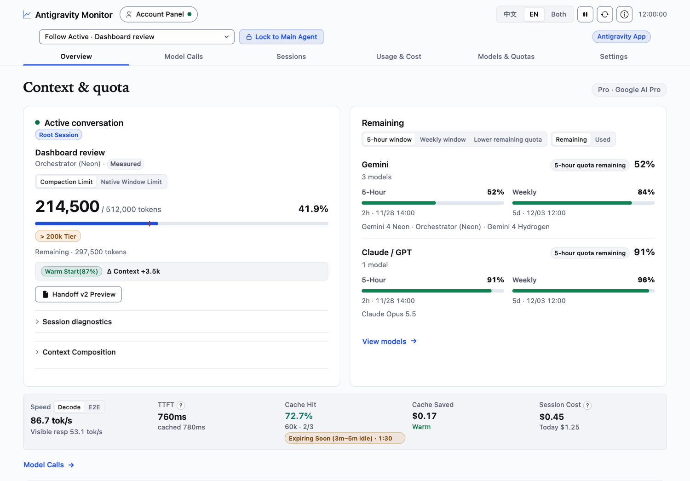
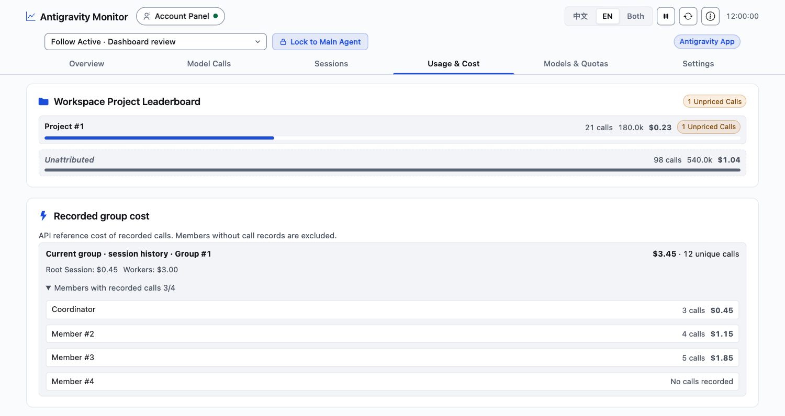
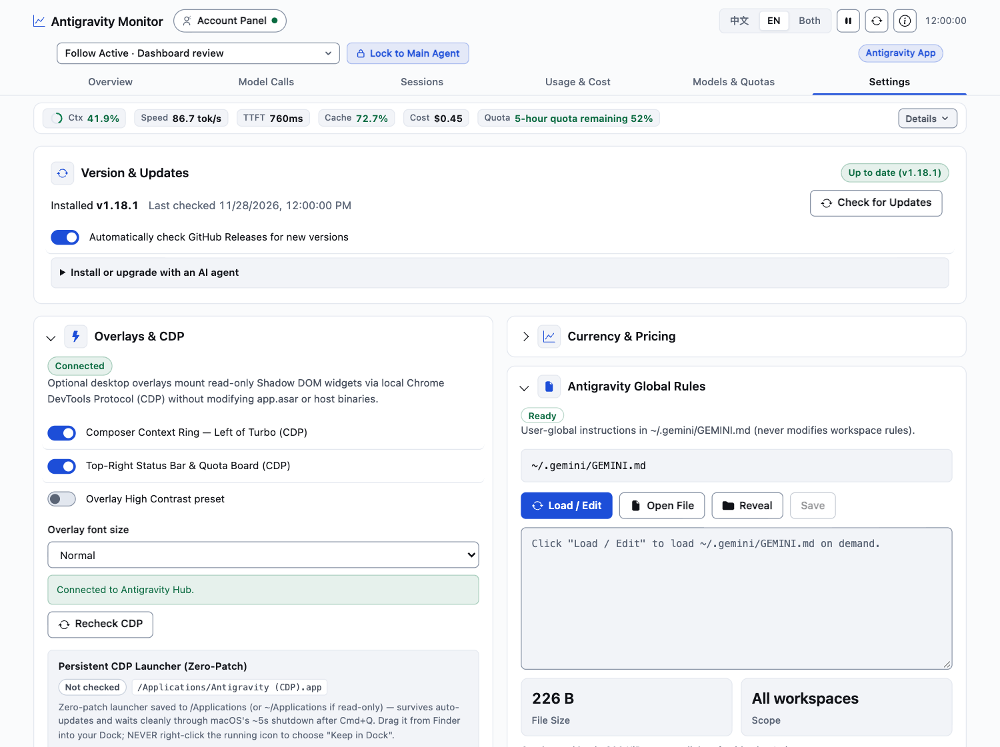
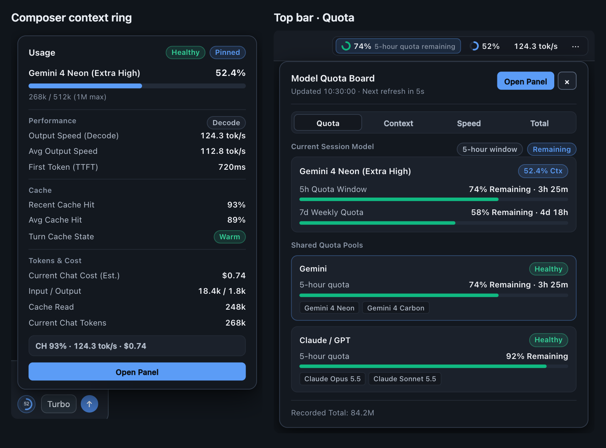

# Antigravity Context Window Monitor

See how much context a conversation has left in Antigravity App and IDE. Inspect individual model calls, follow swarm members, compare cache usage and reference costs, and check when your 5-hour and weekly quotas reset. You can also show context usage in the `agy` CLI status line.

[中文文档](readme_CN.md) · [Install](#3-step-install--upgrade) · [AI agent instructions](AGENTS.md) · [Interface gallery](#interface-gallery) · [v1.18.2 release notes](docs/releases/1.18.2.md) · [Changelog](CHANGELOG.md)

**English walkthrough · 54 seconds**

https://github.com/user-attachments/assets/2a84844d-1f4a-4b27-b5b8-ffdc964f80cb

[Download the full-quality MP4](https://github.com/AGI-is-going-to-arrive/Antigravity-Context-Window-Monitor/releases/download/v1.18.1/acm-promo-07-sticker-en.mp4)

## Capability Matrix

| Capability | Antigravity App (Sidecar) | Antigravity IDE (VSIX) | `agy` CLI (`statusLine`) |
| --- | :---: | :---: | :---: |
| **Integration Surface** | `AUX_PANE` (`/`) + `SIDEBAR` (`/full`) + `SKILL.md` | Status Bar + Hover + Webview Panel | Opt-in read-only stdin pipe (`agy-statusline.mjs`) |
| **6-Tab Monitor UI + Topbar `ⓘ`** | Six tabs in the side pane and full dashboard | Full (4 themes, nonce IPC, safe hotkeys) | Single-line ANSI/plain summary |
| **Unified Observation & 3-Field Root Lock** | Yes (App + Native HUD + CDP parity) | Yes (Panel + Status Bar parity) | Shares context & currency contract |
| **Swarm / Subagent Live Tracking** | Yes (20+ members, Inspect / Back to Main) | Yes (read-only topology + group cost) | Active subagent count (`sub:N`) |
| **Native HUD / Opt-In CDP Overlays** | Native HUD (`on`) + Opt-In CDP (`off`) | Native HUD (`off`) + Status Bar | Terminal status line (`NO_COLOR` safe) |
| **Global Rules & Bidirectional Hot Sync** | `~/.gemini/GEMINI.md` editor + `state-v1.json` | `~/.gemini/GEMINI.md` editor + `state-v1.json` | Local CLI logs read in **Usage & Cost** |
| **Runtime Dependencies / Host Patching** | Zero npm deps / Zero `app.asar` patches | Zero npm deps / Standard VSIX API | Zero npm deps / Read-only stdin |

## 3-Step Install & Upgrade

### 1. Antigravity App (Native Sidecar Plugin — macOS / Windows / Linux)

Paste this sentence to any AI coding agent (Antigravity, Claude Code, Codex), or run the zero-clone installer directly (automatic HTTPS allowlist + fail-closed `SHA256SUMS.txt` verification):

> Read `AGENTS.md` in `https://github.com/AGI-is-going-to-arrive/Antigravity-Context-Window-Monitor` and install/upgrade Antigravity Context Monitor for my Antigravity App.

```bash
# macOS / Linux (curl + node)
curl -fsSL https://raw.githubusercontent.com/AGI-is-going-to-arrive/Antigravity-Context-Window-Monitor/main/scripts/install-app-plugin.mjs -o /tmp/acm-install.mjs && node /tmp/acm-install.mjs --from-github && rm -f /tmp/acm-install.mjs
```

```powershell
# Windows PowerShell (irm + node)
$f = Join-Path $env:TEMP 'acm-install.mjs'; irm 'https://raw.githubusercontent.com/AGI-is-going-to-arrive/Antigravity-Context-Window-Monitor/main/scripts/install-app-plugin.mjs' -OutFile $f; node $f --from-github; Remove-Item $f -Force
```

Enable **Antigravity Context Monitor** in **Customizations → Installed** (`customization://antigravity-context-monitor`), then open via the side panel **`+`** menu (`AUX_PANE`) or **Plugins → Context Monitor** (`SIDEBAR`). When upgrading over a running sidecar, toggle **Off → On** safely — never kill the running Antigravity process. See [AGENTS.md](AGENTS.md) for local builds (`--local-dir` / `--no-remote-fallback`) and `--status --check-remote`.

### 2. Antigravity IDE (VSIX Extension — macOS / Windows / Linux / WSL)

Install from [Open VSX](https://open-vsx.org/extension/AGI-is-going-to-arrive/antigravity-context-monitor) or download `antigravity-context-monitor-<version>.vsix` + `SHA256SUMS.txt` from [GitHub Releases](https://github.com/AGI-is-going-to-arrive/Antigravity-Context-Window-Monitor/releases) and run:

```bash
antigravity-ide --install-extension antigravity-context-monitor-<version>.vsix --force
```

Reload the IDE window (`Developer: Reload Window`). Open the panel anytime with `Cmd+Alt+M` (macOS) / `Ctrl+Alt+M` (Windows/Linux) or refresh with `Cmd+Alt+Shift+R` / `Ctrl+Alt+Shift+R`.

### 3. Optional Opt-In Enhancements (Zero Binary Patching)

- **Persistent CDP Overlays (App, default `OFF`):** Core Sidecar and Native HUD work without CDP. First-open Overview displays a dismissible **Overlays & CDP Quick Setup** banner, and **Settings → Overlays & CDP** provides 1-click **Create Persistent Launcher** (or run `node scripts/install-app-plugin.mjs --setup-cdp-launcher`). See [docs/cdp-overlays.md](docs/cdp-overlays.md).
- **Opt-In `agy` CLI `statusLine`:** Point `~/.gemini/antigravity-cli/settings.json` at `~/.gemini/config/plugins/antigravity-context-monitor/bin/agy-statusline.mjs`. See [docs/telemetry-and-pricing.md](docs/telemetry-and-pricing.md).

## Highlights in v1.18.2

**Models & Quotas** now shows one set of quota cards in both the App and IDE. Select **View model quota above** in the account section to return to those cards. AI credits and their expiry reminder stay with the account.

For post-compaction readings, swarm refresh and reference cost fixes, see the [v1.18.1 release notes](docs/releases/1.18.1.md).

## Interface gallery

[](docs/images/en/hero-overview.webp)

### Overview · swarm members

Expand a member to see its model, context usage and share of the recorded group cost.

[](docs/images/en/overview-swarm.webp)

### Model Calls

Compare generation speed, time to first token and cache hits, then inspect the latest call.

[](docs/images/en/model-calls.webp)

### Sessions

Open a session and expand a member to inspect its latest measurements.

[](docs/images/en/aux-pane-sessions.webp)

### Usage & Cost

Review usage by workspace and see which swarm members have recorded calls.

[](docs/images/en/usage-cost.webp)

### Models & Quotas

Compare weekly quota forecasts and expand a model to see its limits.

[](docs/images/en/models-quotas.webp)

### Settings

Check for an update, configure overlays or open the Global Rules editor.

[](docs/images/en/settings-global-rules.webp)

### Antigravity IDE

Open the monitor from the IDE status bar to inspect the current session alongside your editor.

[](docs/images/en/ide-light.webp)

### App overlays

Open the context ring or the quota indicator for details while you work in the conversation.

[](docs/images/en/cdp-overlays.webp)

## Thresholds & Quick Troubleshooting

| Signal / Symptom | Threshold or Behavior | Quick Resolution |
| --- | --- | --- |
| **Context Pressure** | Healthy `<65%` · Elevated `65%–79%` · High `>=80%` · Overflow `>100%` | Use **Handoff v2** or `/compact`; `200k` tick is a standard API reference marker, not an extra subscription fee |
| **Prompt Cache / 5m TTL** | Measured: Warm `>=70%` · Partial `10%–69%` · Cold `<10%`; TTL warn `>=180s`, expire `>=300s` | Local TTL is an idle-timer heuristic; check possible miss causes (model switch, idle gap, compaction) |
| **Model Quota Pools** | Healthy `>=50%` · Caution `20%–49%` · Critical `<20%` (alert threshold default `20%`) | Switch `5h` / `7d` / **Lower remaining quota** and `remaining` / `used`; weekly forecast requires `>=2` active hours across `>=2` days |
| **`reloadRequired` After Upgrade** | On-disk plugin version/buildId differs from running Sidecar | Open `customization://antigravity-context-monitor` and toggle **Off → On** (never force-quit Antigravity) |
| **`CDP Inactive` / `host_missing_flag`** | Opt-in CDP overlays enabled without `--remote-debugging-port` | Use **Create Persistent Launcher** in **Settings → Overlays & CDP**, quit cleanly (`Cmd+Q` + ~5s wait on macOS), relaunch, click **Recheck CDP** |
| **Huge Session / `Unattributed`** | `>50 MB` / `>1,200`-step conversations or pre-v1.18 rows without workspace tags | The monitor reads a bounded tail of oversized histories. **Unattributed** groups older calls that have no workspace tag. |

## Architecture & Technical Compliance Boundaries

| Boundary | Technical Fact |
| --- | --- |
| **Host Binaries & `app.asar`** | Zero modification, unpacking, patching, or code-signing of `app.asar`, `Info.plist`, `language_server`, or `agy` |
| **Telemetry & Global Rules Access** | The monitor processes local language-server RPC data, which can include prompt metadata, text snippets and checkpoint summaries. It reads CLI logs for usage and the swarm manifests `members.json` and `swarm.json` for membership. The Global Rules editor saves user edits only to `~/.gemini/GEMINI.md`, rejects symbolic links and enforces a 200 KiB limit. |
| **Credentials & Network** | Never extracts CloudCode/Google OAuth tokens, switches accounts, sends synthetic wake-up requests, or uploads telemetry; only optional outbound traffic is ETag-throttled HTTPS `443` GitHub Releases checks |
| **Opt-In CDP Overlays** | Default `OFF`; mounts read-only Trusted-Types-safe Shadow DOM widgets only when explicitly launched with CDP; per-target Origin-bound credentials revoked on navigation/detach |
| **Runtime Dependencies & License** | Zero external runtime npm dependencies (pure Node.js built-ins + bundled `esbuild` artifacts); independent clean-room **MIT** codebase |

## Guides and license

Maintained by **AGI-is-going-to-arrive**. [Architecture](docs/architecture.md) · [Telemetry, pricing and CLI status line](docs/telemetry-and-pricing.md) · [CDP overlays](docs/cdp-overlays.md) · [Design system](DESIGN.md) · [Product specification](PRODUCT.md) · [MIT License](LICENSE)

## Acknowledgments

Thank you to @gitstq for the Global Rules editor and to @GHTGXL for documenting the Windows crashes and update failures in large sessions. [PR #78](https://github.com/AGI-is-going-to-arrive/Antigravity-Context-Window-Monitor/pull/78) · [Issue #79](https://github.com/AGI-is-going-to-arrive/Antigravity-Context-Window-Monitor/issues/79)

Thank you to the [LINUX DO community](https://linux.do/).
