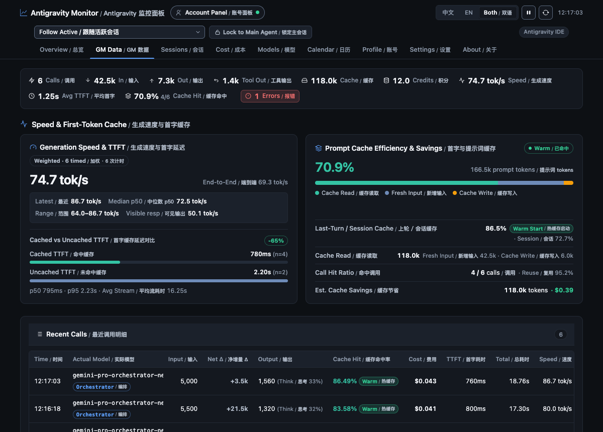

# Antigravity 上下文窗口监控

在 **Antigravity App（桌面版 2.0+ 原生 Sidecar 插件）** 与 **Antigravity IDE（VSIX 扩展）** 中实时监控会话上下文构成与双水位线（`自动压缩` + `200k` 档位）、带基础费率映射与全链路角色归因的 Orchestrator 编排/执行路由、带续航预测的双窗口模型配额（`5h` + `周`）、模型生成速度（`tok/s`）、首字延迟与逐轮提示词缓存诊断、52 周多源活动热力图（`App` / `IDE` / `CLI`）、多币种 API 等价费用与可选套餐回本估算、重置时间和 AI 积分。

**1.17.10** 在 v1.17.9 基础上彻底修复 Windows Antigravity 2.35.2 下内联右上角状态条右侧出现多余空白的问题（[Issue #77](https://github.com/AGI-is-going-to-arrive/Antigravity-Context-Window-Monitor/issues/77)，致谢 [`@Number444`](https://github.com/Number444)），并全面加固跨平台 WCO 与锚定边界：(1) **消除内联幽灵 WCO 空白并加固 `computeWcoInsetPx` 边界校验**（内联锚定时直接返回 `0`，不再于双行标题栏下在胶囊与 `toggle-aux-sidebar` 之间插入约 146px 空白；`fixed` 模式同步防护隐藏预留节点、空 `DOMRect(0,0,0,0)` 撑爆及 Windows 全屏/RTL 误回退 `138px`）；(2) **内联同行右侧控件宽度预算与空首行 WCO 防碰撞**（内联模式不再虚扣 WCO 宽度并支持 `r.top < 96` 第二行兄弟元素测量，杜绝胶囊提前折叠进 `···`；当空首行 `pane-titlebar-toolbar` 落入右侧 WCO 按钮区时自动跳过并回退至 `fixed` 避让 `_ □ ×`）；(3) **幂等 `anchor.before` 归一化与 `geometrychange` 实时监听**（消除 Tier 3 重复 `insertBefore(host, host)` 抖动，实时响应 `navigator.windowControlsOverlay` `geometrychange` 并在卸载时完整释放）。

[English](README.md) · [AI 智能体一键安装（`AGENTS.md`）](AGENTS.md) · [1.17.10 发布说明与验证](docs/releases/1.17.10.md#中文) · [技术实现](docs/technical_implementation.md) · [项目结构](docs/project_structure.md) · [变更日志](CHANGELOG.md)

## 给 AI 智能体的一句话安装 / 升级（`AGENTS.md`）

将下面这一句话直接发给任意 AI 编程助手（Antigravity、Claude Code、Codex 等）即可自动完成安装或升级——**零 `app.asar` 修改、零外部 npm 依赖、强制校验 SHA-256，且绝不强杀正在运行的 Antigravity 会话**：

> 请阅读 `https://github.com/AGI-is-going-to-arrive/Antigravity-Context-Window-Monitor` 中的 `AGENTS.md`，为我的 Antigravity App 安装或升级 Antigravity Context Monitor。

也可以在终端直接执行零外部依赖的跨平台一行命令（追加 `--version <x.y.z>` 可锁定指定版本）：

- **macOS / Linux（`curl` + `node`）：**
  ```bash
  curl -fsSL https://raw.githubusercontent.com/AGI-is-going-to-arrive/Antigravity-Context-Window-Monitor/main/scripts/install-app-plugin.mjs -o /tmp/acm-install.mjs && node /tmp/acm-install.mjs --from-github && rm -f /tmp/acm-install.mjs
  ```
- **Windows（PowerShell `irm` + `node`）：**
  ```powershell
  $f = Join-Path $env:TEMP 'acm-install.mjs'; irm 'https://raw.githubusercontent.com/AGI-is-going-to-arrive/Antigravity-Context-Window-Monitor/main/scripts/install-app-plugin.mjs' -OutFile $f; node $f --from-github; Remove-Item $f -Force
  ```
- **跨平台纯 Node 一行命令（macOS / Windows / Linux 通用）：**
  ```bash
  node -e "const fs=require('fs'),os=require('os'),p=require('path'),cp=require('child_process');fetch('https://raw.githubusercontent.com/AGI-is-going-to-arrive/Antigravity-Context-Window-Monitor/main/scripts/install-app-plugin.mjs').then(r=>{if(!r.ok)throw new Error(r.status);return r.text()}).then(s=>{const f=p.join(os.tmpdir(),'acm-install.mjs');fs.writeFileSync(f,s);try{cp.execFileSync(process.execPath,[f,'--from-github'],{stdio:'inherit'})}finally{fs.rmSync(f,{force:true})}})"
  ```
- **在本地仓库中执行：** `node scripts/install-app-plugin.mjs --upgrade`（macOS/Linux 可用 `./scripts/install-app-plugin.sh --upgrade`，Windows 可用 `.\scripts\install-app-plugin.ps1 --upgrade`，均自动发现内置 `agy-node` 或 Electron `ELECTRON_RUN_AS_NODE=1`），执行 `node scripts/install-app-plugin.mjs --status --check-remote` 即可复核已安装版本、启用状态与实时 Sidecar 状态。完整安全边界见 [AGENTS.md](AGENTS.md)。

## 1.17.10 核心更新

- **修复 Windows 内联右上角状态条 WCO 多余空白并加固 WCO 边界守卫（致谢 [`@Number444`](https://github.com/Number444) — [Issue #77](https://github.com/AGI-is-going-to-arrive/Antigravity-Context-Window-Monitor/issues/77)，`CDP_OVERLAY_SCRIPT_VERSION = '1.17.10'` — `src/app/cdp-overlay-assets.ts`）：**
  - **消除内联幽灵 `.acm-wco-spacer` 空白：** `computeWcoInsetPx(isFixedAnchor)` 在内联锚定（`!isFixedAnchor`）时立即返回 `0`，彻底消除 Windows Antigravity 2.35.2 双行标题栏下（第一行承载 `_ □ ×`、第二行承载会话顶栏且不含 `window-controls-reserve`）胶囊与 `toggle-aux-sidebar` 之间约 146px 的空白间距。
  - **加固 `fixed` 模式 WCO 边界与 `geometrychange` 监听：** 通过 `querySelectorAll(reserveSel)` 查找首个可见右上角预留节点；防护 Chromium 过渡期空 `DOMRect(0,0,0,0)` 撑爆（`rect.right > 0`、`rightGap < vw * 0.5`）；Windows 全屏/RTL（`wco.visible && rightGap === 0`）直接权威返回 `0` 不再误回退 `138px`；监听 `navigator.windowControlsOverlay` `geometrychange` 并在卸载时清理。
- **内联同行右侧控件宽度预算、空首行 WCO 防碰撞与幂等锚定（`src/app/cdp-overlay-assets.ts`）：**
  - **杜绝 Windows 2.35.2 过早折叠 `···`：** `getRightChromeLeftPx()` 内联模式下不再虚扣 `computeWcoInsetPx(true)`，优先测量同一行后续兄弟节点，并扫描 `r.top < 96` 的右侧控件（精准覆盖 `top >= 48` 的第二行顶栏及展开/收起 `AUX_PANE` 场景）。
  - **空首行 `pane-titlebar-toolbar` WCO 防碰撞与幂等 `anchor.before`：** Tier 3 自动跳过落入右侧 WCO 窗口按钮区的空首行 `pane-titlebar-toolbar` 并回退至 Tier 4 `fixed`（避免遮挡 `_ □ ×`）；`anchorTopBarHost()` 与 `anchorComposerHost()` 归一化自引用 `anchor.before === host` 为 `host.nextSibling`，保持重复刷新严格幂等。

### 基于 1.17.9 核心升级

- **右上角状态条 4 级锚定、Top Layer 弹窗与侧边栏安全定位（`src/app/cdp-overlay-assets.ts`）：**
  - **收起/展开侧边栏零遮挡：** 移除误匹配 `@container/titlebar`（`x=0`）与 `.agy-hover-actions` 的旧选择器，重构为严格 4 级锚定（`toggle-aux-sidebar` / `toggle-maximize-pane` 左侧 → `window-controls-reserve` → 独立可见非悬停 `pane-titlebar-toolbar` → 右上角 `fixed` 兜底，含 WCO 留白与左侧控件安全 `maxWidth`），支持跨页面动态重锚、`:host { flex-shrink: 0 }` 与 `AUX_PANE` 真实空闲宽度预算。
  - **Top Layer `popover="manual"` + 侧边栏动态夹紧：** 将右上角 4 视图弹窗、`···` 折叠菜单与输入框用量卡全部提升至 Chromium Top Layer（`popover="manual"` + `inset: auto; margin: 0;`），彻底越过 `agy-sheet`（`z:0; overflow:hidden`）、左侧边栏（`z:10`）、分隔条（`z:30`）与 `AUX_PANE` iframe；新增 `getOpenSidebarRightPx()` 避让夹紧、4 标签页统一锚定 `r.cluster` 零跳动，以及 `ResizeObserver` / 布局属性 `MutationObserver` / `transitionend` 实时重定位。
- **输入框上下文环精准锚定 `Turbo` 左侧与 HTTPS Hub 目标修复（`src/app/cdp-overlay-assets.ts`、`src/app/cdp-injector.ts`）：**
  - **严格位于 `Turbo` 左侧（绝不落入 `This Computer` 栏）：** 拉黑顶部元信息栏 `[data-testid="input-box-bottom-toolbar"]`（`This Computer` / 项目 / 分支），采用全局严格分层、聚焦分屏（`data-pane-unfocused`）优先与 64 层祖先可见性检查，兼容 `Request Review` / `Default` / `Auto` / `Turbo` / 中文 / `<400px` 纯图标 / 取消态，并自动跳出 `span[data-testid="voice-live-pill"]`。
  - **不再自排除 HTTPS Hub：** 更新 `isExcludedSidecarOrDevToolsTitle()`，避免工作区或会话标题包含 `"antigravity context monitor"` 或 `"swarm"` 时误排除真正的 HTTPS `... - Antigravity` Hub 窗口。

### 基于 1.17.8 核心升级

- **右上角状态条 4 视图弹窗、本地 `HH:MM:SS` 时钟与上下文感知「打开面板」（`src/app/cdp-overlay-assets.ts`、`src/app/sidecar-types.ts`、`src/app/sidecar-runtime.ts`、`src/app/sidecar-server.ts`、`src/app/cdp-injector.ts`、`src/webview-script.ts`）：**
  - **4 个专属视图（配额 / 上下文 / 速度 / 累计）：** 点击右上角状态条的任意胶囊指标（或窄屏 `···` 折叠菜单项）即可直达对应弹窗视图，内置 4 段切换器、跨指标点击平滑切视图（不会误关闭），并以本地 `HH:MM:SS` 时钟替代原始 UTC 时间戳。
  - **8 项实时速度与累计遥测字段（`buildCdpOverlayPayload()`）：** 直接由运行时实时计算 `todayTokens`、`todayCostFormatted`、`cumulativeCostFormatted`、`recordedDaysCount`、`sessionCount`、过滤短样本后的 `peakOutputSpeedTps`、`recentCallCount` 与 `subscriptionRoiSummary`。
  - **上下文感知「打开面板」`targetTab` 切页：** 在不同视图点击**打开面板**时，经 256-bit 本地回环鉴权桥与单调 `meta.overlayTargetTab` 自动切换至对应监控标签页（`quota → 模型`、`context → 总览`、`speed → GM 数据`、`total → 成本`）。
- **持久化 CDP 启动器交互升级、一键定位与跨平台加固（`src/app/cdp-launcher.ts`、`src/app/sidecar-runtime.ts`、`src/webview-panel.ts`、`src/webview-settings-tab.ts`、`src/webview-script.ts`、`src/webview-editorial-styles.ts`、`scripts/install-app-plugin.mjs`）：**
  - **macOS 前台弹窗与自动化权限回退：** 显式调用 AppleScript `activate` 确保确认对话窗浮于前台，并在 macOS 拒绝 Apple Events（TCC）权限时展示清晰的 `Cmd+Q` 手动退出指引。
  - **双端一键定位启动器（`#cdpRevealLauncherBtn`）：** 在 App Sidecar 与 IDE 双端打通「在访达 / 资源管理器 / 文件夹中显示」，优化 Step 1 / Step 2 文案，加固 Linux `DEFAULT_BIN` 与 Freedesktop `.desktop` `Exec=` 转义，并修复 `AUX_PANE` 窄侧栏下 `Google AI Ultra 20x ($199.99/mo)` 下拉选项截断。

### 基于 1.17.7 核心升级

- **空闲退避轮询、ETag 稳定性与 GM 缓存优化（致谢 [`@reidentify`](https://github.com/reidentify) — [Issue #75](https://github.com/AGI-is-going-to-arrive/Antigravity-Context-Window-Monitor/issues/75) / [PR #76](https://github.com/AGI-is-going-to-arrive/Antigravity-Context-Window-Monitor/pull/76) 及后续加固）：**
  - **打破空闲退避自锁（`src/app/sidecar-runtime.ts`、`src/app/sidecar-server.ts`、`src/app/host-bridge.ts`）：** 被动 `/api/snapshot` 轮询不再重置 `lastClientActivityMs`；空闲期平滑从 `5s → 30s` 退避，在任意会话处于 `CascadeStatus.RUNNING` 时始终保持基础高频轮询，并在真实用户交互（`?active=1` 或 `/api/action`）时立即唤醒休眠定时器（可见侧客户端空闲轮询上限收敛至 `≤ 15s`）。
  - **空闲期消除约 4,900+ 次/小时本地 LS RPC（`src/gm/tracker.ts`、`src/app/sidecar-runtime.ts`、`src/extension.ts`）：** `GMTracker.fetchAll()` 在当前会话处于 `IDLE` 且步数未变化时跳过重复拉取，记录无调用/无时间戳空闲会话的稳定步数（`_settledIdleStepCounts`），对瞬态 `GetCascadeTrajectory` 报错改用有界指数退避（`60s → 10m`，App Sidecar 与 IDE 手动刷新均立即清空）而非永久冻结不完整数据，通过 `buildGMMatchKey()` + `mergeGMCallEntries()` 与严格 `executionId` 防冲突守卫完整保留已补全字段（含 `model`、`responseModel`、`executionModel`、锚点、工具与会话级检查点），保护 `RUNNING → IDLE` 尾帧补全，并对静态 `env` 来源 LS 跳过冗余 6 周期复验探测。
  - **稳定 ETag 与多槽位分钟桶快照缓存：** `computeSnapshotHash()` 剔除易变 `meta.pollCount`，将 `snapshotCache` 升级为带 1 分钟时间桶的有界多槽位 `Map`（解决 `AUX_PANE` + `SIDEBAR` 同时打开时互相驱逐缓存且不冻结实时重置倒计时与就绪点），扩展 `computeDataSignature()` 覆盖全部渲染状态，并消除异步 `handleAction()` 缓存污染竞态。
- **App CDP 发现、桌面悬浮层、实时诊断与一键零魔改持久化启动器（`src/app/cdp-launcher.ts`、`src/app/cdp-injector.ts`、`src/app/cdp-overlay-assets.ts`、`src/webview-settings-tab.ts`、`src/webview-script.ts`、`src/webview-panel.ts`、`scripts/install-app-plugin.mjs`）：**
  - **一键零魔改持久化 CDP 启动器：** 在**设置 → 悬浮层与 CDP** 点击**一键生成持久化启动器**（或运行 `node scripts/install-app-plugin.mjs --setup-cdp-launcher`，支持 `--remove-cdp-launcher` 移除），零修改 `/Applications/Antigravity.app` 与 `app.asar`，永久免疫自动更新丢参：
    - **macOS（`~/Applications/Antigravity (CDP).app`）：** 复用原生图标与 `LSUIElement=true`；精确识别运行中的 Antigravity App 主进程（忽略 IDE/Tools），若未带 CDP 启动则前台弹出系统确认框（含 TCC 权限回退提示）后优雅退出，并轮询最多 15 秒直至 `Cmd+Q` 后约 5 秒的 `language_server` 后台清理彻底结束再以 `--remote-debugging-port=0` 启动。
    - **Windows（桌面 + 开始菜单 `.lnk` + `%LOCALAPPDATA%\AntigravityContextMonitor\launch-antigravity-cdp.cmd`）** 与 **Linux（`~/.local/share/applications/antigravity-cdp.desktop` + `~/.local/bin/antigravity-cdp`）**。
  - **智能宿主参数发现与并发加固：** 修复 `selectAntigravityHubTarget()` 误挂自身 Sidecar（自动排除 `ANTIGRAVITY_SIDECAR_WEB_PORT`、`ANTIGRAVITY_SIDECAR_PORT`、独立监听端口、`plugin://` 及监控/蜂群标题，优先 `https:` 本地回环 Hub 与 `Jetski Web`）；新增只读父进程命令行检测（精准诊断 `host_missing_flag`、自定义 `--user-data-dir` 与固定 `--remote-debugging-port=<N>` 直连回退）；支持 IPv6 `[::1]` 回退、互斥锁与桥创建失败断开防泄漏；`install-app-plugin.mjs --status` 新增回环 TCP 探测识别过期 `DevToolsActivePort`（`cdp.stale`）及 `cdpLauncher` 状态。
  - **悬浮层锚定、WCO、主题、「打开面板」与双端实时诊断（`CDP_OVERLAY_SCRIPT_VERSION = '1.17.10'`）：** 右上角状态条按 4 级右浮层优先锚定在 `[data-testid="toggle-maximize-pane"]` 之前，内联模式零 `.acm-wco-spacer` 留白（`computeWcoInsetPx(false) === 0`），配合边界加固的 `fixed` WCO 留白与 `geometrychange` 监听、同行右侧控件宽度预算（`getRightChromeLeftPx()`）、空首行 `pane-titlebar-toolbar` WCO 防碰撞回退及幂等 `anchor.before` 处理；弹窗经 Chromium Top Layer（`popover="manual"`）与侧边栏感知夹紧彻底消除裁切；输入框悬浮环严格锚定 `permissions-selector-trigger`（`Turbo` 左侧，绝不落入顶部 `This Computer` 元信息栏）；「打开面板」直接展开折叠侧栏并切换至对应视图标签页；完善深浅主题检测；打通 `#cdpStatusPill`、双语 `#cdpDiagnosticHint`（含 `host_missing_flag`）、`#cdpLauncherStatus`、`#cdpSetupLauncherBtn`、`#cdpRevealLauncherBtn`、`#cdpRecheckBtn`、一键复制按钮（`.cdp-copy-btn`）及 IDE 端打开开关实时探测。
- **订阅套餐回本（Plan ROI）预设升级（`src/cli-usage-scanner.ts`、`package.json`、`src/webview-settings-tab.ts`、`src/webview-script.ts`）：**
  - 日历订阅回本预设更新为 **Google AI Pro（`$19.99/月`）**、**Google AI Ultra 5x（`$99.99/月`）** 与 **Google AI Ultra 20x（`$199.99/月`）**（及自定义月费），通过 `normalizeSubscriptionPlanId()` 无损兼容旧版 `'google-ai-ultra'` 配置（完整保留用户已保存的如 `$249.99` 历史月费）并动态同步 `#subscriptionFeeInput` 占位提示。

### 基于 1.17.6 核心底座

- **AI 智能体一句话安装 / 升级（`AGENTS.md`）：** 仓库根目录提供中英双语 [AGENTS.md](AGENTS.md) 契约与零外部依赖跨平台安装脚本（`install-app-plugin.{mjs,sh,ps1}`），支持 `--from-github`、`--upgrade`、`--install`、`--status [--check-remote] [--json]`、`--uninstall` 与 `--print-cdp-guide`，强制 HTTPS/443 域名白名单、`SHA256SUMS.txt` 校验、原子备份回滚与无损 `config.json` 注册。
- **面板内自动 / 手动更新检查与一键自更新（`src/app/plugin-updater.ts`）：** 基于条件 ETag（6 小时节流或手动触发）检查 GitHub Releases；App 端支持**立即升级**一键校验并原子替换（绝不强杀宿主），IDE 端提供 **Open VSX 市场**直达入口。
- **原生 Sidecar 精简 HUD + 严格按需开启的 CDP 悬浮层：** 零 CDP 原生精简 HUD 默认在 App 面板顶部开箱即用；输入框上下文环与右上角状态条均默认关闭、100% 零 `app.asar` 修改、严格 Trusted-Types 安全 Shadow DOM（零 `innerHTML`）与 256-bit 回环鉴权。
- **52 周活动热力图与多源遥测日历（`All / App / IDE / CLI`）：** 实时合并今日 `DailyLedger` 零重复计数、相加式总 Token、400 天可调保留期（`30–3650`）、只读 `~/.gemini/antigravity-cli` 扫描器、9 种币种 + 订阅套餐回本（Plan ROI）、防公式注入 CSV/JSON 导出与两步清空历史保护。
- **编排模型基础映射定价、角色归因与 App ↔ IDE 双向热同步：** 融合实时 RPC 与 `~/.gemini/config/config.json` 只读回退，默认**按基础模型映射计价**（可随时切换严格模式），提供**编排拆分**卡片、`编排 / 执行 / 子智能体`徽章、`切换冷启动`与`短样本`保护、双上下文水位线（`自动压缩` + `200k`），并通过加固 `DurableState` 原子锁 + 三方合并实现 App ↔ IDE 双向热同步。

## 安装

### 方式一 — Antigravity App（桌面版 2.0+ 原生 Sidecar 插件）

支持 **macOS、Windows、Linux**，零外部依赖（直接运行于 Antigravity App 内置 Node 运行时）。

1. **从 GitHub Releases 一键安装 / 升级（推荐）：**
   - 直接运行上方[给 AI 智能体的一句话安装 / 升级（`AGENTS.md`）](#给-ai-智能体的一句话安装--升级agentsmd)中的任意零克隆命令——自动校验 `SHA256SUMS.txt`、安全解压并无损注册到 `config.json`。
   - 或前往 [GitHub Releases](https://github.com/AGI-is-going-to-arrive/Antigravity-Context-Window-Monitor/releases) 手动下载 `antigravity-context-monitor-app-1.17.10.zip`（macOS / Windows / Linux）、`antigravity-context-monitor-app-1.17.10.tar.gz`（macOS / Linux）与 `SHA256SUMS.txt`，解压得到 `antigravity-context-monitor/` 后执行：
     ```bash
     agy plugin install ./antigravity-context-monitor
     ```
     *（也可直接解压至 macOS/Linux 的 `~/.gemini/config/plugins/` 或 Windows 的 `%USERPROFILE%\.gemini\config\plugins\`。）*
2. **从本地源码仓库安装 / 升级：**
   - 直接升级至最新 GitHub Release（无需本地编译）：`node scripts/install-app-plugin.mjs --upgrade`（macOS/Linux：`./scripts/install-app-plugin.sh --upgrade`；Windows：`.\scripts\install-app-plugin.ps1 --upgrade`）。
   - 从当前本地源码构建并安装：
     ```bash
     npm ci && npm run compile && node scripts/package-app-plugin.mjs && node scripts/install-app-plugin.mjs --install
     ```
   - 核验安装状态、远端版本与 Sidecar 状态：`node scripts/install-app-plugin.mjs --status --check-remote`（附加 `--json` 输出结构化结果，`--uninstall` 卸载，`--print-cdp-guide` 查看可选 CDP 启动指南）。
3. **在 Antigravity App 中启用并打开：**
   - 打开 **Customizations → Installed**（`customization://antigravity-context-monitor`），确认 **Antigravity Context Monitor** 及其 **Context Monitor** Sidecar 已启用。*（覆盖升级运行中的 Sidecar 后，请手动关闭再重新开启插件以安全加载新运行时，切勿在对话中强杀 Antigravity 进程。）*
   - 通过侧边栏 **`+`** 菜单（`AUX_PANE`）、左侧导航 **Plugins → Context Monitor**（`SIDEBAR`）或 `sidecar://antigravity-context-monitor/context_monitor/` 打开面板。
   - 后续 App 插件更新可直接在面板的**设置**或**关于**页一键检查并安全自更新。

### 方式二 — Antigravity IDE（VSIX 扩展）

1. 从 [GitHub Releases](https://github.com/AGI-is-going-to-arrive/Antigravity-Context-Window-Monitor/releases) 下载 `antigravity-context-monitor-1.17.10.vsix`（并对照 `SHA256SUMS.txt` 校验），或运行 `npm run compile && npm run package` 在本地打包。
2. 在 Antigravity IDE 命令面板（macOS：`Cmd+Shift+P`，Windows / Linux：`Ctrl+Shift+P`）执行 **Extensions: Install from VSIX...** 选择该文件，或命令行执行：
   ```bash
   antigravity-ide --install-extension antigravity-context-monitor-1.17.10.vsix --force
   ```
3. 重载 IDE 窗口，在扩展详情或监控器的**关于**页确认版本为 **1.17.10**。

IDE 扩展也可以通过 [Open VSX](https://open-vsx.org/extension/AGI-is-going-to-arrive/antigravity-context-monitor) 安装并自动获取更新。

双端插件均支持 **macOS、Windows、Linux**（IDE 另支持 **WSL**）。1.17.10 原生实机验收在 macOS 完成，Windows 与 Linux 平台分支由自动化单元与模拟回归测试覆盖，详见发布说明。[验证](docs/releases/1.17.10.md#验证)

## 使用监控器

- **在 Antigravity App 中：** 在对话旁打开紧凑 **`AUX_PANE`** 或从左侧栏打开全宽 **`SIDEBAR`** 仪表盘。默认在面板顶部展示可折叠的**原生精简 HUD**（零 CDP 依赖），如需在对话输入框旁和窗口顶部叠加极简浮层，可在**设置 → 悬浮层与 CDP** 按需分别开启**输入框上下文环**（`Turbo` 左侧）与**右上角状态条**（运行 `--print-cdp-guide` 获取零魔改启动参数）。通过顶部上下文控制条切换或固定会话、在多智能体并发时启用**锁定主会话**、一键切换**条形视图 ↔ 20×5 点阵视图**、展开 **Top 5 最大占用项**，或一键**复制 `/context` 报告**与**复制交接提示词**。
- **在 Antigravity IDE 中悬停右下角状态栏监控项：** 查看当前会话与模型（或跨池 **编排 `规划 → 执行`** 路由）、上下文进度条与已用/剩余 tokens、**最近一次调用**明细、**会话与今日费用**（含缓存节省与等效混合输入单价）、**编排拆分**、带规划/执行角色标注的**双窗口（`5h` + `周`）共享配额**、事件驱动提醒，以及一键直达**总览**、**活动**、**费用**、**模型**、**设置**与**刷新**的快捷链接。
- **点击状态栏监控项（IDE）或打开监控面板（App）：** 浏览完整 9 个功能页。设置项、编排计价模式、币种、保留期与语言偏好均经共享 `state-v1.json` 在 App 与 IDE 之间双向热同步。

## 监控页面

面板在 `320px` 窄侧边栏（`AUX_PANE` / 窄分屏）至 `1440px` 宽仪表盘（`SIDEBAR` / 宽编辑区）之间自适应排版，自动跟随浅色、深色与高对比度（`hc` 与 `hc-light`）主题，并通过 **WCAG 2.1 AA 零违规**验证（App Sidecar 432/432 布局单元、332/332 axe-core 审计及已安装 IDE 742/742 项全通过）。下方截图展示双语模式下的 **Obsidian Slate 深色**主题。

### 总览

查看顶部可折叠**原生精简 HUD**、**顶部上下文控制条**（会话切换器、锁定主会话、运行端与缓存保底徽章）、App 端**低配额预警横幅**、带**双上下文水位线**（`自动压缩` + `200k` 档位）的活跃会话主卡片、活跃**编排 `规划 → 执行`**跨池路由标签与自动隐藏的**编排拆分**卡片、**上下文构成**卡片（条形 ↔ 20×5 点阵视图、双上限有效预算 vs 原生上限、测量状态徽章、压缩节省量、可折叠 Top 5 最大占用项及复制 `/context` 报告 / 交接提示词按钮）、内嵌 L2 遥测条（含`短样本`速度保护与术语悬浮提示）、可折叠会话诊断、带**配额续航预测**徽章（或 `custom-*` 自定义模型隔离提示）的**双窗口（`5h` + `周`）**共享配额池，以及底部 AI 积分摘要。


<details>
<summary>GM 数据 — 速度、TTFT、逐轮缓存诊断、编排拆分、最近调用明细与时间线</summary>

按模型和会话实时分析 Generator Metadata，包含按账号过滤的顶部 KPI 概览、双列**生成速度与首字缓存账本**（加权/最新/中位/可见 `tok/s`、**缓存 vs 非缓存 TTFT** 对比条、3 段式提示词缓存进度条，以及**最近一轮 vs 会话累计缓存命中率**对比与**冷启动 / 部分命中 / 热缓存**状态徽章）、自动隐藏的**编排拆分**卡片、可折叠**最近调用明细**（含`编排 / 执行 / 子智能体`角色徽章、`切换冷启动`标签、`短样本`速度保护、`+Δ` 上下文净增长与压缩骤降标识、费用/映射/未定价、首字耗时、总耗时与状态）、统一逐模型统计卡片、时间线遥测标签、当日账本、工具调用排行、上下文增长趋势及错误详情。



</details>

<details>
<summary>会话 — 可搜索的对话记录</summary>

按工作区分组浏览会话上下文与历史记录，支持按当前工作区、仓库、运行状态或可备份状态筛选，并一键定位本地工作区、Brain 记录目录或 `.pb` 原始文件（全面加固 Windows `explorer.exe /select,` 空格/逗号路径转义与 macOS/Linux 打开逻辑）。


</details>

<details>
<summary>成本 — 编排基础映射 vs 严格计价、多币种估算、官方调价提醒与自定义 API 费率</summary>

支持一键切换编排模型的**按基础模型映射（默认）**与**严格模式**，同时保持每百万 tokens 自定义费率最高优先级；按美元或所选显示币种查看月度与当日费用估算、汇总与逐模型缓存节省、思考费用占比、四分项成本分布堆叠条（输入 / 输出 / 缓存 / 思考），以及**官方定时调价提醒**横幅（Carbon/Argon `2026-12-01`、Flash `2027-01-01`）。


</details>

<details>
<summary>模型 — 带有效费率的编排设置、双窗口配额池、续航预测与模型参数</summary>

查看实时**编排设置**（`编排模型` + `执行模型`，融合 RPC 与 `~/.gemini/config/config.json` 回退、默认/自定义状态、每百万 tokens 有效参考费率与跨池角色标记）、当前默认模型、合并后的 Gemini 与 Claude / GPT **双窗口（`5h` + `周`）**共享配额池及**消耗速率续航**徽章、重置计划、可用模型家族与思考档位（`低` / `中` / `高` / `超高`）、规格卡片内置 API 参考价格、`Notice` 下线标签（如 GPT-OSS 120B），以及后端上报的详细模型参数。聊天目录与图片生成目录独立展示。


</details>

<details>
<summary>日历 — 52 周活动热力图、实时今日合并、多源（App/IDE/CLI）、多币种、套餐回本与导出</summary>

支持长达 **400 天**（可调 `30–3650` 天）的多源用量追溯（`全部 / App / IDE / CLI`），实时合并当日账本并采用相加式总 Token 口径。自由切换 **52 周热力图**与**月历网格**、**按日 / 按周 / 按月 / 本年 / 全部** 5 个周期及 **Token / API 费用**指标，查看连续活跃天数、双币种总额、可选**订阅套餐回本（Plan ROI）**、可展开日详情抽屉（Token 构成、模型占比条、来源标签、归档速度/TTFT/缓存与周期归档）、一键 **CSV / JSON 导出**及**两步清空历史**安全确认。


</details>

<details>
<summary>账号信息 — 计划、双窗口共享配额、AI 积分与账号设置</summary>

查看当前账号身份（默认开启隐私遮罩，可一键切换）、当前订阅计划、**双窗口（`5h` + `周`）**模型共享配额池、琥珀色下线模型 `Notice` 提醒标签、Google AI 积分（缺失时标注**未上报**）、按账号配置的每月积分到期日，以及可折叠的计划限制、功能开关与团队配置。


</details>

<details>
<summary>设置 — 悬浮层与 CDP、更新检查、成本/币种/历史、持久化存储与双端适配</summary>

统一配置**悬浮层与 CDP**（原生精简 HUD 开关，以及默认关闭的输入框上下文环与右上角状态条独立开关、实时 `#cdpStatusPill` 连接状态、双语诊断提示含 `host_missing_flag`、**一键持久化 CDP 启动器**创建/移除、**重新检测**按钮与可一键复制的跨平台无竞态启动命令）、**更新**（6 小时自动检查开关、立即检查与 App 端一键立即升级）、**成本、币种与历史**（编排计价模式、9 种显示币种 + 自定义汇率、`Pro $19.99` / `Ultra 5x $99.99` / `Ultra 20x $199.99` 订阅套餐回本预设与日历保留天数）、共享外部持久化存储（`state-v1.json`，App ↔ IDE 原子锁热同步）、低配额提醒阈值、轮询间隔、IDE 状态栏开关（在 Antigravity App 中自动折叠于 `<details>`）、悬停摘要密度、内部模型 ID 显示、界面缩放比例，以及滚动条和页底提示偏好。


</details>

<details>
<summary>关于 — 版本与更新卡片、AGENTS.md 一句话提示、双端兼容性与功能导航</summary>

查看实时**版本与更新**卡片（`v1.17.10`、上次检查时间、**检查更新**、App 端**立即升级**或 IDE 端 **Open VSX 市场**）、复制 **AGENTS.md** AI 智能体一句话安装/升级提示词、核对双端官方支持标识（**Antigravity IDE** + **Antigravity App（桌面版 2.0+ Sidecar）**），通过功能导航卡片直达各页面，并查阅社区致谢与兼容性记录。


</details>

## 模型、上下文与计价

- 可用模型以当前登录账号的实时目录为准。状态栏悬停摘要与**总览**按基础模型家族合并统计已核实的思考档位；**模型**规格、**GM 数据**与**成本**账本保留每个档位的独立 ID。
- **Orchestrator 与 Gemini 4 家族：** 全部 **Gemini 4** 家族（**Neon**、**Hydrogen**、**Carbon**、**Argon**）与 **Orchestrator** 模型（`M537`、`M667`、`M681`、`M669`）均采用统一的 **512,000 tokens** 实时检查点上限（模型上下文 `1,048,576`、最大输出 `262,144`）。**Gemini 4 Neon** 与 **Gemini 4 Hydrogen** 均提供 `低` / `中` / `高` / `超高` 四档思考力度。在**自定义编排模式**下，任意合格编排模型（含 **Claude Opus 5.5** 与 **Gemini 4 Neon**）均可与任意合格执行模型（如 **Gemini 4 Hydrogen** 或 **Claude Sonnet 5.5**）自由组合，各阶段按实际调用模型独立计价并跨配额池追踪。
- **编排模型基础映射定价（v1.17.6）：** 默认启用**按基础模型映射计价（`mapped`）**，将旧版编排器与执行模型 ID 自动映射到对应 Gemini 4 基础模型的官方费率（严格遵守 Carbon/Argon 的 UTC 调价日期），同时始终保留用户自定义费率最高优先级；也可随时在**成本**或**设置**页切换为**严格模式（`strict`）**，无自定义费率时保持未定价。
- **内置官方 API 等价参考费率（美元 / 百万 tokens，2026-11-22 核实）：**

| 模型家族 | 输入 | 输出 / 思考 | 缓存读取 | 缓存写入 | 说明 / 调价排期 |
| --- | ---: | ---: | ---: | ---: | --- |
| **Gemini 4 Neon**（低–超高） | `$3.00` | `$15.00` | `$0.15` | `$0` | 全 1M 上下文统一费率；隐式缓存读取 |
| **Gemini 4 Hydrogen**（低–超高、`M530`/`M531`） | `$1.50` | `$7.50` | `$0.075` | `$0` | 全 1M 上下文统一费率；`M578` Sonar 未定价 |
| **Gemini 4 Carbon / Argon** | `$2.00` → `$4.00` | `$10.00` → `$20.00` | `$0.10` → `$0.20` | `$0` | 优惠价将于 `2026-12-01` UTC 结束（`2×` 标准价） |
| **Claude Opus 5.5**（低–高） | `$4.00` | `$20.00` | `$0.20` | `$5.00` | 5 分钟 TTL 缓存写入费率 |
| **Claude Sonnet 5.5**（低–高） | `$2.00` | `$10.00` | `$0.10` | `$2.50` | 已修正缓存读取费率（`$0.10`）；5 分钟 TTL 写入 |
| **Gemini 3.8 / 3.7 / 3.6 Flash** | `$0.75` → `$1.50` | `$3.75` → `$7.50` | `$0.075` → `$0.15` | `$0.9375` → `$1.875` | 优惠价将于 `2027-01-01` UTC 结束（3.6 区间自 `2026-08-13` 起） |
| **GPT-OSS 120B (Medium)** | `$0.09` | `$0.36` | `$0` | `$0` | 当后端上报下线通知时显示 `Notice` 标签 |
| **编排模型**（`M537` / `M667` / `M681` / `M669`） | 基础映射 | 基础映射 | 基础映射 | `$0` | 默认映射到 Neon / Carbon（按日）/ Argon（按日）/ Hydrogen；`严格模式`下未自定义时标为未定价 |
| **Sonar 与图片模型**（`M578` / `M21`） | 未定价 | 未定价 | 未定价 | 未定价 | 绝不伪造 `$0.00`；可在**成本**页设置自定义价格 |

- 上下文读数优先采用当前 planner 响应或 checkpoint 中模型提供商报告的新输入、缓存读取、缓存创建与输出。缺少时间戳的历史定时调价模型调用会诚实保留为未定价，不以当前日期伪造费率。订阅 AI 积分独立展示（缺失时显示**未上报**而非 `0`）。[模型与计价说明](docs/technical_implementation.md)

## 命令与设置

### Antigravity IDE 命令与设置

| 命令 | 用途 |
| --- | --- |
| **Show Context Window Details** | 打开总览（同时支持悬停快捷直达 `gmdata`、`pricing`、`models`、`settings`） |
| **Refresh Context Window Monitor** | 重新连接后端并重启轮询 |
| **Switch Display Language** | 选择英文、中文或双语显示 |
| **Show Model Activity** | 打开 GM 数据 |

IDE 设置项使用 `antigravityContextMonitor.` 前缀（共 22 项；共享偏好通过 `state-v1.json` 与 Antigravity App 双向热同步）：

| 设置项 | 默认值 | 用途 |
| --- | --- | --- |
| `pollingInterval` | `5` | 设置轮询间隔，单位为秒 |
| `statusBar.showContext` | `true` | 在状态栏显示上下文用量 |
| `statusBar.showQuota` | `true` | 显示当前模型的剩余配额百分比 |
| `statusBar.showResetCountdown` | `true` | 显示当前模型的配额重置倒计时 |
| `statusBar.showAiCredits` | `true` | 在状态栏显示 AI 积分余额（未上报时隐藏） |
| `statusBar.showSpeed` | `false` | 在状态栏显示最新或加权平均模型生成速度（`tok/s`） |
| `statusBar.showCacheHit` | `false` | 在状态栏显示按 token 加权的提示词缓存命中率（`%`） |
| `statusBar.showSessionCost` | `false` | 在状态栏显示当前会话估算的 API 等价费用 |
| `statusBar.tooltipDensity` | `auto` | 选择 `auto`（自动）、`compact`（精简）或 `full`（完整）悬停摘要密度 |
| `quotaNotificationThreshold` | `20` | 低于该配额百分比时提醒（IDE 通知与 App 总览预警横幅），设为 `0` 可禁用 |
| `showModelInternalId` | `false` | 在模型名旁显示内部 ID |
| `activity.maxRecentSteps` | `100` | 限制持久化保留的近期活动时间线条数（`10–500`） |
| `activity.maxArchives` | `20` | 限制保留的活动归档数量（`1–100`） |
| `orchestratorPricingMode` | `mapped` | 编排模型计费模式：`mapped`（映射基础 Gemini 4 费率）或 `strict`（仅自定义费率） |
| `displayCurrency` | `USD` | 成本与日历页的显示币种（`USD`、`CNY`、`EUR`、`JPY`、`GBP`、`KRW`、`HKD`、`TWD`、`AUD`） |
| `customFxRate` | `null` | 可选自定义汇率（1 USD 对应目标币种，`null` 使用内置参考汇率） |
| `subscriptionPlan` | `none` | 可选日历套餐回本预设（`none`、`google-ai-pro` `$19.99`、`google-ai-ultra-5x` `$99.99`、`google-ai-ultra-20x` `$199.99`、`custom`；旧版 `google-ai-ultra` 自动无损迁移） |
| `subscriptionMonthlyFee` | `null` | 可选月订阅费用金额，用于回本计算 |
| `subscriptionCurrency` | `USD` | 月订阅费用使用的币种 |
| `calendarRetentionDays` | `400` | 日历用量历史最长保留天数（`30–3650`） |
| `autoCheckUpdates` | `true` | 后台自动检查 GitHub Releases 更新（6 小时 ETag 节流） |
| `showNativeHudBar` | `false`（App 默认 `true`） | 在监控面板顶部显示可折叠的原生精简 HUD 状态条 |

### Antigravity App Sidecar 视图与接口

| 入口 / 路径 | 用途 |
| --- | --- |
| `AUX_PANE`（`/`） | 紧凑侧边栏视图，从侧边面板 `+` 菜单或 `sidecar://antigravity-context-monitor/context_monitor/` 打开 |
| `SIDEBAR`（`/full`） | 全宽仪表盘视图，从左侧栏 **Plugins → Context Monitor** 打开 |
| `/api/health`、`/api/snapshot`、`/api/action` | 本地回环健康检查、可见性门控 ETag 快照接口与交互动作分发（含更新检查/自更新、日历筛选与导出、编排计价模式、币种/回本与 App↔IDE 热同步 `appSettings`） |
| `POST /api/overlay/action` | 面向按需开启 CDP Shadow DOM 悬浮层的本地回环鉴权桥接接口——强制常量时间 256-bit `X-Monitor-Token` 校验、严格回环/Hub `Origin` 校验、`16 KB` 请求体上限及命令白名单（`ping`、`refresh`、`openSidecar`、`togglePanel`、`openPanel`、`togglePause`） |

## 排障与限制

- **无活跃会话**表示后端已连接，当前视图尚无已加载对话。打开任意对话（或在顶部会话切换器中指定会话）即可读取上下文。
- **同时运行 Antigravity App 与 Antigravity IDE：** 双端自动按运行端隔离各自的本地后端（`preferredSurface: 'app'` 与 `'ide'`）零串扰，并通过加固后的原子 `O_CREAT | O_EXCL` 文件锁（死进程 PID 过期回收 + 持有者令牌校验）与三方合并安全热同步 `state-v1.json` 历史记录与设置。
- **升级 Antigravity App 插件：** 在面板内点击**立即升级**或命令行执行 `--upgrade` 后，请在 **Customizations → Installed**（`customization://antigravity-context-monitor`）中将插件**关闭再重新开启**，或在方便时由您自行重启 Antigravity App——绝不可在活跃对话期间强杀运行中的宿主进程。
- **可选 CDP 悬浮层显示 `CDP 未就绪` / `CDP 不可用`：** 核心 Sidecar `AUX_PANE`、`SIDEBAR` 与原生精简 HUD 均 100% 原生工作，不依赖 CDP。如需启用输入框上下文环或右上角状态条（零 `app.asar` 修改）：
  - **推荐方案（一键持久化，永久免疫自动更新丢参）：** 在**设置 → 悬浮层与 CDP** 点击**一键生成持久化启动器**（或运行 `node scripts/install-app-plugin.mjs --setup-cdp-launcher`），自动生成 `~/Applications/Antigravity (CDP).app`（macOS）、桌面与开始菜单 `.lnk`（Windows）或 `~/.local/share/applications/antigravity-cdp.desktop`（Linux），之后直接从该启动器打开即可。
  - **手动终端重启：** **务必先完全退出 Antigravity App**（macOS 按 `Cmd+Q` 后请等待约 5 秒让后台 `language_server` 彻底退出，否则 `open -a` 会静默忽略 `--args`；Windows / Linux 关闭全部窗口与托盘图标），再带参重启并在设置页点击**重新检测**：
    - **macOS（无竞态等待并启动）：** `while pgrep -f '^/Applications/Antigravity\.app/Contents/MacOS/Antigravity($| )' >/dev/null; do sleep 0.5; done; open -a "/Applications/Antigravity.app" --args --remote-debugging-port=0`
    - **Windows（PowerShell）：** `& "$env:LOCALAPPDATA\Programs\Antigravity\Antigravity.exe" --remote-debugging-port=0`
    - **Windows（CMD / 快捷方式目标）：** `"%LOCALAPPDATA%\Programs\Antigravity\Antigravity.exe" --remote-debugging-port=0`
    - **Linux：** `antigravity --remote-debugging-port=0`
  - *（提示：Antigravity 自动更新重启会丢弃命令行参数，使用持久化启动器可免去重复敲命令；也可运行 `node scripts/install-app-plugin.mjs --print-cdp-guide` 查看完整指引。）*
- **后端连接已断开**或 **LS not found** 指向本地发现或连接异常。安装后请重载窗口，在 IDE 中打开**输出 → Antigravity Context Monitor** 检查 `PATH check:`。发现机制支持 `ANTIGRAVITY_LS_ADDRESS`、`agy --hub`（含 v1.5.14+ 的 `GetStatus` 与 `daemon/hub_<port>.json`）、旧版语言服务器、Linux `/proc/<pid>` 套接字兜底以及 WSL 动态挂载与宿主目录解析（`drvfs` / `9p` / `wslpath`）。[后端发现](docs/technical_implementation.md)
- 超长或经过内部摘要处理的会话可能存在部分遥测缺失，监控器会明确标注压缩后/回退估算值、`短样本`速度保护与缺失步骤。[上下文与 Token 计算](docs/technical_implementation.md) · [Checkpoint 摘要社区讨论](https://www.reddit.com/r/google_antigravity/comments/1q7zcag/heres_how_to_find_which_mcp_tools_are_leading_to/)

## 致谢

由 **AGI-is-going-to-arrive** 维护。感谢 **SecretLUL** 报告 Windows 后端发现问题（[Issue #64](https://github.com/AGI-is-going-to-arrive/Antigravity-Context-Window-Monitor/issues/64)），感谢 **@AxelDZP** 提出次要端口 TLS 优先探测、`GetUserStatus` 结构校验与等价 proto3 纪元零值 `resetTime` 修复（[PR #74](https://github.com/AGI-is-going-to-arrive/Antigravity-Context-Window-Monitor/pull/74)），感谢 **@reidentify** 定位并修复 Sidecar 空闲退避自锁、空闲/空调用 GM 缓存重复拉取、ETag 抖动与 `env` LS 冗余复验问题（[Issue #75](https://github.com/AGI-is-going-to-arrive/Antigravity-Context-Window-Monitor/issues/75) / [PR #76](https://github.com/AGI-is-going-to-arrive/Antigravity-Context-Window-Monitor/pull/76)），并感谢 **@Number444** 报告 Windows Antigravity 2.35.2 内联右上角状态条 WCO 多余空白问题（[Issue #77](https://github.com/AGI-is-going-to-arrive/Antigravity-Context-Window-Monitor/issues/77)）。

衷心感谢以下 Antigravity 开源社区项目在交互设计与工程实践上的启发，为 **v1.17.5–v1.17.10** 的体验与架构升级提供了宝贵参考（本项目的实现完全基于自有 TypeScript 核心与官方 Sidecar / VSIX 接口从零独立编写，未修改 `app.asar`，亦未复制任何外部代码）：

- [`dimitr-io/antigravity-desktop-context`](https://github.com/dimitr-io/antigravity-desktop-context) — Antigravity App Sidecar `AUX_PANE` 工作流、20×5 点阵上下文可视化、双上限清晰标注及 CLI 风格 `/context` 纯文本导出。
- [`elviscjn-cjn/antigravity-context-viewer`](https://github.com/elviscjn-cjn/antigravity-context-viewer) — 桌面端遥测交互探索、轮次与缓存可视化思路，以及 Antigravity v2.33+/v2.34+ 社区稳定性实践经验。
- [`yuhuan-dev/antigravity-usage-monitor`](https://github.com/yuhuan-dev/antigravity-usage-monitor) — 零依赖 Sidecar 架构、Linux `/proc` 端口发现兜底方案，以及防范后台子智能体抢占的「锁定主会话（Lock to Main Agent）」保护机制。
- [`ahmetdotsh/agy-context`](https://github.com/ahmetdotsh/agy-context) 与 [`ahmetdotsh/agy-usage`](https://github.com/ahmetdotsh/agy-usage) — 分段条形图 ↔ 点阵视图切换、有效预算与原生上限对照展示、最近一轮与会话累计缓存命中率区分，以及 ETag `unchanged` 增量短路优化。
- [`arthurcavallari/antigravity-context-monitor`](https://github.com/arthurcavallari/antigravity-context-monitor) 与 [`arthurcavallari/antigravity-sidecar-kit`](https://github.com/arthurcavallari/antigravity-sidecar-kit) — 压缩检查点与最大占用项（Largest Items）上下文排查、`custom-*` 自定义模型配额隔离，以及跨平台无 BOM 安装实践。
- [`Lumidarin/agy-capsule`](https://github.com/Lumidarin/agy-capsule) — 为紧凑桌面端上下文胶囊与输入框旁悬浮环交互体验提供设计灵感。
- [`evenluo/agy-pulse`](https://github.com/evenluo/agy-pulse) — 为多周期活动脉搏热力图与用量统计看板提供设计灵感。
- [`jule-x/antigravity-context-monitor`](https://github.com/jule-x/antigravity-context-monitor) — 逐轮冷启动 / 部分命中 / 热缓存（Cold / Partial / Warm）提示词缓存分类与 `+Δ` 上下文净增长诊断。
- [`bocai991/antigravity-quota-meter`](https://github.com/bocai991/antigravity-quota-meter) — `AUX_PANE` + `SIDEBAR` 双入口 Sidecar 挂载与滚动窗口配额消耗速率及续航预测。
- [`vladsboev-web/chat_tokens`](https://github.com/vladsboev-web/chat_tokens) — 一键复制 `HANDOFF.md` 续接提示词与近期会话切换思路。
- [`benedictusrey/Antigravity-Monitor`](https://github.com/benedictusrey/Antigravity-Monitor) — 明确区分「实测（Measured）」与「估算（Estimated）」状态徽章，以及将「回退（Rewind）」与「压缩（Compaction）」区分呈现的设计。

[MIT 许可证](LICENSE) · [LINUX DO](https://linux.do/) · [Star 趋势](https://www.star-history.com/#AGI-is-going-to-arrive/Antigravity-Context-Window-Monitor&type=date&legend=top-left)
