# 🌌 Antigravity 实时上下文窗口监控

一个专为 **Antigravity IDE** 开发的插件，用于实时**监控所有聊天会话的上下文窗口使用情况**。

**[🇺🇸 English Documentation / 英文文档](README.md)**

---

> [!WARNING]
> **平台支持**
>
> 🍏 **macOS**: 支持。通过 `ps`、声明的 hub 端口及 `lsof` 发现当前 `agy` hub 和旧版语言服务器。
>
> 🐧 **Linux**: 自 v1.6.0 起支持。通过 `ps` 和 `lsof`/`ss` 实现进程发现。历史平台测试覆盖 Ubuntu 22.04 (x64 & ARM64)。
>
> 🪟 **Windows**: 完全支持（v1.8.0+）。通过 `wmic` 缓存和 PowerShell 回退机制优化了发现逻辑。
>
> 🐧🪟 **WSL**: 完全支持（v1.12.0+）。通过 `/proc/version` 检测 WSL 环境，利用 WSL 互操作调用 Windows 端工具进行 LS 发现。v1.12.1 新增 `extensionKind: ["ui", "workspace"]`，通过 Remote-WSL 或 Remote SSH 连接时扩展自动运行在本地 Windows 宿主机上。v1.13.0 新增 **Remote-WSL LS 发现** — 连接 WSL 工作区时，扩展通过 `wsl -d <distro>` 发现 WSL 内部运行的 `language_server_linux_x64` 进程，通过 WSL2 端口转发连接并显示正确的上下文数据。

---

**1.17.0：** 支持 Gemini 4 Hydrogen 四档及 Orchestrator 协调/执行模型，包含独立身份、上下文、配额、计价和三语言 UI；本次补充真实委派、重复 executionId、上下文切换与历史保留测试。完整结果及平台范围见[发布验收](docs/releases/1.17.0.md#验证)。

**验证方式：** GitHub 自动编译/测试 CI 已于 2026-11-13 按维护者要求停用并移除；保留本地 `npm run compile`、`npm test` 和 IDE 安装验收。历史 CI 失败/取消记录不代表当前构建通过托管检查。

## 📚 技术细节

👉 **[阅读技术实现说明](docs/technical_implementation.md)**

---

## ✨ 主要功能

* **⚡ 实时 Token 监控**
    状态栏显示当前 Token 消耗，格式如 `125k/200k, 62.5%`。精确值取自当前 planner response 或旧版 checkpoint 中提供商报告的新输入 + 缓存读取 + 缓存创建 + 输出 token。缓存输入仍占用上下文，缓存命中不等于压缩。缺失部分采用估算并保留估算标记；GM 请求前估算不会覆盖提供商精确值。运行中的响应会重新拉取，避免流式更新时总量停留在旧值。

* **🪪 状态栏计划层级显示稳定**
    当 Antigravity 后续轮询不再返回最新 `userTierName` 时，状态栏悬浮提示会主动清空旧的二级计划/层级后缀，避免过期标签在后续轮询中残留。

* **🌐 语言切换**
    用户可选择仅中文、仅英文或双语显示模式。点击状态栏 → 设置 → 切换显示语言即可访问。偏好通过 `globalState` 跨会话持久化。

* **🔒 多窗口隔离**
    每个 Antigravity 窗口优先显示本工作区的对话数据，通过 workspace URI 过滤。遇到 Antigravity 切换项目后仍上报旧 workspace 的情况，监控会跟随共享语言服务器里当前 RUNNING 的对话，避免状态栏直接空掉。未打开文件夹的窗口显示所有对话。

* **🗜️ 上下文压缩检测**
    当模型自动压缩对话历史时，插件通过双层检测机制识别：主层比较连续 checkpoint 的含缓存输入（下降超过 5000 tokens 即判定，天然免疫 Undo 误报），降级层比较跨轮询 `contextUsed` 变化（带 Undo 排除守卫）。状态栏显示 `~100% 🗜` 压缩标识。

* **⏪ Undo/Rewind 支持**
    撤销对话步骤后，插件检测到 `stepCount` 减少，会重新计算 Token 用量，显示回滚后的准确值。

    | 回退前 | 回退后 |
    | :---: | :---: |
    | 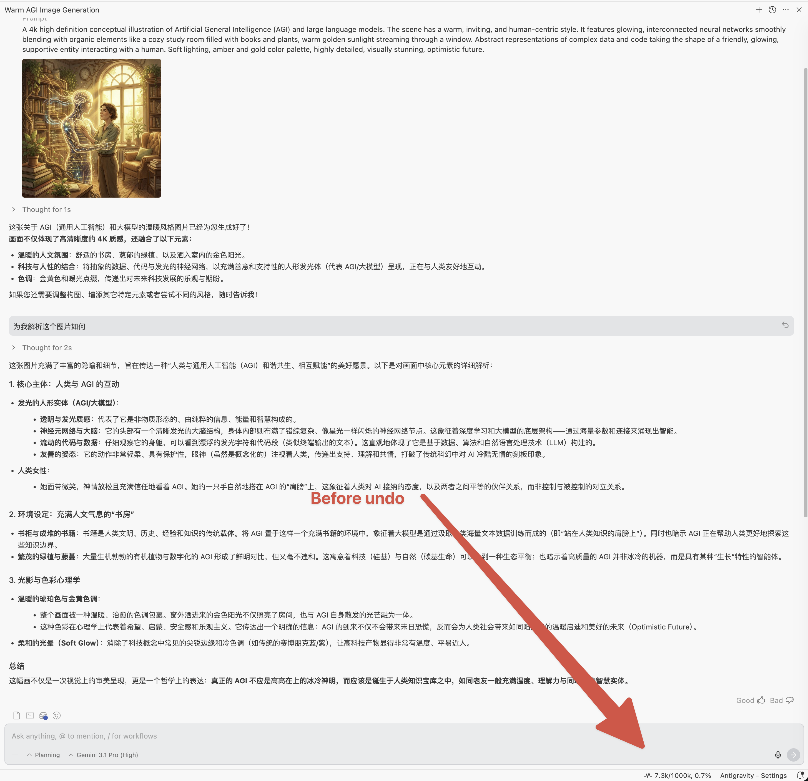 | 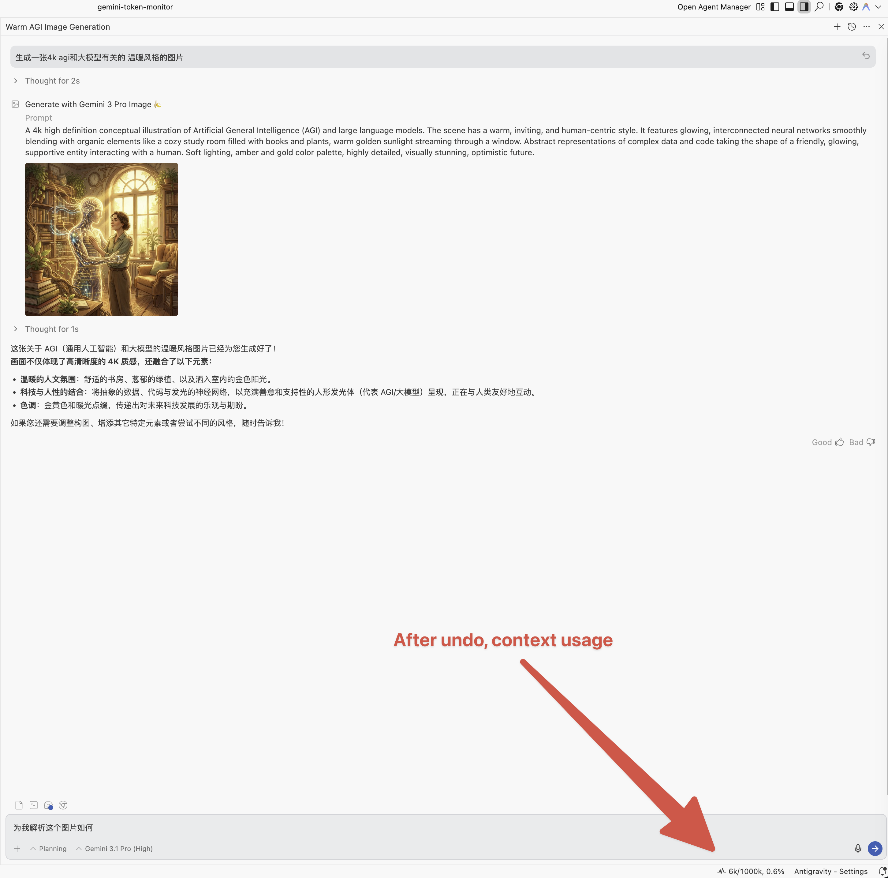 |

* **🔄 动态模型切换**
    对话中切换模型时，上下文窗口上限自动更新为当前模型的限制值。v1.4.0 起通过 `GetUserStatus` API 动态获取模型显示名称。

* **🎨 图片生成追踪**
    使用 Gemini Pro 对话中调用 Nano Banana Pro 生成图片时，相关 Token 消耗会被计入，tooltip 中以 `📷` 标记。检测逻辑基于 step type 和 generator model 名称匹配。

    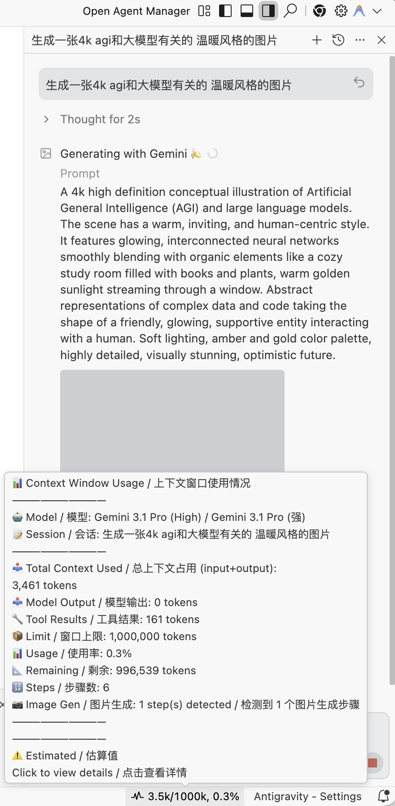

* **🛌 自动退避轮询**
    语言服务器不可用时，轮询间隔按 `baseInterval × 2^n` 递增，采用双上限策略：发现失败上限 15 秒（5s → 10s → 15s，快速检测 LS），RPC 失败上限 60 秒。重连后立即恢复正常间隔。

* **📊 WebView 监控面板** *(v1.10.1 新增)*
    点击状态栏打开侧边面板全景仪表盘。展示账户计划与等级、Prompt / Flow Credits（额度）余额、模型共享配额池（带颜色进度条）、功能开关、团队配置（MCP Servers、Auto-Run 等）、Google AI 额度。所有数据来自已有的 `GetUserStatus` API——零额外网络请求。
    * **🛡️ 隐私遮罩**：面板顶部盾牌按钮可遮罩姓名和邮箱，开关状态跨刷新持久化。
    * **📂 可折叠区域**：次要信息（计划限制、功能开关、团队配置、Google AI 额度）默认折叠，展开/收起状态持久化。

* **⚙️ 交互式设置仪表盘** *(v1.11.0 新增，持续增强至 v1.16.9)*
    设置页提供图形化界面，可直接配置轮询、低额度警告、状态栏内容、界面缩放和面板显示偏好。
    * **🟢 状态栏额度指示灯**：当前模型的配额百分比带彩色状态灯（`🟢`、`🟡`、`🔴`）直接显示在状态栏上。
    * **⏳ 当前模型重置倒计时**：状态栏倒计时现在跟随你当前正在使用的模型的重置时间，而不再是所有模型中最早的那个。
    * **🎛️ 状态栏显示开关**：独立开关控制「上下文用量」、「额度指示灯」、「重置倒计时」与「AI 积分余额」的显示/隐藏。
    * **⚡ 状态栏 AI 积分** *(v1.16.7)*：状态栏新增 AI 积分余额段（如 `⚡14,701`），使用 `||` 包裹格式（如 `|| ⚠ 121.2k/160k || 🟡40% || ⏳4h6m || ⚡14,701 ||`）。积分为零时自动隐藏。可在设置页通过 `statusBar.showAiCredits` 开关控制。
    * **📆 按账号独立到期日** *(v1.16.7)*：在个人页内联设置每个账号的月度积分到期日（1-31）。个人页、账号面板和状态栏 tooltip 都会显示「今日到期 / X 天后到期 / 到期日未设置」倒计时徽章。使用 durable JSON 持久化，卸载重装不丢失。采用 UTC 日历日差计算，跨夏令时也不会多算 1 天。
    * **⏸️ 暂停/恢复**：暂停自动刷新以冻结面板数据，方便排查问题。

* **🧠 模型活动监控** *(v1.11.2 新增，持续增强至 v1.16.4)*
    新增活动标签页，实时追踪 AI 推理调用、工具使用、Token 消耗和每模型耗时。通过主状态栏或 `Show Model Activity` 命令访问。
    * **🔧 工具名称显示** *(v1.11.3)*：时间线条目显示工具名称（如 `view_file`、`gh/search_issues`）和步骤序号标签。
    * **📚 工具目录清理** *(v1.16.4)*：GM 数据页提供可折叠工具目录、智能 chip tooltip，以及只清空目录、不影响工具排行计数的清理按钮。
    * **⚡ 独立 Activity 轮询** *(v1.11.3)*：Activity 追踪运行在独立的 3 秒轮询循环中，与全局 5 秒轮询解耦，更新更快。
    * **🎯 三层额度检测** *(v1.12.2)*：即时检测（周期内已用时间比较）、漂移检测（resetTime 观察）、额度检测（fraction 变化）。不再使用硬编码周期——自动适配任何额度周期。
    * **🔀 归档防抖合并** *(v1.12.2)*：不同配额池在 5 分钟内先后重置时自动合并为单条归档，避免碎片化。
    * **💾 数据持久化**：活动统计通过 `globalState` 跨 VS Code 重启保存，写入频率限制为每 30 秒一次。
    * **📋 自动归档**：模型额度重置时，当前活动自动归档到历史记录，带来源追踪（`triggeredBy`），生成每周期使用报告。
    * **📊 推算步数**：当对话超过 LS API 约 500 步获取窗口时，额外步数以推算方式记录，UI 上以 `📊` 标记明确区分。
    * **⚠️ 低额度通知**：当任意模型剩余额度低于可配置阈值（默认 20%）时弹出警告通知。

## 🤖 支持的模型

模型页依据当前登录账号的实时聊天 picker 和独立图片生成目录。注册表保留历史身份，但不会授予访问权限，也不会假定所有账号的模型列表相同。

### Orchestrator

Orchestrator（`M667` / `gemini-pro-orchestrator`）现已完整注册，包含冷启动/历史身份和上下文兜底。IDE 将 `M669` / `gemini-flash-worker-agy` 配置为执行模型；它是隐藏执行模型，不新增为可选聊天档位。模型信息展示中英文委派关系；协调和执行调用分别统计，工作流复用 executionId 时仍按步骤正确恢复时间、匹配调用，底层模型切换不误报压缩。两者的独立 API 价格尚未核实，价格保持未知并支持独立自定义，不直接套用 Carbon/Hydrogen 费率。

### 当前 IDE 模型元数据

2026-11-13 本地 `GetUserStatus` 与 `GetAvailableModels` 响应包含 **21 个聊天条目：20 个已知思考档位，以及 Orchestrator**。Orchestrator（`M667`）及其执行模型（`M669`）归入 Gemini 共享额度池，调用和计价身份仍独立保留。下表数值**由 IDE 报告**，不代表公开 API 的限额；“压缩上限”和“检查点阈值”是不同设置。

| 聊天模型 | 档位与内部 ID | 模型上下文 | 最大输出 | 压缩上限 | 检查点阈值 |
| --- | --- | ---: | ---: | ---: | ---: |
| Orchestrator | `M667` | 1,048,576 | 262,144 | 256,000 | 50,000 |
| Gemini 4 Hydrogen | Low / Medium / High / Extra：`M527` / `M526` / `M525` / `M528` | 1,048,576 | 262,144 | 256,000 | 50,000 |
| Gemini 4 Carbon | Low / Medium / High：`M438` / `M437` / `M427` | 1,048,576 | 262,144 | 256,000 | 50,000 |
| Gemini 4 Argon | Low / Medium / High：`M419` / `M418` / `M417` | 1,048,576 | 65,536 | 256,000 | 50,000 |
| Gemini 3.8 Flash | Low / Medium / High：`M320` / `M319` / `M318` | 1,048,576 | 65,536 | 256,000 | 50,000 |
| Claude Opus 5.5 | Low / Medium / High：`M400` / `M401` / `M402` | 1,000,000 | 128,000 | 256,000 | 50,000 |
| Claude Sonnet 5.5 | Low / Medium / High：`M403` / `M404` / `M405` | 1,000,000 | 128,000 | 256,000 | 50,000 |
| GPT-OSS 120B | Medium：`MODEL_OPENAI_GPT_OSS_120B_MEDIUM` | 131,072 | 32,768 | 80,000 | 50,000 |

`Mxxx` 是 `MODEL_PLACEHOLDER_Mxxx` 的简写；Hydrogen catalog ID 为 `gemini-4-hydrogen-{low,medium,high,xhigh}`；IDE 菜单中的 **Extra** 对应后端 **XHigh**，思考力度为 1 / 2 / 3 / **100**。报告的最小预算 32 不等于固定思考预算。Carbon 与 Argon catalog ID 分别为 `gemini-4-carbon-{low,medium,high}` 和 `gemini-4-argon-{low,medium,high}`。其余列出的 Gemini 档位使用 1 / 2 / 3 思考力度，不提供固定预算；Claude 为相应力度的自适应思考；GPT-OSS 报告 8,192 token 思考预算。返回的最小思考预算属于能力边界，不等于每次请求的固定预算。当前 Flash 3.8 三档不再沿用早期的动态/4,000/1,000 预算。实时参数优先于静态兜底；Hydrogen、Carbon、Argon、Flash 3.8、Claude 5.5 在 256,000 实时压缩上限到达前使用 255,000。

档位身份在中英文标签、上下文追踪、GM 数据和历史用量中保持独立；仅返回家族名不会抹掉已知档位。Hydrogen、Carbon、Argon 与 Flash 共用聊天 Gemini 配额池；显示代表依次优先当前模型、实时推荐模型和可用世代顺序，无当前或推荐模型时 Hydrogen 排在 Carbon、Argon 前。

`Gemini 4 CarbonHigh`、未配对括号及不支持的档位名称不会误套 Carbon 身份或家族价格。冲突的学习别名不能通过大写形式或中文标签覆盖已注册档位。

**模型配额**将 21 个可选聊天条目合并为两张共享池卡片：**Gemini** 包含 Hydrogen 四档、Carbon/Argon/Flash 各三档，再加 Orchestrator，共 14 个可选条目；**Claude / GPT** 包含 Opus、Sonnet、GPT-OSS，共七档。Orchestrator 列在 Gemini 池内，不伪造思考档位；隐藏执行模型不额外增加选择器行。每张卡片列出实际可用的模型家族和思考档位。配额不求和、不取平均：数据不一致时展示范围及逐模型明细，缺失数据明确标注。未知模型和图片生成身份与两个已知聊天池分开。**模型信息**、调用统计及计价仍独立保留每档身份。

### 图片生成模型

IDE 的 `imageGenerationModelIds` 列表独立于聊天 picker，明确提供 **Gemini 3.1 Flash Image（Nano Banana 2）**。

| 模型 | 内部 ID | Catalog ID | IDE 模型上下文 | IDE 最大输出 | 聊天压缩上限/阈值 |
| --- | --- | --- | ---: | ---: | --- |
| Gemini 3.1 Flash Image | `MODEL_PLACEHOLDER_M21` | `gemini-3.1-flash-image` | 65,536 | 65,536 | 不适用 |

模型页单独展示**图片生成模型**区域。生成图片的能力以明确的目录列表为准，不能由支持图片输入推断。IDE 没有为该条目报告聊天 checkpointer 或独立图片配额，因此不编造聊天压缩上限，也不套用共享聊天额度。目录未提供思考能力时显示 **IDE 未上报**，不把缺失信息认定为不支持。

[公开 Gemini API 模型文档](https://ai.google.dev/gemini-api/docs/models/gemini-3.1-flash-image) 的图片 API 输入/输出上限为 131,072 / 32,768，与已安装 IDE 的 65,536 / 65,536 不同。因此卡片使用**模型上下文**文案，并明确数据来源为 IDE。

监控器追踪当前工作流及关联子智能体中的图片生成步骤，设置遍历上限并处理重复/循环链接，同时保留父聊天模型与上下文；子智能体文本调用不会被当作图片模型 Token，缺失图片计费数据也不会被补成实测值。

### 历史兼容

旧 Gemini Flash/Pro、Claude 4.6，以及改号/退役的 placeholder 继续为仍提供这些模型的账号和历史记录保留注册。例如 Gemini 3.6 的 `M264` / `M265` / `M266` 仍可与当前 `M71` / `M72` / `M73` 一起解析；仅目录可见的 `M322` 和较旧 Flash 世代保留历史画像。可用模型由账号实时数据决定，不按订阅名或日期强制隐藏。

### API 等价计价

2026-11-13 核实的 [Gemini 4 Hydrogen Standard API 价格](https://aistudio.google.com/docs/pricing#gemini-4-hydrogen) 对四档均为**每百万 token 输入 $1.50 / 输出（含思考）$7.50 / 隐式缓存读取 $0.075**，不支持显式缓存。Hydrogen 使用独立固定参考费率，不沿用 Carbon/Argon 的优惠价或 12 月调价规则；自定义家族/档位覆盖保持优先。账号更改已知模型显示名仍保留已验证内置费率，显式自定义显示名价格继续优先。

内置 Google Standard API 的 [Gemini 4 Carbon 官方费率](https://aistudio.google.com/docs/pricing#gemini-4-carbon)（2026-11-11 核实）及 [Gemini 4 Argon 官方费率](https://ai.google.dev/gemini-api/docs/pricing#gemini-4-argon) 适用于三个思考档位，单位为美元/百万 token：

| 调用日期（UTC） | 输入 | 输出，含思考 | 隐式缓存读取 |
| --- | ---: | ---: | ---: |
| 截至 2026-11-30 | $2.00 | $10.00 | $0.10 |
| 自 2026-12-01 起 | $4.00 | $20.00 | $0.20 |

计价使用每次调用的 UTC 时间戳，因此跨过 12 月调价边界后，历史调用仍保留当时费率。已归档费用与自定义覆盖保持不变。Carbon 与 Argon 虽然公布费率相同，仍保留独立计价身份及家族/档位覆盖。两者仅支持隐式缓存，不添加显式缓存写入费。未知模型继续显示**价格待确认**，不视为免费。这些是 Standard API 参考估算，与 Antigravity 订阅收费和积分分开；不使用 Batch、Flex 或 Priority 价格。

图片生成的 [Google Standard API 参考费率](https://ai.google.dev/gemini-api/docs/pricing#gemini-3.1-flash-image) 为输入 $0.50/百万 token、文本/思考输出 $3/百万 token、图片输出 $60/百万 token。官方列出的图片输出等价费用为 512 px / 1K / 2K / 4K 各 $0.045 / $0.067 / $0.101 / $0.151。实际 IDE 生图测试未返回 M21 独立的 Token、积分或 GM 用量。因此成本页将已观测金额标为**未计入图片生成费的已知小计**，并提供官方参考链接，不把生图视为免费。详见[发布验收](docs/releases/1.16.19.md#验证)。

以下为 [Claude 5.5 官方 API 参考价格](https://platform.claude.com/docs/en/about-claude/pricing)，单位为美元/百万 token（2026-10-03）：

| 模型 | 输入 | 输出 | 缓存读取 | 缓存写入，5 分钟 | 缓存写入，1 小时 |
| --- | --- | --- | --- | --- | --- |
| Claude Opus 5.5 | $4 | $20 | $0.20 | $5 | $8 |
| Claude Sonnet 5.5 | $2 | $10 | $0.20 | $2.50 | $4 |

内置缓存写入参考费率为 **5 分钟**。当前费用估算不计缓存创建费，因为遥测不能可靠区分创建 token 及其存活时间（TTL）；1 小时缓存写入费用也不自动计入。已上报的缓存读取 token 会参与计价。这些费用只是本地 API 等价估算，不代表 Antigravity 订阅账单。

Gemini 3.8 Flash 与 3.7 Flash 使用相同的引入期定价：截至 2026-12-31，**每 1M 输入 token $0.75**、**每 1M 输出 token $3.75**；从 2027-01-01 起变为 $1.50 / $7.50。来源：[Google Antigravity 发布文](https://antigravity.google/blog/gemini-3-8-flash-in-google-antigravity)与 [Google 模型公告](https://blog.google/innovation-and-ai/models-and-research/gemini-models/3-8-flash-and-3-8-flash-cyber/)。

## 🚀 使用方法

1. **安装**:
   * **OpenVSX**: 直接从 [Open VSX Registry](https://open-vsx.org/extension/AGI-is-going-to-arrive/antigravity-context-monitor) 安装。
   * **手动安装**: 通过“扩展 → 从 VSIX 安装”安装 `antigravity-context-monitor-1.17.0.vsix`，随后重载窗口，并在扩展详情中确认版本 **1.17.0**。
2. **查看状态**: 右下角状态栏显示当前上下文使用情况；没有活跃对话时显示**无活跃会话**，不再沿用历史模型的旧上限。首次模型回复前即可从用户输入配置识别已选择的思考档位。
3. **悬停详情**: 将鼠标悬停在状态栏项上，查看详细信息（模型、输入/输出 Token、剩余容量、压缩状态、图片生成步骤、每模型配额摘要，以及最近 checkpoint 的影子模型标识等）。

   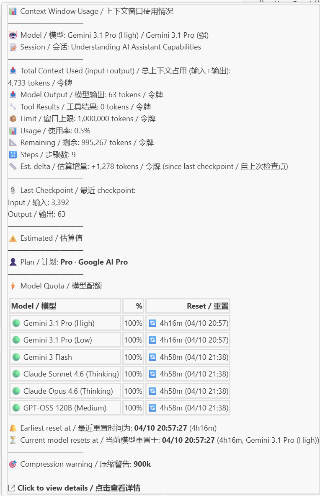

4. **点击查看 — WebView 监控面板**: 点击状态栏项，打开综合性 **8 标签页监控仪表盘**：

   **总览**（现位于 GM 数据标签页内）— 额度概览、GM 快照、成本快照、活跃会话详情（含输出分解和 LLM 调用明细）。

   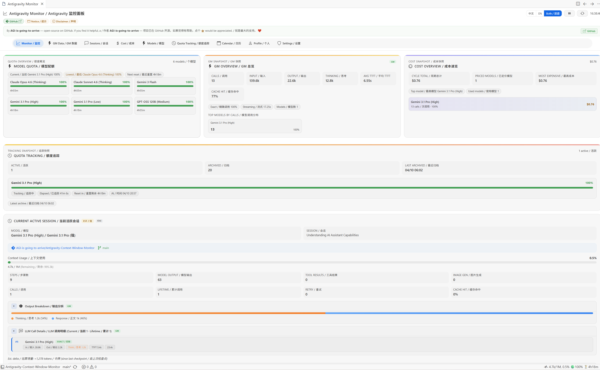

   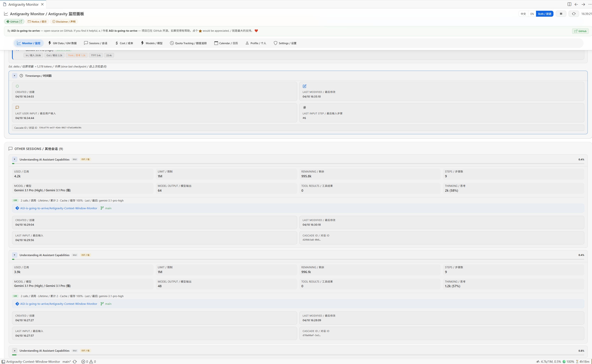

   **GM 数据 (GM Data)** — 每模型 Token 用量明细、调用次数、缓存命中率、重试统计、工具排行和可折叠工具目录。

   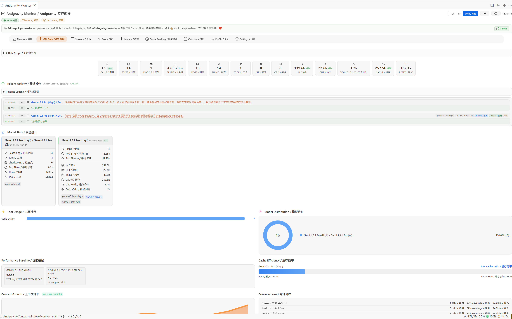

   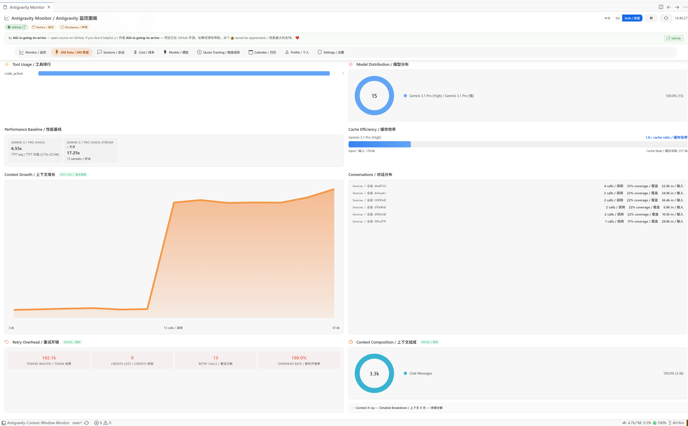

   **会话 (Sessions)** — 浏览所有对话会话，查看上下文用量、步骤数和模型信息。

   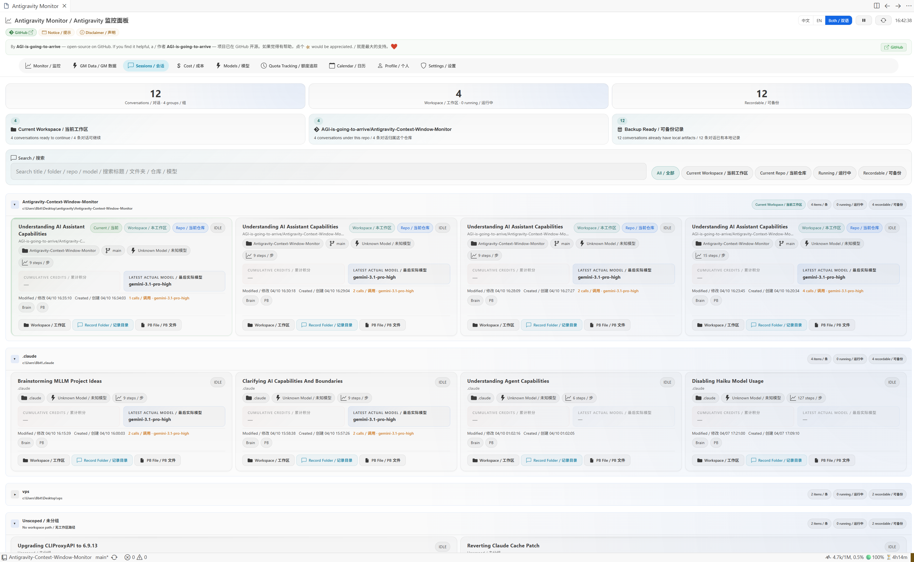

   **成本 (Cost)** — 月度成本分拆，按模型定价、成本概览可视化，以及覆盖已调用模型和内置默认价格模型的自定义价格编辑器。

   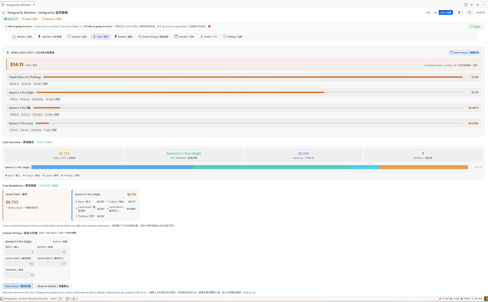

   **模型 (Models)** — Gemini 和 Claude / GPT 共享池卡片汇总额度/重置状态，列出实际可用的家族与档位；模型信息保留独立聊天档位与图片生成目录。信息卡片区分 IDE 报告的模型上下文、最大输出、压缩上限、检查点阈值和思考状态；图片压缩设置显示不适用。支持窄面板、亮色/暗色/高对比度主题和中文、英文、双语显示。

   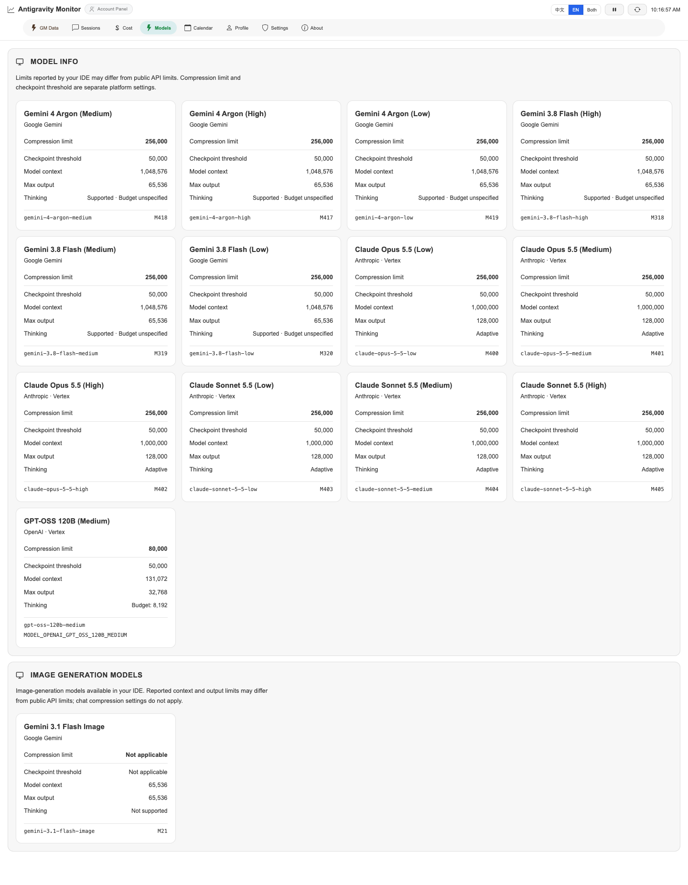

   截图中的 80% 配额为示例数据。

   **日历 (Calendar)** — 按日期组织的历史使用数据，包含每周期成本和 Token 分解。

   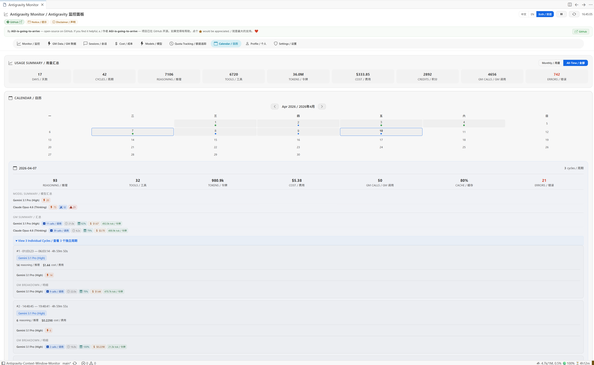

   **个人 (Profile)** — 账户信息、计划详情和额度余额。

   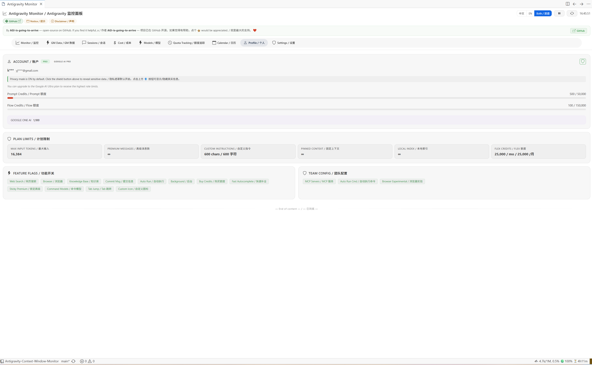

   **设置 (Settings)** — 配置扩展行为：低额度警告阈值、状态栏开关、轮询间隔等。

   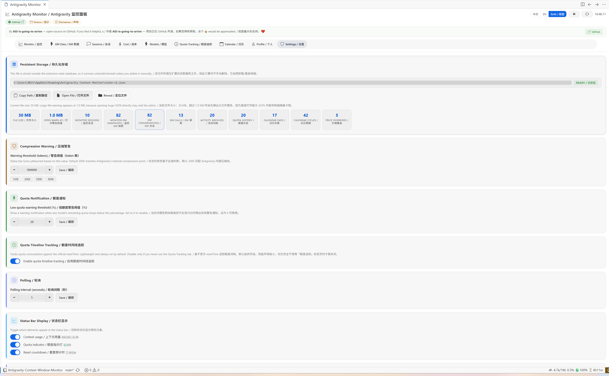

   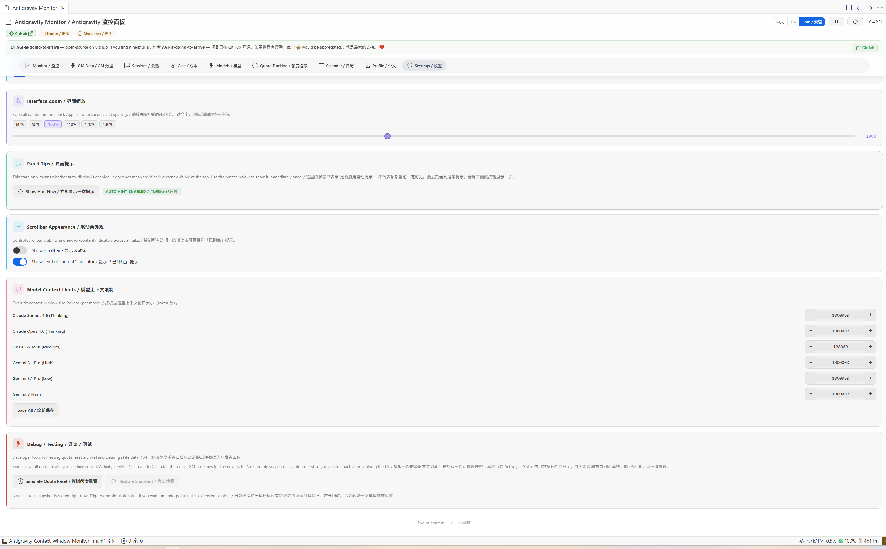

## ⚠️ 已知限制

> [!IMPORTANT]
> **同一工作区多窗口**
> 如果在**同一个文件夹**上打开多个 Antigravity 窗口，它们共享相同的 workspace URI，会话数据可能会混合。
>
> **解决方法**: 不同窗口打开不同的文件夹。

> [!NOTE]
> **上下文压缩提示**
> 压缩完成通知（🗜 图标）持续约 15 秒（3 个轮询周期）后恢复正常显示。

> [!IMPORTANT]
> **Antigravity 内部总结机制**
> Antigravity IDE 对检查点总结有一个硬编码的 7500 token "总结阈值" (Summarization Threshold)。这意味着当对话非常长且跨过该阈值后，Token 计数可能会出现轻微偏差。更多细节请参考 [Reddit 社区讨论](https://www.reddit.com/r/google_antigravity/comments/1q7zcag/heres_how_to_find_which_mcp_tools_are_leading_to/)。

> [!NOTE]
> **子智能体动态切换**
> 使用 Claude 模型时，Antigravity 可能会调用轻量子智能体模型处理小任务——平台把该模型标注为 **Gemini Flash Lite**（`MODEL_PLACEHOLDER_M50`；显示名称以 IDE 目录为准）。子智能体切换不会改变显示的上下文上限，因为本扩展跟踪的是你所选模型的上限。Claude 5.5 的IDE 报告的模型上下文为 1,000,000 token、平台压缩上限为 256,000 token（2026-10-03 核实）；保留的 Claude 4.6 画像分别为 250,000 和 160,000，子智能体模型使用 128,000 画像。

> [!IMPORTANT]
> **当前 Antigravity IDE 的 "LS not found"**
> 新版 IDE 使用 `agy --hub` 后端，不再运行名为 `language_server_*` 的进程。监控器自 1.16.19 起兼容两种架构，支持 `--csrf_token=value` 和空格分隔参数，先检查声明的 hub 端口，再使用平台套接字发现。安装 `antigravity-context-monitor-1.17.0.vsix` 后重载窗口。后端已连接但没有已加载对话时显示**无活跃会话**，不是发现失败；IDE 中仍可能保存着历史对话。未打开文件夹也不代表后端不可用。
>
> **Windows 发现诊断**
> 若状态栏卡在 `LS not found`，请打开 **Output → "Antigravity Context Monitor"**，查看 `PATH check:` 那一行——扩展现在会记录究竟是哪一步发现失败。自 v1.16.13 起，扩展以 `%SystemRoot%` 绝对路径调用 `wmic`/`powershell.exe`/`netstat`，因此 Extension Host 的 `PATH` 被裁剪（例如 Win11 24H2+ 移除 WMIC 后缺少 `System32\wbem`）不再导致发现失败。
> 自 v1.16.16 起另有两个成因被处理（issue #64，由 @SecretLUL 报告）：Windows 会本地化 `netstat` 的 State 列，德文安装上 `LISTENING` 显示为 `ABHÖREN`，此前所有候选行都会被拒绝；以及监听在全部网卡而非仅环回上的语言服务器，此前完全取不出端口。两者均已修复；若扩展宿主本身运行在 WSL 内部，现在会优先在该发行版中查找语言服务器。
> **请勿以管理员身份运行 Antigravity** —— 这对检测毫无帮助（LS 发现无需提权），还可能导致 IDE 启动崩溃并报 `The window terminated unexpectedly (reason: 'launch-failed', code: '18')`；该崩溃属于 Electron/Chromium 沙箱问题，与本扩展无关。

## ⚙️ 设置

| 设置项 | 默认 | 说明 |
| --- | --- | --- |
| `pollingInterval` | 5 | 轮询频率（秒） |
| `statusBar.showContext` | true | 状态栏显示上下文用量（如 `45k/1M, 4.5%`） |
| `statusBar.showQuota` | true | 状态栏显示当前模型额度指示灯（如 `🟢85%`） |
| `statusBar.showResetCountdown` | true | 状态栏显示重置倒计时（如 `⏳4h32m`） |
| `quotaNotificationThreshold` | 20 | 模型剩余额度低于此百分比时弹出警告（设为 0 可禁用） |
| `activity.maxRecentSteps` | 100 | 活动时间线最多保留的操作条数 |
| `activity.maxArchives` | 20 | 活动归档最多保留份数 |

## 🔤 命令

| 命令 | 说明 |
| --- | --- |
| `Show Context Window Details` | 打开 QuickPick 面板显示所有被追踪的会话 |
| `Refresh Context Window Monitor` | 重新发现语言服务器并重启轮询 |
| `Switch Display Language` | 选择仅中文、仅英文或双语显示模式 |
| `Show Model Activity` | 打开监控面板的 GM 数据标签页 |

## ⭐ Star History / Star 趋势

## 🔗 友情链接

- [LINUX DO](https://linux.do/)

---
**作者**: AGI-is-going-to-arrive
**版本 / Version**: 1.17.0 — [发布说明](docs/releases/1.17.0.md)
