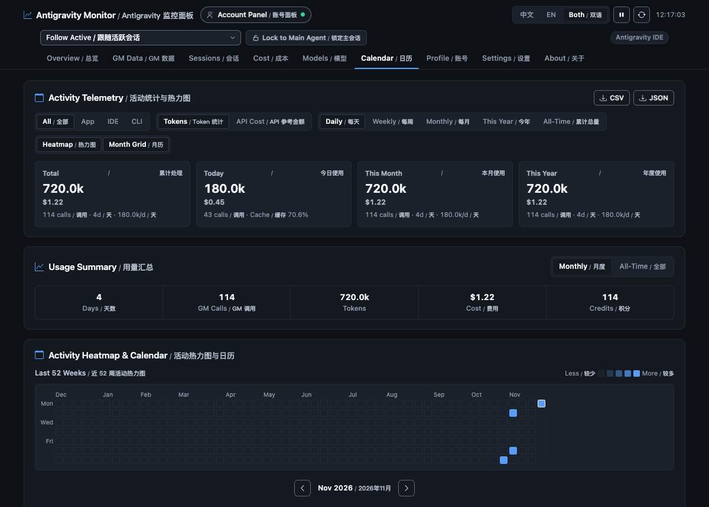
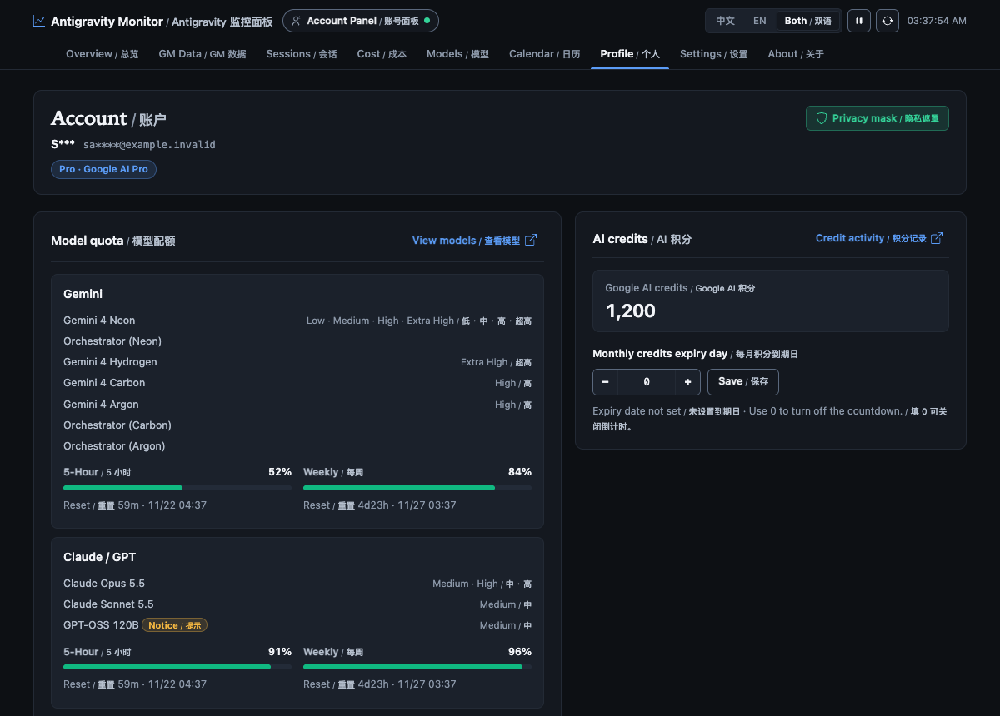
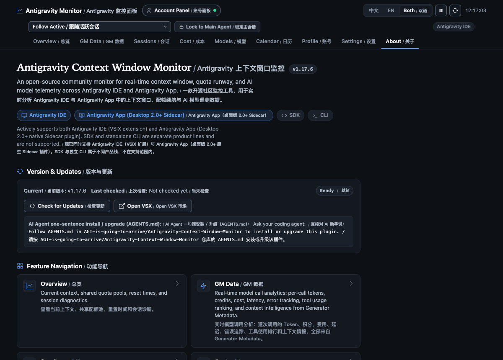

# Antigravity 上下文窗口监控

在 **Antigravity App（桌面版 2.0+ 原生 Sidecar 插件）** 与 **Antigravity IDE（VSIX 扩展）** 中实时监控会话上下文构成、Orchestrator 编排与执行路由、带续航预测的双窗口模型配额（`5h` + `周`）、模型生成速度（`tok/s`）、首字延迟与逐轮提示词缓存诊断、API 等价费用（美元 USD）、重置时间和 AI 积分。

**1.17.5** 正式推出原生 **Antigravity App（2.0+ Sidecar 插件）** 支持（`AUX_PANE` 侧边面板 + `SIDEBAR` 宽屏视图 + 配套 `SKILL.md`，依托内置 Node 零外部运行时依赖、零 LLM 工具 schema token 开销、零 `app.asar` 魔改与零 CDP 注入），并新增**上下文构成明细**（条形 ↔ 20×5 点阵视图、双上限有效预算 vs 原生上限、Top 5 最大占用项及一键复制 `/context` 报告与交接提示词）、**顶部会话切换器与锁定主会话**、**逐轮提示词缓存诊断**（`冷启动`/`部分命中`/`热缓存` + `+Δ` 净增长）、**配额消耗速率续航预测**、**断连缓存保底**、`custom-*` 模型配额隔离以及 **App + IDE 并发原子锁持久化**。

[English](README.md) · [1.17.5 发布说明与验证](docs/releases/1.17.5.md#中文) · [技术实现](docs/technical_implementation.md) · [项目结构](docs/project_structure.md) · [变更日志](CHANGELOG.md)

## 1.17.5 核心更新

- **原生 Antigravity App（2.0+ Sidecar 插件）：** 作为官方插件体系内的原生 Sidecar 运行于 Antigravity 桌面版 2.0+，同时提供紧凑侧边栏（`AUX_PANE`，`/`）与全宽主仪表盘（`SIDEBAR`，`/full`）双入口，并附带 `context-monitor` 配套 `SKILL.md`（对话中一键点击 `sidecar://antigravity-context-monitor/context_monitor/` 唤起）。直接运行于 Antigravity App 内置 Node（`v24.22.0`），**零外部 npm 运行时依赖**、**零 LLM 工具 schema token 占用**、**无需修改 `app.asar` 或开启 CDP**；通过 `src/app/theme-adapter.ts` 自动适配宿主浅色 / 深色 / 高对比度（`hc` 与 `hc-light`）主题，结合可见性门控 ETag 增量轮询（`/api/snapshot`）与零 `vscode` 依赖的共享文档引擎 `src/webview-document.ts`，在 App 与 IDE 双端呈现完整 9 页功能对等体验。
- **上下文构成明细与双上限清晰标注：** 按语义类别（`系统提示`、`规则/技能`、`插件/MCP`、`子智能体`、`用户输入`、`模型回复与思考`、`工具调用`、`媒体/文件`、`其他`）拆解当前会话上下文占用，提供交互式**条形视图 ↔ 20×5（100 格）点阵视图**切换与分类联动高亮、**双上限（Dual-Cap）**对比条（有效自动压缩预算 vs 模型原生上限）、诚实测量状态徽章（**实测**、**估算（压缩后）**、**估算（回退重算）**、**等待生成**）、压缩检查点节省量标签、可折叠 **Top 5 最大占用项**，以及一键**复制 `/context` 报告**与**复制交接提示词**快捷按钮。
- **顶部会话切换器与锁定主会话：** 在 App 与 IDE 双端页首新增紧凑**上下文控制条（Masthead Context Bar）**，支持**跟随活跃会话**或手动固定任意对话、一键切换**锁定主会话（Lock to Main Agent）**（防止后台并发子智能体抢占当前上下文视图），并直观标识运行端（`Antigravity App` / `Antigravity IDE`）与缓存保底状态。
- **逐轮提示词缓存诊断（`GM 数据`）：** 对比展示**最近一轮**与按 token 加权的**会话累计缓存命中率**，按命中区间标记**冷启动（`<10%`）**、**部分命中（`10%–<70%`）**、**热缓存启动（`≥70%`）**徽章，并在最近调用明细表中呈现逐轮 **`+Δ` 上下文净增长**及压缩/回退骤降标记。
- **配额续航预测、断连缓存保底与 `custom-*` 模型隔离：** 基于 45 分钟滚动窗口与抖动过滤计算各配额池消耗速率及续航状态（`重置前充裕`、`预计耗尽 ...`、`配额已耗尽`、`配额刚恢复`）；本地 RPC 瞬时波动时自动保留上次成功拉取的数据并显示带时间戳的**缓存数据（待刷新）**横幅；检测到 `custom-*` / BYOK / 本地自定义模型时自动折叠并静音无关的 Google 配额池预警。
- **App + IDE 并发原子锁持久化、跨平台发现与无障碍加固：** 为共享外部存储 `state-v1.json`（`DurableState`）引入跨平台原子 `O_CREAT | O_EXCL` 互斥锁（`state-v1.json.lock`，含过期锁回收、三方字段/账号快照合并及 Windows NTFS `EPERM`/`EACCES`/`EBUSY` 争用重试），确保 Antigravity App 与 Antigravity IDE 同时运行时历史与设置互不覆盖；统一 App + IDE 本地后端发现（`ANTIGRAVITY_LS_ADDRESS`、按端分类的 `daemon/hub_<port>.json`、Linux `/proc/<pid>` 兜底与 macOS/Windows/WSL 加固）；抽离纯 Node 零 `vscode` 依赖的 `i18n-core.ts`；通过 **WCAG 2.1 AA 零违规验收**（App Sidecar 432/432 全矩阵 0 违规、已安装 IDE 739/739 全通过）。
- **完整保留 v1.17.4 与 v1.17.3 核心能力：** 零闪烁三层状态栏悬停摘要、次要端口 TLS 优先探测与严格 RFC 3339 纪元零值重置处理、实时自定义 **Orchestrator 设置**、双窗口配额（`5 小时` + `每周`）、经核实的官方美元计费表（Gemini 4 Neon `$3/$15/$0.15`、Claude Sonnet 5.5 缓存读 `$0.10`、官方定时调价横幅）与 `P0`–`P5` 分层悬停摘要。

## 安装

### 方式一 — Antigravity App（桌面版 2.0+ 原生 Sidecar 插件）

支持 **macOS、Windows、Linux**，零外部依赖（直接运行于 Antigravity App 内置 Node 运行时）。

1. **从 GitHub Releases 下载安装（推荐）：** 前往 [GitHub Releases](https://github.com/AGI-is-going-to-arrive/Antigravity-Context-Window-Monitor/releases) 下载 `antigravity-context-monitor-app-1.17.5.zip`（macOS / Windows / Linux）或 `antigravity-context-monitor-app-1.17.5.tar.gz`（macOS / Linux）。
   - **通过 `agy` CLI 安装（全平台）：** 解压压缩包（得到 `antigravity-context-monitor/` 目录），执行：
     ```bash
     agy plugin install ./antigravity-context-monitor
     ```
   - **或直接解压至 Antigravity 插件目录：**
     - **macOS / Linux：** 解压至 `~/.gemini/config/plugins/`（确保 `plugin.json` 位于 `~/.gemini/config/plugins/antigravity-context-monitor/plugin.json`）。
     - **Windows（PowerShell）：**
       ```powershell
       Expand-Archive -Path .\antigravity-context-monitor-app-1.17.5.zip -DestinationPath "$env:USERPROFILE\.gemini\config\plugins" -Force
       ```
2. **或从源码仓库本地构建安装（跨平台安装脚本）：**
   - 先编译打包：
     ```bash
     npm run compile && node scripts/package-app-plugin.mjs
     ```
   - 执行安装（当系统 `PATH` 未安装 Node 时，Shell/PowerShell 包装脚本会自动回退使用 Antigravity 内置 `agy-node`）：
     - **全平台（Node）：** `node scripts/install-app-plugin.mjs --install`
     - **macOS / Linux：** `./scripts/install-app-plugin.sh --install`
     - **Windows（PowerShell）：** `.\scripts\install-app-plugin.ps1 --install`
     - *（传入 `--uninstall` 可一键卸载，`--dry-run` 可预览操作。）*
3. **在 Antigravity App 中启用并打开：**
   - 打开 **Customizations → Installed**（或访问 `customization://antigravity-context-monitor`），确认 **Antigravity Context Monitor** 及其 **Context Monitor** Sidecar 处于启用状态。*（覆盖升级旧版本后，请在自定义页面关闭再重新开启插件，或重启 Antigravity App 以加载新版本运行时。）*
   - 可通过侧边栏 **`+`** 菜单（`AUX_PANE` 紧凑面板）、左侧导航 **Plugins → Context Monitor**（`SIDEBAR` 全宽仪表盘），或在对话中让智能体打开上下文监控（`sidecar://antigravity-context-monitor/context_monitor/`）。

### 方式二 — Antigravity IDE（VSIX 扩展）

1. 从 [GitHub Releases](https://github.com/AGI-is-going-to-arrive/Antigravity-Context-Window-Monitor/releases) 下载 `antigravity-context-monitor-1.17.5.vsix`，或运行 `npm run package` 在本地打包。
2. 在 Antigravity IDE 中打开命令面板（macOS：`Cmd+Shift+P`，Windows / Linux：`Ctrl+Shift+P`），执行 **Extensions: Install from VSIX...** 并选择该文件；或通过命令行安装：
   ```bash
   antigravity-ide --install-extension antigravity-context-monitor-1.17.5.vsix --force
   ```
3. 重载窗口，在扩展详情或监控器的**关于**页确认版本为 **1.17.5**。

IDE 扩展也可以通过 [Open VSX](https://open-vsx.org/extension/AGI-is-going-to-arrive/antigravity-context-monitor) 安装注册表已发布版本。

双端插件均支持 **macOS、Windows、Linux**（IDE 另支持 **WSL**）。1.17.5 原生实机验收在 macOS（Antigravity App v2.34.0 + Antigravity IDE v2.7.0）完成，Windows 与 Linux 平台分支由自动化单元与模拟回归测试覆盖，详见发布说明。[验证](docs/releases/1.17.5.md#验证)

## 使用监控器

- **在 Antigravity App 中：** 在对话旁打开紧凑 **`AUX_PANE`** 或从左侧栏打开全宽 **`SIDEBAR`** 仪表盘。通过顶部上下文控制条切换或固定会话、在多智能体并发时启用**锁定主会话**、一键切换**条形视图 ↔ 20×5 点阵视图**、展开 **Top 5 最大占用项**，或一键**复制 `/context` 报告**与**复制交接提示词**。浅色 / 深色 / 高对比度主题自动跟随宿主切换，面板隐藏时自动暂停轮询零空耗。
- **在 Antigravity IDE 中悬停右下角状态栏监控项：** 查看当前会话与模型（或跨池 **编排 `规划 → 执行`** 路由）、上下文进度条与已用/剩余 tokens、**最近一次调用**明细（输入/输出/思考、缓存命中率、费用、首字/总耗时与去噪生成速度）、**会话与今日费用**（含缓存节省与等效混合输入单价）、**编排拆分**、带规划/执行角色标注的**双窗口（`5h` + `周`）共享配额**、事件驱动提醒（调价倒计时、模型下线提示、重试损耗与 AI 积分），以及一键直达**总览**、**活动**、**费用**、**模型**、**设置**与**刷新**的快捷链接。可在设置中切换**自动**、**精简**或**完整**密度，并按需开启状态栏**生成速度（`tok/s`）**、**提示词缓存命中率（`%`）**或**当前会话费用**常驻显示（无实时数据时自动隐藏）。
- **点击状态栏监控项（IDE）或打开监控面板（App）：** 浏览完整 9 个功能页。页首吸顶控件支持打开多账号快照（**账号面板**）、即时切换中文 / 英文 / 双语、暂停自动轮询或手动刷新。
- **展开会话诊断与最大占用项：** 查看提供商上报的 Token 计数、自动压缩检查点、占用最高的上下文条目与图片生成活动。监控器明确区分实测值与压缩后/回退估算值，在流式响应时原地更新读数，并在回退或切换模型后重新计算上下文。

## 监控页面

面板在 `320px` 窄侧边栏（`AUX_PANE` / 窄分屏）至 `1440px` 宽仪表盘（`SIDEBAR` / 宽编辑区）之间自适应排版，自动跟随浅色、深色与高对比度（`hc` 与 `hc-light`）主题，并通过 **WCAG 2.1 AA 零违规**验证。下方截图使用示例数据，展示双语模式下的 **Obsidian Slate 深色**主题。

### 总览

查看当前会话、**顶部上下文控制条**（会话切换器、锁定主会话、运行端与缓存保底徽章）、活跃**编排 `规划 → 执行`**跨池路由标签、上下文已用与可用余量、**上下文构成**卡片（条形 ↔ 20×5 点阵视图、双上限有效预算 vs 原生上限、测量状态徽章、压缩节省量、可折叠 Top 5 最大占用项及复制 `/context` 报告 / 交接提示词按钮）、内嵌 4–5 格 L2 遥测条（生成速度 `tok/s`、自适应 TTFT、按 token 加权的缓存命中率、缓存节省及以美元展示的会话/今日费用）、可折叠会话诊断、带**配额续航预测**徽章（或 `custom-*` 自定义模型隔离提示）的**双窗口（`5h` + `周`）**共享配额池，以及底部 AI 积分摘要。


<details>
<summary>GM 数据 — 速度、TTFT、逐轮缓存诊断、最近调用明细与时间线</summary>

按模型和会话实时分析 Generator Metadata，包含按账号过滤的顶部 KPI 概览、双列**生成速度与首字缓存账本**（加权/最新/中位/可见 `tok/s`、**缓存 vs 非缓存 TTFT** 对比条、3 段式提示词缓存进度条，以及**最近一轮 vs 会话累计缓存命中率**对比与**冷启动 / 部分命中 / 热缓存**状态徽章）、可折叠**最近调用明细**（最新 20 次调用：时间、实际模型、新鲜输入、`+Δ` 上下文净增长与压缩骤降标识、输出与思考占比、缓存命中率、费用/未定价、首字耗时、总耗时、去噪速度与状态）、统一逐模型统计卡片、逐步骤与逐轮次时间线遥测标签、当日账本、工具调用排行、上下文增长趋势及错误详情。


</details>

<details>
<summary>会话 — 可搜索的对话记录</summary>

按工作区分组浏览会话上下文与历史记录，支持按当前工作区、仓库、运行状态或可备份状态筛选，并一键定位本地工作区、Brain 记录目录或 `.pb` 原始文件。


</details>

<details>
<summary>成本 — 美元估算、官方调价提醒与自定义 API 费率</summary>

以美元（USD）查看月度与当日费用估算、汇总与逐模型缓存节省、思考费用占比、四分项成本分布堆叠条（输入 / 输出 / 缓存 / 思考），以及**官方定时调价提醒**横幅（Carbon/Argon `2026-12-01`、Flash `2027-01-01`）。支持按每百万 tokens 自定义家族或单模型费率；尚未核实价格的用量明确标注为未定价，绝不伪造 `$0.00`。


</details>

<details>
<summary>模型 — Orchestrator 编排设置、双窗口配额池、续航预测与模型参数</summary>

查看实时 **Orchestrator 编排设置**（`编排模型` + `执行模型`、默认/自定义状态与跨池角色标记）、当前默认模型、合并后的 Gemini 与 Claude / GPT **双窗口（`5h` + `周`）**共享配额池及**消耗速率续航**徽章、重置计划、可用模型家族与思考档位（`低` / `中` / `高` / `超高`）、规格卡片内置 API 参考价格、`Notice` 下线标签（如 GPT-OSS 120B），以及后端上报的详细模型参数。聊天目录与图片生成目录独立展示。


</details>

<details>
<summary>日历 — 每日用量、美元汇总、归档速度/TTFT/缓存与周期归档</summary>

在**月度**与**全部**统计间一键切换，通过 7 列交互月历浏览每日活跃标记与美元费用标签，展开任意日期即可查看逐模型统计、归档生成速度（`tok/s`）、自适应 TTFT、按 token 加权的提示词缓存命中率与归档周期。



</details>

<details>
<summary>个人 — 计划、双窗口共享配额、AI 积分与账号设置</summary>

查看账号身份（默认开启隐私遮罩，可一键切换）、当前订阅计划、**双窗口（`5h` + `周`）**模型共享配额池、琥珀色下线模型 `Notice` 提醒标签、Google AI 积分（缺失时标注**未上报**）、按账号配置的每月积分到期日，以及可折叠的计划限制、功能开关与团队配置。



</details>

<details>
<summary>设置 — 持久化存储、轮询、状态栏与双端适配</summary>

查看共享外部持久化存储状态与路径（`state-v1.json`，支持 App 与 IDE 并发原子锁同步），配置低配额提醒阈值、轮询间隔、七项 IDE 状态栏开关（含可选开启的生成速度 `tok/s`、提示词缓存命中率 `%` 与带 `$0.27` 美元预览的**当前会话费用**——在 Antigravity App 中清晰标注为仅 IDE 生效）、悬停摘要密度（`auto` / `compact` / `full`）、内部模型 ID 显示、界面缩放比例，以及滚动条和页底提示偏好。


</details>

<details>
<summary>关于 — 版本、双端兼容性与功能导航</summary>

确认已安装版本（`v1.17.5`，从清单动态读取）、双端官方支持标识（**Antigravity IDE** + **Antigravity App（桌面版 2.0+ Sidecar）**）与 512K 上下文兼容性范围，通过双列功能导航卡片直达各个监控页面，并查阅开源仓库与兼容性说明。



</details>

## 模型、上下文与计价

- 可用模型以当前登录账号的实时目录为准。状态栏悬停摘要与**总览**按基础模型家族合并统计已核实的思考档位；**模型**规格、**GM 数据**与**成本**账本保留每个档位的独立 ID。
- **Orchestrator 与 Gemini 4 家族：** 全部 **Gemini 4** 家族（**Neon**、**Hydrogen**、**Carbon**、**Argon**）与 **Orchestrator** 模型（`M537`、`M667`、`M681`、`M669`）均采用统一的 **512,000 tokens** 实时检查点上限（模型上下文 `1,048,576`、最大输出 `262,144`）。**Gemini 4 Neon** 与 **Gemini 4 Hydrogen** 均提供 `低` / `中` / `高` / `超高` 四档思考力度。在**自定义编排模式**下，任意合格编排模型（含 **Claude Opus 5.5** 与 **Gemini 4 Neon**）均可与任意合格执行模型（如 **Gemini 4 Hydrogen** 或 **Claude Sonnet 5.5**）自由组合，各阶段按实际调用模型独立计价并跨配额池追踪。
- **内置官方 API 等价参考费率（美元 / 百万 tokens，2026-11-22 核实）：**

| 模型家族 | 输入 | 输出 / 思考 | 缓存读取 | 缓存写入 | 说明 / 调价排期 |
| --- | ---: | ---: | ---: | ---: | --- |
| **Gemini 4 Neon**（低–超高） | `$3.00` | `$15.00` | `$0.15` | `$0` | 全 1M 上下文统一费率；隐式缓存读取 |
| **Gemini 4 Hydrogen**（低–超高、`M530`/`M531`） | `$1.50` | `$7.50` | `$0.075` | `$0` | 全 1M 上下文统一费率；`M578` Sonar 未定价 |
| **Gemini 4 Carbon / Argon** | `$2.00` → `$4.00` | `$10.00` → `$20.00` | `$0.10` → `$0.20` | `$0` | 优惠价将于 `2026-12-01` UTC 结束（`2×` 标准价） |
| **Claude Opus 5.5**（低–高） | `$4.00` | `$20.00` | `$0.20` | `$5.00` | 5 分钟 TTL 缓存写入费率 |
| **Claude Sonnet 5.5**（低–高） | `$2.00` | `$10.00` | `$0.10` | `$2.50` | 已修正缓存读取费率（`$0.10`）；5 分钟 TTL 写入 |
| **Gemini 3.8 / 3.7 / 3.6 Flash** | `$0.75` → `$1.50` | `$3.75` → `$7.50` | `$0.075` → `$0.15` | `$0.9375` → `$1.875` | 优惠价将于 `2027-01-01` UTC 结束（3.6 区间自 `2026-08-13` 起） |
| **GPT-OSS 120B (Medium)** | `$0.09` | `$0.36` | `$0` | `$0` | 当后端上报下线通知时显示 `Notice` 标签 |
| **旧版编排与图片模型**（`M537`/`M667`/`M681`/`M669`/`M578`/`M21`） | 未定价 | 未定价 | 未定价 | 未定价 | 绝不伪造 `$0.00`；可在**成本**页设置自定义价格 |

- 上下文读数优先采用当前 planner 响应或 checkpoint 中模型提供商报告的新输入、缓存读取、缓存创建与输出。缺少时间戳的历史定时调价模型调用会诚实保留为未定价，不以当前日期伪造费率。订阅 AI 积分独立展示（缺失时显示**未上报**而非 `0`）。[模型与计价说明](docs/technical_implementation.md)

## 命令与设置

### Antigravity IDE 命令与设置

| 命令 | 用途 |
| --- | --- |
| **Show Context Window Details** | 打开总览（同时支持悬停快捷直达 `gmdata`、`pricing`、`models`、`settings`） |
| **Refresh Context Window Monitor** | 重新连接后端并重启轮询 |
| **Switch Display Language** | 选择英文、中文或双语显示 |
| **Show Model Activity** | 打开 GM 数据 |

IDE 设置项使用 `antigravityContextMonitor.` 前缀（共 13 项）：

| 设置项 | 默认值 | 用途 |
| --- | --- | --- |
| `pollingInterval` | `5` | 设置轮询间隔，单位为秒 |
| `statusBar.showContext` | `true` | 在状态栏显示上下文用量 |
| `statusBar.showQuota` | `true` | 显示当前模型的剩余配额百分比 |
| `statusBar.showResetCountdown` | `true` | 显示当前模型的配额重置倒计时 |
| `statusBar.showAiCredits` | `true` | 在状态栏显示 AI 积分余额（未上报时隐藏） |
| `statusBar.showSpeed` | `false` | 在状态栏显示最新或加权平均模型生成速度（`tok/s`，无有效耗时样本时自动隐藏） |
| `statusBar.showCacheHit` | `false` | 在状态栏显示按 token 加权的提示词缓存命中率（`%`，无提示词数据时自动隐藏） |
| `statusBar.showSessionCost` | `false` | 在状态栏显示当前会话估算的 API 等价美元费用（费用为 0 或未定价时自动隐藏） |
| `statusBar.tooltipDensity` | `auto` | 选择 `auto`（自动）、`compact`（精简）或 `full`（完整）悬停摘要密度 |
| `quotaNotificationThreshold` | `20` | 低于该配额百分比时提醒，设为 `0` 可禁用 |
| `showModelInternalId` | `false` | 在模型名旁显示内部 ID |
| `activity.maxRecentSteps` | `100` | 限制持久化保留的近期活动时间线条数 |
| `activity.maxArchives` | `20` | 限制保留的活动归档数量 |

### Antigravity App Sidecar 视图与接口

| 入口 / 路径 | 用途 |
| --- | --- |
| `AUX_PANE`（`/`） | 紧凑侧边栏视图，从侧边面板 `+` 菜单或 `sidecar://antigravity-context-monitor/context_monitor/` 打开 |
| `SIDEBAR`（`/full`） | 全宽仪表盘视图，从左侧栏 **Plugins → Context Monitor** 打开 |
| `/api/health`、`/api/snapshot`、`/api/action` | 本地回环健康检查、可见性门控 ETag 快照接口与交互动作分发（轮询间隔、语言、低配额阈值、自定义费率、缩放、会话固定与锁定主会话均直接持久化至共享 `state-v1.json`） |

## 排障与限制

- **无活跃会话**表示后端已连接，当前视图尚无已加载对话。打开任意对话（或在顶部会话切换器中指定会话）即可读取上下文。同一工作区的窗口可能共享会话数据，需要独立观察时请打开不同文件夹。
- **同时运行 Antigravity App 与 Antigravity IDE：** 双端自动按运行端隔离各自的本地后端（`preferredSurface: 'app'` 与 `'ide'`）零串扰，并通过原子 `O_CREAT | O_EXCL` 文件锁与三方合并安全共享 `state-v1.json` 历史记录。
- **升级 Antigravity App 插件：** 覆盖安装新版本后，请在 **Customizations → Installed** 中将 **Antigravity Context Monitor** 关闭再重新开启（或重启 Antigravity App），以便正在运行的 Sidecar 进程重载至新版本，并在**关于**页或 `/api/health` 核对版本号。
- **后端连接已断开**或 **LS not found** 指向本地发现或连接异常。安装后请重载窗口，在 IDE 中打开**输出 → Antigravity Context Monitor** 检查 `PATH check:`。发现机制支持 `ANTIGRAVITY_LS_ADDRESS`、`agy --hub`（含 v1.5.14+ 的 `GetStatus` 与 `daemon/hub_<port>.json`）、旧版语言服务器、Linux `/proc/<pid>` 套接字兜底以及 macOS/Windows/WSL 系统工具。请以普通用户身份运行 Antigravity。[后端发现](docs/technical_implementation.md)
- WSL 环境支持检测当前发行版并经 WSL interop 连接。使用 Remote-WSL 或 Remote SSH 时，Antigravity IDE 可在本地界面宿主中运行扩展。[项目结构](docs/project_structure.md)
- 超长或经过内部摘要处理的会话可能存在部分遥测缺失，监控器会明确标注压缩后/回退估算值与缺失步骤。在编排模式下，监控器会跨池独立追踪 `planModel` 与 `executionModel` 的调用与计费，同时保持准确的上下文读数。[上下文与 Token 计算](docs/technical_implementation.md) · [Checkpoint 摘要社区讨论](https://www.reddit.com/r/google_antigravity/comments/1q7zcag/heres_how_to_find_which_mcp_tools_are_leading_to/)

## 致谢

由 **AGI-is-going-to-arrive** 维护。感谢 **SecretLUL** 报告 Windows 后端发现问题（[Issue #64](https://github.com/AGI-is-going-to-arrive/Antigravity-Context-Window-Monitor/issues/64)），并感谢 **@AxelDZP** 提出次要端口 TLS 优先探测、`GetUserStatus` 结构校验与等价 proto3 纪元零值 `resetTime` 修复（[PR #74](https://github.com/AGI-is-going-to-arrive/Antigravity-Context-Window-Monitor/pull/74)）。

[MIT 许可证](LICENSE) · [LINUX DO](https://linux.do/) · [Star 趋势](https://www.star-history.com/#AGI-is-going-to-arrive/Antigravity-Context-Window-Monitor&type=date&legend=top-left)
